# 英语小窝 LingoNest V0.1 开发设计文档

完整文档修订号：**1.0.4**  
修订日期：**2026-10-11**  
产品范围：**V0.1**  
修订方式：**产品规则、数据契约与架构统一修订**。

第0～19节定义产品、教学、评分与数据规则；第20～36节定义 Android、Vue 3／Capacitor、独立 TypeScript 引擎、FastAPI 和 SQLite 实现边界。本版直接修正新旧章节冲突，作为 V0.1 的统一设计基线。依赖版本、原生插件和供应商仍须按 M0 实测锁定；示例课程保持 sample，设计决策不代表应用已经实现或验收。

本仓库交付 Markdown 与相邻 assets 目录中的三张原图；当前目录不包含已打包的 ZIP、正式题库或示范音频。

## 架构篇导航

- [20. 增补依据、技术基线与原文衔接](#architecture-20)
- [21. 系统总体架构与信任边界](#architecture-21)
- [22. Android Vue 3 / Capacitor 客户端分层](#architecture-22)
- [23. 独立 TypeScript 学习引擎](#architecture-23)
- [24. FastAPI 云端课程编译与适配器](#architecture-24)
- [25. SQLite 与服务端数据模型](#architecture-25)
- [26. 接口契约与命令边界](#architecture-26)
- [27. 导入、生成、学习、评分与复习时序](#architecture-27)
- [28. 离线课程、缓存与安装策略](#architecture-28)
- [29. 错误恢复、事件回放与降级](#architecture-29)
- [30. 安全、儿童隐私与授权实现](#architecture-30)
- [31. 部署、配置、运维与发布](#architecture-31)
- [32. ADR：主要架构决策记录](#architecture-32)
- [33. 模块依赖与代码目录](#architecture-33)
- [34. 实施里程碑、先后依赖与交付物](#architecture-34)
- [35. 架构验收标准与发布门禁](#architecture-35)
- [36. 本次修订记录与交付说明](#architecture-36)

---

# 第一部分 产品与学习规则


中文名称：英语小窝  
英文名称：LingoNest  
文档版本：1.0.4  
编写日期：2026-10-08  
修订说明：2026-10-11 合并产品规则与架构契约，补齐离线人工评价、状态转换、云授权、删除与恢复路径。  
面向读者：产品、前后端、学习引擎、内容校对、测试开发人员  
产品定位：从用户提供的教材课文生成课程，帮助六年级学生综合掌握课文的理解、听读、背诵、拼写和迁移运用。

## 0. 文档依据、状态与阅读约定

### 0.1 已确认的需求

原对话可读取的用户消息明确提出：做学习辅助软件，辅助六年级学生掌握课程内容、熟练读写课文；通过课文直接生成课程；选择“综合掌握型”，重点细化学习阶段、自动出题、朗读与默写、掌握度判定及数据模型。本次需求进一步指定七阶段训练、确定性评分、知识点×能力掌握度、复习调度与可开发的数据契约。

已取回并逐张查看原对话的三张图片：`1000075731.jpg`、`1000075732.jpg`、`1000075733.jpg`。原对话部分助手消息只有内容引用占位符，不能读取其正文。因此，本文件不声称逐字恢复原方案；下文的阶段命名、阈值、公式、接口和技术边界是为落实上述目标而制定的**本版设计决策**。

### 0.2 四类数据必须分开

| 标记 | 含义 | 可以怎样使用 |
|---|---|---|
| 原文转录 | 三张图片中实际可见的印刷文字，已人工目视核对 | 可用作私有课文导入与校对种子；正式包仍需内容审核 |
| 生成内容 | 本文编写的中文释义、知识点标签、练习、解释、调度参数 | 必须标记生成来源，不得显示成教材原有题目 |
| 结构示例 | 为说明 JSON、TypeScript、评分而提供的最小数据 | 可作开发夹具，不能冒充整课正式课程 |
| 待补齐 | 图片未包含或尚未验证的书名、出版社、册次、页码、音频等 | 用 `null` 或明确状态表达，不凭空填入 |

**完整设计文档不等于完整 Lesson Package。** 第 3 节转录全部可见的主要对话；第 12 节 JSON 只包含一条原文句子和一个练习，是结构完整、内容不完整的示例包。正式课程需要覆盖全部经确认的课文、目标知识点、七阶段题库和可播放音频，并经过发布校验。

文中分数、时间、权重和间隔是 V0.1 的可配置初始值，不是经过实验验证的教学结论，也不是考试成绩预测。所有规则进入版本化配置；调整后必须能回放解释。

## 1. 产品目标与核心体验

### 1.1 产品目标

让学生能完成四件事：看懂课文在说什么；正确、连贯地读出课文；在减少提示后回忆和写出重点表达；在新的运动和社团场景里使用同一表达。课程按照课文组织，能力按照知识点积累，两者相互关联。

家长或教师负责导入、校对、确认学习目标；学生进入应用后看到“今天学什么、先练什么、哪里需要复习”。学习结果应指出具体困难，例如“认识 basketball，但拼写仍需练习”，避免仅显示一个总分。

### 1.2 首个闭环

```text
导入三张课文图片
  → 旋转与 OCR → 对照图片校对 → 确认课文版本
  → 提取词汇、句型、语义与对话结构
  → 生成并审核课程包
  → 七阶段训练 → 按知识点记录有效证据
  → 今日复习队列 → 延迟复测 → 可解释的掌握度报告
```

### 1.3 页面与交互

1. 家长入口：本地学习档案、隐私选择、导入教材；不要求真实姓名、学校或班级。
2. 导入校对页：左侧原图、右侧文字；高亮不确定位置；支持旋转、排序、分句和说话人修改。
3. 课程确认页：展示课文、候选词汇、句型、生成题预览和缺失资源；确认后才能开始自动训练。
4. 学生首页：继续当前阶段、今日复习、已完成任务；显示约 10～15 分钟的短任务预算。
5. 训练页：每屏一个任务，大按钮，可听示范、录音回放、查看解释；提示使用情况透明显示。
6. 掌握报告：词汇/句型/句子与能力矩阵；显示“未测、练习中、待复测、已掌握、需复习”。
7. 家长设置：导出、删除、语音开关和内容版本；校对和删除入口与学生训练入口区分。

V0.1 不设置公开排行榜、陌生人互动、惩罚式连续打卡；不因录音失败阻断文字学习。

### 1.4 产品指标

| 指标 | 定义 | 初期目标 |
|---|---|---|
| 课程可用率 | 通过校对并确认的导入中，成功生成可用包的比例 | 在验收样本上 ≥95%，失败给出可操作原因 |
| 内容覆盖 | required 知识点具有对应训练和测评的比例 | 100%，按能力逐格检查 |
| 可重放评分 | 同一提交和同一评分配置得到完全相同结果 | 100% |
| 延迟保持 | 隔日或更长时间后，无提示首次作答的准确率 | 作为观察指标，不预设宣传效果 |
| 学习负担 | 单次任务时长、连续失败和主动退出情况 | 用于缩短任务与调整难度 |

## 2. V0.1 范围、边界与架构

### 2.1 必须交付

- 单用户本地档案，支持同设备多个独立档案；课程资源和学习数据分开存储。
- 图片或粘贴文字导入、OCR 草稿、逐句人工校对、导入顺序确认、内容版本管理。
- 中英文界面以中文解释为主；英语对话按说话人、话轮、句子和场景组织。
- 七阶段训练；客观题、拼写、受控句型、逐句朗读、提示递减背诵、键入默写、受控迁移。
- 示范音频播放与录音回放；音频资源可由获授权录音或 TTS 生成，标注来源。
- 录音比对可接入 ASR，但 V0.1 自动结果只代表识别文本匹配；低质量时转人工复核。
- 确定性评分、能力矩阵、复习与自适应调度；学习事件可重放，包可导入导出。
- 教师/家长审核题目、纠正评分、查看错因；关键改动留下版本与审计记录。

### 2.2 暂不交付

全教材扫描自动发布、无审核的开放问答评分、音素级发音诊断、自由作文自动定级、手写识别判分、社交与班级管理、跨设备实时同步、对未成年人声音做身份识别、把教材内容或录音用于模型训练。

键入默写不代表纸笔书写能力。V0.1 可附纸笔任务并人工确认，但单独标记证据来源。麦克风不可用时仍可学词汇和句型；朗读、口头背诵的自动验证状态应为“未测/待复核”，不能自动算掌握。

### 2.3 逻辑模块

| 模块 | 职责 | 输入/输出 |
|---|---|---|
| 内容导入 | 图片处理、OCR、校对、来源管理 | SourceAsset → ReviewedTranscript |
| 内容编译 | 词汇句型提取、题目生成、静态校验 | ReviewedTranscript → LessonPackage |
| 资源服务 | 本地音频缓存、TTS/ASR 适配、授权状态 | AssetRef / FrozenSpeechObservation |
| 训练运行器 | 阶段、提示、题目呈现、任务预算 | Package + Session → Attempt |
| 评分器 | 标准化、答案匹配、差异与分项评分 | Attempt + GradingSpec → GradeResult |
| 学习状态引擎 | 去重、归因、证据更新、复习排程 | LearningEvent → SkillState + Queue |
| 档案存储 | 课程包、事件、快照、导出删除 | 本地数据库与文件目录 |

V0.1 采用 Android 上的 Vue 3／Capacitor 客户端、独立 TypeScript 学习引擎、原生 SQLite 与私有文件存储；云端采用 FastAPI、PostgreSQL 持久任务和独立 worker，详见 §20～26。内容编译与外部识别通过适配器隔离；云服务不获得全量学习档案。具体依赖版本、原生插件和供应商在 M0 验证并锁定。

无密钥写入客户端。云服务由受控网关调用；无云授权时允许粘贴文字、手工校对、本地音频和人工评价。断网不影响已下载课程的客观题、键入默写、已缓存示范和录音回放。

## 3. Unit 1 Lesson 1：真实课文与来源边界

### 3.1 元数据核对

用户指定六年级、Unit 1 Lesson 1；第二张图片可见 `Unit 1`。三图没有提供足以确认的书名、出版社、版本、册次或完整页码，不能推断具体教材版本。主题“运动与加入球队”是本应用的内容标签，不是声称教材正式单元名称。

| 来源标识 | 文件名 | 可见主要内容 | 处理与限制 |
|---|---|---|---|
| img-01 | 1000075731.jpg | Wang Tao / Chen Hai 篮球队对话；Football Team 标牌 | 照片横置，需要旋转；标牌与口语正文分开 |
| img-02 | 1000075732.jpg | Yang Ming / Ma Li 足球与喜爱运动对话；Unit 1 | 相机画面含键盘；画面外区域不进入正文 |
| img-03 | 1000075733.jpg | Ma Li / Xia Yiyi 乒乓球队对话；练习标题 | 手写中文注释排除；下方练习选项不完整 |

三张原图已随本设计文档资源包提供。解压后保持 `assets/unit1-lesson1/` 与本 Markdown 文件的相对位置，即可在支持图片的 Markdown 阅读器中对照查看。图片为原始文件，未旋转、裁切或重新压缩；img-01 横置是原照片状态。

**img-01：篮球队对话原图**

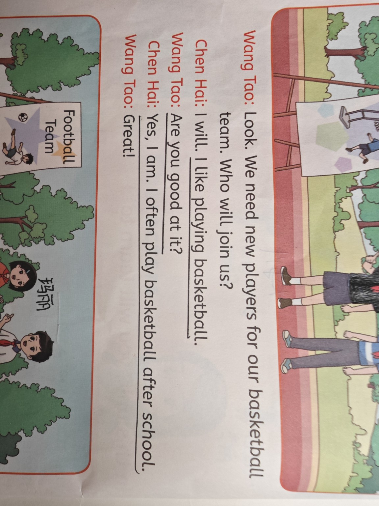

**img-02：足球邀请与运动偏好原图**

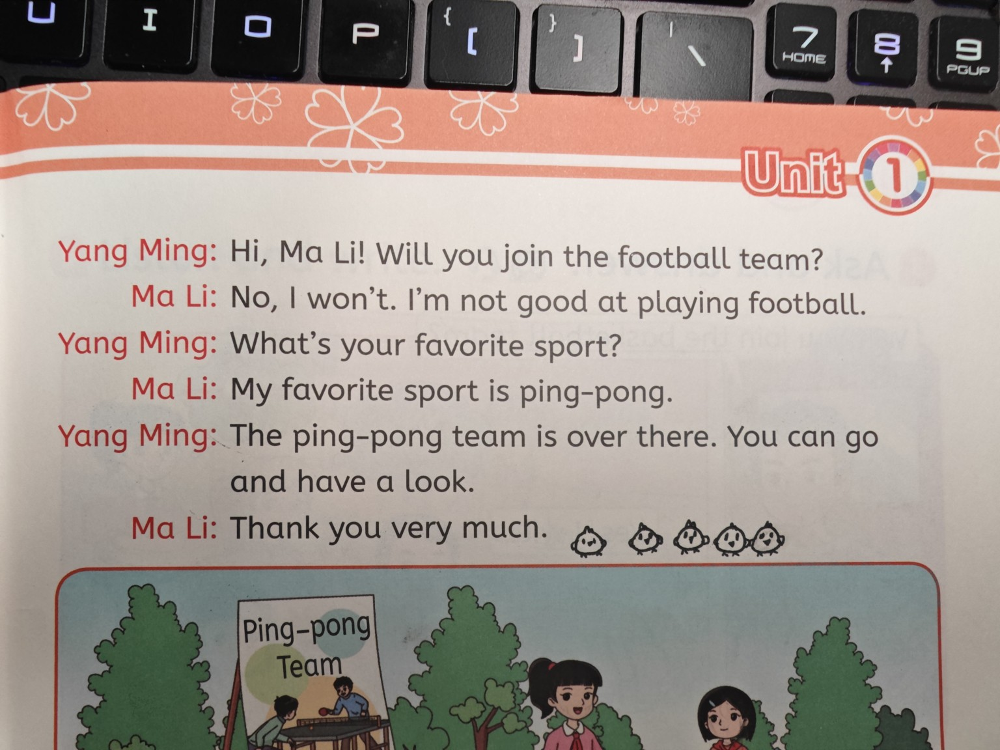

**img-03：乒乓球队对话原图**

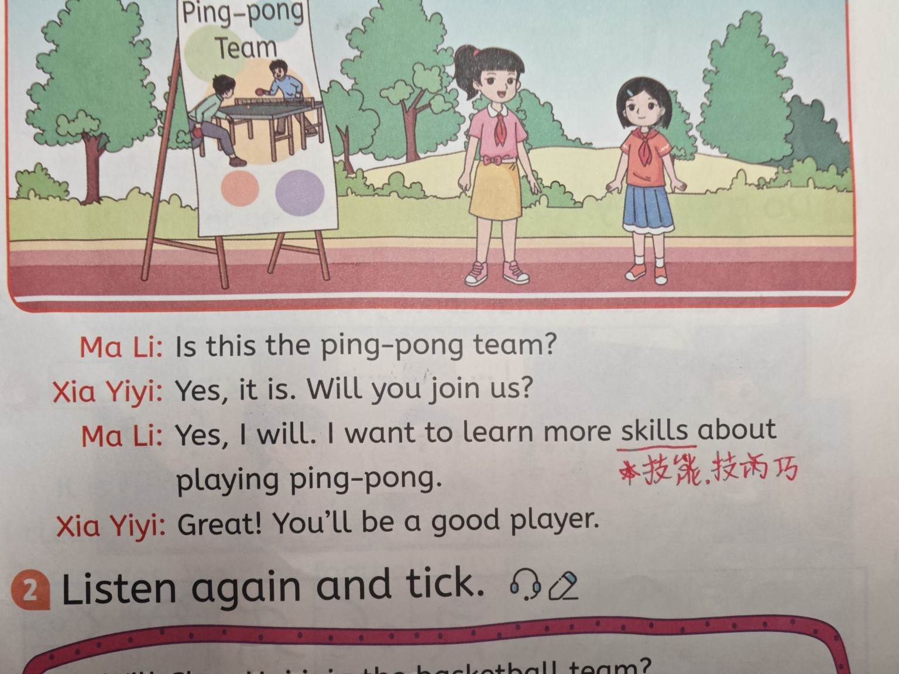

以下将印刷弯引号统一为直引号、把排版换行合并为空格；未改写词语或语法。这是用于设计的人工转录，不是实际 OCR 引擎输出，也没有虚构 OCR 置信度、坐标或处理哈希。

### 3.2 全部可见主要对话：15 个话轮、25 个句子

场景 A：篮球队招募（img-01；t01～t05）

```text
t01 Wang Tao: Look. We need new players for our basketball team. Who will join us?
t02 Chen Hai: I will. I like playing basketball.
t03 Wang Tao: Are you good at it?
t04 Chen Hai: Yes, I am. I often play basketball after school.
t05 Wang Tao: Great!
```

场景 B：足球邀请与运动偏好（img-02；t06～t11）

```text
t06 Yang Ming: Hi, Ma Li! Will you join the football team?
t07 Ma Li: No, I won't. I'm not good at playing football.
t08 Yang Ming: What's your favorite sport?
t09 Ma Li: My favorite sport is ping-pong.
t10 Yang Ming: The ping-pong team is over there. You can go and have a look.
t11 Ma Li: Thank you very much.
```

场景 C：加入乒乓球队（img-03；t12～t15）

```text
t12 Ma Li: Is this the ping-pong team?
t13 Xia Yiyi: Yes, it is. Will you join us?
t14 Ma Li: Yes, I will. I want to learn more skills about playing ping-pong.
t15 Xia Yiyi: Great! You'll be a good player.
```

补充可见印刷文字：`Football Team`、`Ping-pong Team`、`Listen again and tick.`。这些作为标牌/活动标题存储，不并入对话背诵顺序。图片中的中文手写“技能、技巧”等属于用户注释，不能伪装为教材原注。下方听力题被裁切，不补造题目、选项或听力答案。

**图片覆盖不等于整课覆盖。** 上述主对话在三图可见范围内完整转录，但本文件不宣称覆盖教材 Lesson 1 所有活动。正式包的覆盖范围须由校对者明确确认。

### 3.3 分句与指代示例

固定句子编号顺序：t01→s01～s03；t02→s04～s05；t03→s06；t04→s07～s08；t05→s09；t06→s10～s11；t07→s12～s13；t08→s14；t09→s15；t10→s16～s17；t11→s18；t12→s19；t13→s20～s21；t14→s22～s23；t15→s24～s25。

- s06 `Are you good at it?` 中的 `it` 在当前对话指打篮球，不能脱离语境问成乒乓球。
- s14 `What's your favorite sport?` 与 s15 构成偏好问答；`favorite` 按原图拼写保留。
- s23 `I want to learn more skills about playing ping-pong.` 按原图保留 `about`，不得自动“优化”原文措辞。
- t01 的 `Who will join us?` 不能自动生成主语为 `you` 的原文答案；改写必须标记为生成题。

### 3.4 候选知识清单：生成的教学分析

这份清单用于审核选取，**不是教材指定生词表**。正式包区分 required 与 optional，不要求六年级学生机械背写所有冠词、代词和人名。

| 类型 | 候选知识点 | 中文释义/用途（本文件生成） |
|---|---|---|
| 词汇 | basketball, football, ping-pong | 篮球、足球、乒乓球 |
| 词汇 | team, player, players, join, sport, favorite | 球队、队员、加入、运动、最喜欢的 |
| 词汇 | often, skills, school, learn | 经常、技能、学校、学习 |
| 短语 | be good at, after school, over there, have a look | 擅长、放学后、在那边、看一看 |
| 句型 | Will you join …? / Yes, I will. / No, I won't. | 邀请与表达意愿 |
| 句型 | Who will join us? / I will. | 询问谁愿意参加 |
| 句型 | Are you good at …? / I'm (not) good at … | 询问和描述擅长的活动 |
| 句型 | I like playing + 运动 | 表达爱好；本课范围内练习 `like doing` |
| 句型 | What's your favorite sport? / My favorite sport is … | 询问和回答运动偏好 |
| 句型 | I often play … after school. | 表达习惯 |
| 句型 | I want to learn … / You'll be … | 表达想学习的内容与鼓励 |
| 语义命题 | Chen Hai 愿意参加篮球队；Ma Li 喜欢乒乓球 | 理解题的可溯源事实 |

`player` 与 `players` 可共享词条根，但单复数是不同表面形式；评分时不能直接词形还原后全部判对。`play football`、`play basketball` 和 `play ping-pong` 是受控搭配，不机械添加冠词。知识标签通过人工审核，不让模型把全部 `will` 一律解释成同一种交际功能。

## 4. 课文 OCR、校对与内容版本

### 4.1 导入流程

1. 原图只读保留；为处理创建副本。验证 MIME、尺寸、大小，V0.1 每课最多 20 张、单图最多 15 MB；超限提示压缩或拆分。
2. 检测/手动修正旋转、透视和裁边；坐标明确属于原图还是矫正图，并保存坐标变换。不能把插画、标牌、笔记全部当课文。
3. OCR 输出文本块、行、坐标、语言、原始置信度和引擎版本。供应商置信度不可互当同尺度概率。
4. 区分说话人、正文、活动标题、印刷标签、手写注释。对话块内合并换行，禁止跨说话人合并。
5. 根据页面顺序和对话连贯性给出排序建议，交由用户确认；文件名顺序不是唯一依据。
6. 高亮低置信片段及规则异常：引号、否定缩写、连字符、人名、重复行、缺词、页边截断。
7. 校对者逐块确认，明确导入范围；系统保存修改前后文本、编辑者、时间和来源引用。
8. 冻结 ReviewedTranscript；仅该版本进入知识点提取。任一 required 句子未确认时，不能生成可发布的正式课程。

### 4.2 必须检查的易错项

`I`/`l`、`will`/`wiII`、`won't` 的否定、`I'm` 的撇号、`You'll` 的缩写、`ping-pong` 的连字符、`Xia Yiyi`、`Chen Hai`、图片下划线和手写字。原图中 `favorite` 不能自动变成 `favourite`；需要接受另一拼写时应配置答案变体，而不是改教材。

### 4.3 发布门禁

| 条件 | 处理 |
|---|---|
| 任何必学句未确认、页面顺序未知、来源丢失 | 阻止发布，允许存草稿 |
| 模型补出的正文没有图像或确认文本来源 | 隔离为生成建议，不写入课文 |
| 词汇/题目指向不存在的句子或知识点 | 阻止发布 |
| 缺必需示范音频 | 允许文字预览；阻止声明七阶段正式可用 |
| 来源授权状态不允许分发 | 仅私有个人范围，禁止公共发布 |
| 教材信息未知 | 保留未知；不能影响私有校对，但不能伪造教材目录 |

### 4.4 修改与迁移

课文修改产生新的 transcriptVersion 和 packageVersion。旧 Attempt 永远绑定旧答案与评分规则；历史记录不能被新答案静默覆盖。知识点以 knowledgeNamespace、knowledgeId、semanticVersion 定位，namespace 默认等于课程 packageId；不同私有课程的同名局部 ID 不共享状态。只修正排版、且目标定义与评分语义均不变时，可显式保留同一语义版本。词义、答案集合、目标模式或判分意义改变时分配新的 semanticVersion，旧证据留在旧格；新格显示待复测原因，重新积累证据，不复制旧 alpha/beta 或人工确认。重编译不直接提升掌握度。迁移载荷记录新旧键、原因、受影响模式与批准者，见 §13、§23。

## 5. 课程生成流水线

### 5.1 编译阶段

| 步骤 | 输入 | 输出 | 验证与失败处理 |
|---|---|---|---|
| A 结构化 | 已校对文本 | 场景、话轮、句子、说话人、来源 | 检查顺序与唯一 ID；不完整则回校对 |
| B 提取 | 结构化课文 | 词条、句型、短语、语义命题 | 每项有来源；候选语法需审核 |
| C 目标选择 | 候选清单 + 年级目标 | required/optional、能力格、先修关系 | 不产生环；选择符合年龄的有限范围 |
| D 教学加工 | 目标知识点 | 中文解释、示例、分块、提示层级 | 解释与原文分离；检查指代和否定 |
| E 题目编译 | 模板 + 受控词库 | 题目、答案、干扰项、评分规格 | 唯一答案、可重放、无答案泄漏 |
| F 音频构建 | 已校对句子 + 语音配置 | 逐句与整段音频、分段时间 | 文本一致、可播放、来源已记录 |
| G 课程组装 | 知识点与题库 | 七阶段、复习映射、覆盖报告 | required 格都有训练及验证题 |
| H 发布 | 包 + 审核记录 | 冻结的 Lesson Package | 哈希、版本、权限、完整性校验 |

模型可辅助 B、D、E；它输出候选，不拥有发布权。A、C 的依赖检查、E 的答案验证、G 的覆盖以及最终计分由规则执行。运行时不临时向模型询问“学生答得对不对”。

### 5.2 题目来源与确定性

- `textbook`：图片中实际出现的活动，必须有完整题干及来源；本次被裁切的听力练习不满足条件。
- `generated`：根据模板产生的练习，保留 templateVersion、生成模型/提示版本（如使用）、校对结果。
- 用 `seed = hash(packageId, packageVersion, templateId, variantIndex)` 决定题面变体与选项顺序；固化生成结果，不依赖模型再次生成相同输出。
- 干扰项取自受控词库；避免同义词同时作为唯一答案题的两个选项，避免两个不同队员都符合题干。
- 语义事实题引用具体 proposition，不从常识推断教材人物的能力。例如 Ma Li 不擅长足球，不代表她不会踢足球。
- 提示、答案和解释分字段。计分任务在提交前不能通过隐藏 DOM、离线包“考试保密”获得强保证；本产品用于学习，不作为高利害考试系统。

### 5.3 数量与完整性

不按“每句生成十题”堆量；按 `知识点 × required能力 × 模式 × 题型` 做覆盖矩阵。正式包每个 required 格至少有一个教学任务；默认采用 two_families，需两个经审核的独立验证题族。固定原文朗读／背诵／默写可显式采用 cross_day_sessions，只需一个合法验证族，但掌握必须满足 §9.4 的跨日独立会话门槛。选择题至少有一个变式；输出能力必须有无选项提取任务。仅改 ID、选项顺序或包装文字不构成新题族。题量由目标清单推导，并受短任务预算控制呈现。

重复、答案冲突、过长题干、超出课文且未注明的扩展词、缺音频、无法确定计分规则都产生 lint 错误。单个模板失败可重试最多两次，再换规则模板或人工补题；不能静默遗漏该能力格。

## 6. 七阶段训练

### 6.1 阶段定义

| 阶段 | 学习目的 | 主要任务 | 默认完成条件 | 主要证据 |
|---|---|---|---|---|
| S1 情境理解 | 知道人物、运动、邀请与意愿 | 听/看对话，人物事实选择，句义匹配 | required 格检查通过率 ≥80%，至少两题；错误完成订正 | recognition / sentence_use |
| S2 词汇掌握 | 听懂、认识并能拼写关键词 | 英汉匹配、听词选义、无提示拼写 | required 格检查通过率 ≥80%，每个必学词完成无选项输出 | recognition / listening / spelling |
| S3 句型训练 | 识别结构并受控使用 | 排序、填空、邀请问答、运动替换 | required 格检查通过率 ≥80%，至少一个无选项句型任务通过 | sentence_use |
| S4 朗读训练 | 从句到对话连贯读出 | 示范、跟读、逐句读、角色读、录音回放 | 全部目标块覆盖；每块有效文本匹配 ≥85 且关键检查通过，或人工通过；允许口语待确认完成任务 | read_aloud，自动证据有限 |
| S5 背诵训练 | 脱离原文回忆目标句与对话顺序 | 逐层遮词、首词提示、无文字角色回复 | 全部必背块覆盖；每块 H0 匹配 ≥85 且关键检查通过，或人工通过；允许口语待确认完成任务 | recall |
| S6 默写训练 | 听后/忆后准确写出 | 听词、听句、中文提示、原文回忆键入 | 每个 required 块通过：句子默认阈值90，单词exact；关键槽位正确 | dictation / spelling |
| S7 迁移应用 | 在新情境使用已学结构 | 更换运动、选择合理回复、受控双句对话 | required 格检查通过率 ≥80%，至少两个不同题族的独立输出通过，关键槽位正确 | transfer |

阶段完成只表示完成本次学习任务；“已掌握”还需要第 9 节的独立证据和延迟复测。S4/S5 可以是“任务完成、验证待复核”；缺语音可信证据时不能把它显示成自动达标。

### 6.2 顺序、补救与跳过

默认 S1→S2→S3→S4→S5→S6→S7。S1～S3 可诊断跳过，但诊断任务必须覆盖本阶段 required 格，并满足 §6.5 相同完成门槛，保存 `completedBy=diagnostic`；不能只凭学生声明。S4～S6 共享课文分块，却分别保存朗读、回忆、默写证据，不能互相冒充。S7 以 S1、S3 的阶段验证通过为先修；S4/S5 的人工待确认不阻断 S6/S7。阶段先修是训练检查，不要求先取得 §9 的跨日掌握。

连续三次失败后停止增加难度：展示一个讲解或示范 → 较小块练习 → 新题重测。原题订正不算新的独立证据。学生可回到任一训练阶段；退出、网络错误、录音失败不会被记录成答错。

### 6.3 提示层级

| 层级 | 内容 | 验证资格 |
|---|---|---|
| H0 | 没有额外提示 | 可作掌握证据；听力题的题干音频不是提示 |
| H1 | 首字母、词数、句型框架或部分词 | 保存练习结果，不计正式掌握证据 |
| H2 | 关键词、中文逐句提示、额外示范朗读 | 不计正式掌握证据 |
| H3 | 完整答案、跟读或照抄 | 完成教学任务，不更新掌握格 |

题型定义其基准刺激：独立朗读显示原文属于 H0，可验证 read_aloud；同步跟读或在作答中播放额外示范属于 H3，不能验证该格。显示原文的任务绝不能验证 recall。按中文提示默写可验证“中文提示输出”，不等于听写；正式 dictation 目标需要在规格里声明 cueType 并分别记录模式，报告不混称。基准刺激由包固定，不能在运行时把提示重新标成题干以获得证据资格。

### 6.4 本课任务样例

- S1：谁说愿意加入篮球队？答案 Chen Hai，引用 t02；题目是生成练习。
- S2：播放 `basketball` 后选择释义；再无提示键入该词。选择正确不提升拼写格。
- S3：完成 `I'm not good at ___ football.`，答案 `playing`，引用 s13。
- S4：朗读 `Are you good at it?`；显示文本、录音回放，对低置信 ASR 不判错。
- S5：先遮去 `good at`，再不显示原文回答上一话轮；只有最终无文字提示任务可验证回忆。
- S6：听写 `My favorite sport is ping-pong.`；按原文拼写评分，解释连字符和句首大小写。
- S7：新情境“你愿意加入篮球队”，对 `Will you join the basketball team?` 作肯定回复；接受预先批准的 `Yes, I will.`。此为生成场景，不是教材原对话。

### 6.5 可执行阶段完成与恢复

每个 StageSpec 固定 `prerequisiteStageIds` 与 `completion`。completion 声明 `requiredCellRefs`（完整能力格引用）、`checkExerciseIds`、`minChecks`、`minPassRatio`、`mandatoryOutputCellRefs`、`minPassedOutputChecks`、`minPassedOutputFamilies`、`minDistinctVariants`、`mustPassAllTargets` 及 `allowPendingOralCompletion`。下文 requiredTargets 即 requiredCellRefs；发布时非空且可被检查题覆盖，运行时不得因缺题、离线或待复核而删除目标。minDistinctVariants 只约束实际完成过的不同语义变式（包中exerciseId对应的冻结题面），不替代题族独立性；单纯重排选项不能满足输出题族要求。单题先按自身 GradingSpec 得到 passed，阶段再聚合；85/90 是单题阈值，80% 是格通过比例，不混用平均分。StageSpec不再复制passThreshold，避免与GradingSpec形成两个判分来源。

阶段检查仅使用当前阶段运行内、对应目标模式的 H0 独立任务首次提交及其最终有效评价；取每格按提交事件 seq 最新的一次合格检查结果。同一提交的人工改判替换原结果，不新增一次检查。每日掌握权重封顶不影响训练检查结果，但订正不能替代首次检查；订正后需安排新的检查呈现。答案已暴露的同题当次重做只能完成订正，不能作为合格检查。

```text
scoredTargets = requiredTargets 中最新检查已得到最终阶段评价 passed=true/false 的格
passRatio = scoredTargets 为空 ? null : 通过格数 / scoredTargets格数
pendingTargets = 有合格录音但尚缺最终人工确认的格
missingTargets = 尚无合格检查提交的格
verified = missingTargets为空 && pendingTargets为空 && 满足下表全部检查条件
```

三类集合互斥。需要口语人工确认时，可靠 ASR 通过但尚未人工确认的格归 pending；明确的合格 ASR 失败保留为 scored 的失败，不能借“等人工”隐藏。pending 不进入通过率分子或分母，也不计失败；缺测另列。只有所有 required 格都有最终已评分检查，才允许按比例宣布 `verified=true`，因此只答对一格不能借减少分母完成整阶段。每格等权，不能以重复做同一格或长句权重抵消其他目标。

| 阶段 | 检查条件（除完整覆盖外） | 必需输出及任务完成规则 |
|---|---|---|
| S1 | ≥2 个不同检查题；passRatio≥0.80 | 所有已发现错误完成订正；订正本身不提升 passRatio |
| S2 | passRatio≥0.80 | 每个必学词的指定 spelling 模式至少一次 H0 无选项输出；失败需订正，订正不冒充通过 |
| S3 | passRatio≥0.80 | 至少一个 H0 无选项句型输出通过 |
| S4 | 已评分目标必须全部通过 | 每个目标块独立提交可回放、非静音且未截断的录音；仅待人工确认的块可 pending |
| S5 | 已评分目标必须全部通过 | 每个必背块独立提交 H0 口头或包规定的键入回忆；键入不能替代必需口头模式；仅合格口语待确认可 pending |
| S6 | passRatio=1 | 每个 required 块都通过其指定 cueType 和评分规格；任一关键检查失败阻止完成 |
| S7 | passRatio≥0.80 | 至少两个不同题族的 H0 独立文字输出通过；选择题、换选项顺序不计入 |

通常 `taskCompleted=verified`。仅 S4/S5 且 `allowPendingOralCompletion=true` 时，全部目标已提交、已评分目标全部通过、未决目标全部为上述合格口语 pending，且满足最低提交数、变体数与必需输出覆盖，也可 `taskCompleted=true, verified=false`，显示“任务完成，口语待确认”；纯静音、截断、录音缺失、网络错误本身不满足完成条件。若全为 pending，passRatio=null，仍只能取得任务完成。符合质量门禁的 ASR 通过可完成训练检查，但涉及口语确认的 `verified` 还需人工确认；该差异用 pendingTargets 明示，不宣称发音已达标。

阶段运行保存 `stageRunId`、包版本、已呈现任务与响应、requiredTargets 快照、每格最新结果及 pending 原因。退出后恢复同一运行，不能因重开页面清空失败或把已揭晓答案的题伪装成首次题。人工改判后重算该运行；既有学习历史保留，若完成条件不再满足则显示待补练，并在下一任务检查先修。包升级涉及目标语义变化时按迁移规则新建运行，不混合两个包版本的检查分母。

## 7. 题型规格与能力归因

### 7.1 词汇与句型

| 题型 | 基准输入 | 作答/答案 | 评分与归因 |
|---|---|---|---|
| 英汉匹配/选择 | basketball | 选“篮球” | 选项 ID 精确匹配；recognition |
| 听词辨认 | 单词音频 | 选择词/意义 | listening；不能同时推断 spelling |
| 单词拼写 | 中文“篮球”或词音频 | basketball | 输出归一化后的字符比较；spelling |
| 句型填空 | I'm not good at ___ football. | playing | exact；只验证目标空格及 sentence_use |
| 单词排序 | Are / you / good / at / it / ? | 指定 token ID 顺序 | 默认整题 exact；不奖励无关词序片段 |
| 句型替换 | 框架 + 运动 + 肯定意愿 | Yes, I will. 等已批准答案 | accepted answer set 或 slots |
| 情境选择 | 问偏好 | 对应问答选项 | 只验证理解；不认定自由表达已掌握 |

拼写题的自动纠错、输入法预测和浏览器拼写检查应关闭到平台允许的程度；记录 assistedInput，无法控制时保守地标记设备辅助可能存在。不要把设备输入差异解释成学生能力差。

V0.1 的匹配题编译为逐对选择：每个配对作为一个独立子任务，用 option ID 判分。暂不实现多对拖拽后一次性提交，因此下文 `matching` 使用 `option_ids` 响应；若后续支持整体配对，应增加带左右元素 ID 的响应类型，不能只比较选择集合而丢失配对关系。

### 7.2 朗读

录音仅在点击后开始，开始/停止有明确状态；示范播放时不录入。流水线：录音质量检查 → 冻结 ASR 结果 → 与已校对原文对齐 → 文本匹配分与错词候选 → 录音回放 → 必要时家长/教师确认。

V0.1 **没有音素级发音分数**。识别对上原文只说明服务识别出了相近文本；服务受噪声、口音、儿童语音和目标文本偏置影响。禁止把“单词漏识别”直接解释为该词发音不正确，禁止显示虚构的重音、音素或流利度测量。

若 ASR 使用参考文本辅助识别，要记录该配置，并降低证据可信度；只产生诊断结果。可用的文本匹配记录和人工通过记录分别显示。确需发音评分时，后续版本接入并验证专用评测模型，单独给出能力维度及儿童样本误差。

质量门禁初始配置：纯静音/严重截断/无有效识别文本→`unscorable`；置信度语义经校准且达到适配器阈值→可出文本匹配分；服务不提供可靠置信度→自动诊断、人工复核。0.75 之类门限只能在具体适配器校准后使用，不能通用套用。

### 7.3 背诵

教学模式分为遮词、首词、中文摘要、无文字；测评模式固定一种并记录。按 1～3 句分块，保留角色和前文上下文。ASR 比较当前目标块，不能随意从全文寻找“最像的一句”给满分。原文背诵允许预批准缩写等价，意思相同的改写不能直接当作原文准确背诵。

分块后按目标词数加权得对话回忆分；每个块仍单独有结果，不能靠长块掩盖一个 completely failed 短块。词序、漏句、否定词丢失分别解释。朗读录音与背诵录音分任务，不能复用一次录音更新两个能力格。

### 7.4 默写

支持单词、句子、短话轮；cueType 为 `audio`、`meaning` 或 `recall`。区分听写、中文提示输出与记忆默写。正式课文复现默认保留单复数、词序、缩写和连字符；宽松练习与严格默写使用不同评分规格。

词句错误提示包括遗漏、增加、替换、词序、拼写、大小写、标点。提交前允许正常编辑；提交并见答案后的修改形成订正 Attempt，不能覆盖首次结果。中文翻译只作为提示，不代表所有英文同义改写都满足原文默写要求。

### 7.5 迁移

V0.1 将迁移限定在审核过的情境和句型：运动替换、邀请应答、擅长活动、喜爱运动、放学后活动。题面明确肯定/否定意愿，避免把学生个人选择判成错误。未学新词由词库提供并标为扩展，不冒充课文词汇。

受控自由键入可用 slots：主语、助动词、极性、活动、目标结构；以有限语法规则检查。允许多个正确表达时列入 acceptedAnswers，或使用有限模板 grammar；完全开放作文返回“待人工评价”，不由生成模型决定正式分数。填选式迁移和独立表达式迁移分别标记，只有后者能支持输出迁移掌握。

### 7.6 多知识点归因

一题通常只给一个主要验证格。可附带诊断标签但不顺便提升所有词汇。例如整句听写失败，不扣该句里每个单词的 recognition；只有对齐明确定位的词输出可写入对应 spelling 诊断。需要同一次提交验证多个格时，必须有可独立计算的 components 和 evidenceMappings，并满足每格先修、提示与去重规则。

## 8. 确定性评分与错误反馈

### 8.1 评分契约

同一 `原始响应 + 冻结的识别观察 + GradingSpec + scorerVersion` 必须产生相同评分内容；gradeId由调用方显式提供，相同gradeId与输入得到相同完整GradeResult。ASR、OCR、题目生成本身可能非确定；它们的结果先固化，评分器再确定性运算。重新请求 ASR 是新的 observation，不能偷偷修改旧分数。

纯前端可预览评分，正式保存由共享评分库验证。禁止依赖当前日期、随机采样或在线模型来给分。GradeResult.score 与分项 score 保存未舍入数值，只有显示时保留两位小数；阈值和后续计算使用**未四舍五入**分数。策略修订保留旧版本和原始输入，支持重新评分但不覆盖原结果。

### 8.2 标准化策略

按规格执行，不采用“一切标点都忽略”的全局规则：

1. Unicode NFC；全角 ASCII 转半角；弯撇号统一 `'`，允许配置连字符字形统一为 `-`。
2. 首尾空白去除、连续空白折叠；保留 token 边界，不能把 `a lot` 与 `alot` 等同。
3. caseSensitive 与 punctuationSensitive 按题目定义；默写正字法分项使用保留大小写标点的路径。
4. 内部撇号和 `ping-pong` 的连字符保留；英语词 token 为字母串及内部撇号/连字符。
5. contractions 只有规格允许时展开：`won't→will not`、`I'm→I am`、`you'll→you will`、`what's→what is` 等有限映射。`'s` 的含义不做无条件展开。
6. 不做默认词干化、同义词替换或语法纠错。`player/players`、`will/won't`、`playing/play` 都有区别。

exact 判分可忽略外部句末标点，但是否通过仍要符合关键槽位。对替代答案按各自完整路径计分，取最高分；不得从不同备选答案拼凑局部最高分。

### 8.3 各评分模式

**选择、匹配、排序（choice/order）**：正确选项 ID 集合或 token ID 序列完全相等得 100，否则 0。多选无重复 ID，漏选或额外选择均不通过。若确需部分分，单独声明 components。

**精确答案（exact）**：归一化后等于一个批准答案得 100，否则 0。适用于短填空和固定句型答案。

**单词拼写（spelling）**：

```text
C = 1 - 字符Levenshtein距离 / max(参考字符数, 作答字符数, 1)
显示分 = 100 × max(0, C)
通过 = 归一化后完全正确（不能用90分容忍 basketball 的错拼）
```

字符分用于反馈；掌握证据成功值采用 exact 0/1。空答明确为 0，参考答案为空是包错误。

**文本匹配（text_alignment）**，用于朗读/背诵观察：

```text
Dword = token序列Levenshtein距离（替换、删除、插入各成本1）
A = max(0, 1 - Dword / max(Nref, Nresponse, 1))
显示分 = 100 × A
```

用较长序列作为分母，抑制靠添加大量文字获得高分。并列最优对齐固定优先级：匹配→替换→删除→插入；版本固定，保证错误定位可重放。关键否定/语法槽位失败时保留分数但 `passed=false`。分数不代表声学准确率。

**句子默写（dictation）**：

```text
A = 忽略外部标点和大小写、保留词形的 token 对齐准确率
C = 同一宽松文本路径上的字符准确率
O = 正字法准确率（本题显式列出的首字母、句末标点等检查项）
S = 100 × (0.70A + 0.20C + 0.10O)
O = 通过的orthographyChecks数量 / 总数量
没有正字法检查时去除O，A/C权重按7:2重新归一化
通过 = S达到题目阈值，且所有criticalChecks通过
```

正字法只检测配置项；例如 `sentence_initial_uppercase`、`terminal_period`，不再重复检测已经由 token/字符分处罚的所有拼写错误。关键检查示例：否定极性一致、`favorite sport` 的必需槽位完整、运动值正确。严格式可使用 exact；宽松分不能替代关键结构正确。

**受控迁移（slots）**：有限解析器识别批准结构；每个槽位按声明权重给 0/1，权重总和为 1。S=100×加权和；必须槽位任一失败则不通过。否定意愿丢失、助动词错误不能被礼貌语等非核心槽位抵消。未落入批准结构时返回待复核，不能靠关键词出现判语法正确。

### 8.4 确定性例子

| 任务 | 原文/答案 | 学生响应 | 结果 |
|---|---|---|---|
| basketball 拼写 | basketball | basketbal | 字符分90；exact失败，spelling成功值0 |
| 原文句子比较 | Are you good at it? | Are you good it? | 5词对4词，D=1，A=0.8，文本匹配80 |
| 文本匹配，阈值85 | My favorite sport is ping-pong. | My favorite sport is football. | 5词D=1，80分；运动槽位失败，不通过 |
| 意愿否定题 | No, I won't. | No, I will. | 可显示局部匹配分，但极性关键检查失败 |
| 宽松exact，允许缩写展开 | I'm not good at playing football. | I am not good at playing football. | 完整等价路径100；严格原文默写另行配置 |
| 句子默写，检查首字母与句号 | My favorite sport is ping-pong. | my favorite sport is ping-pong | A=1、C=1、O=0，90分；达到90阈值但反馈大小写/句号 |
| 音频静音或识别无效 | 任一朗读句 | 无有效识别 | unscorable、score=null，不作失败证据 |

最后一个默写例子在配置允许时可通过任务，但“准确原文书写”的额外正字法目标仍需复测；若教师要求大小写和句号必对，可把它们设为 critical。

### 8.5 GradeResult 内容

保存 `status、score、passed、criticalChecksPassed、components、errors、normalizationVersion、scorerVersion、gradingSpecId、speechObservationId、evidenceEligibility、reasonCodes`；每个分项也保存passed与criticalChecksPassed。状态为 `scored / needs_review / unscorable`；后两者的 score、passed、criticalChecksPassed 为 null，components为空，不能伪造分项零分。错误含参考范围、响应范围、类型和教学解释；ASR 差异写成“可能漏读/漏识别”，文字默写可写“漏写”。

教师纠正采用新建 ReviewDecision，引用原结果并写明原因。用于掌握度的是最终有效评价事件；人工覆盖与自动事件不能双算。

## 9. 知识点 × 能力掌握度

### 9.1 能力定义

| 能力代码 | 含义 | 有效验证方式 |
|---|---|---|
| recognition | 看见词/表达能认义 | 新题、无额外提示辨认 |
| listening | 听见能辨义 | 不显示目标文字的听辨 |
| spelling | 写出目标词的正确形式 | 无选项词汇输出，exact成功 |
| sentence_use | 理解并使用目标句型 | 固定结构理解与无选项受控输出；另存表现模式 |
| read_aloud | 看原文读出 | 可信文本匹配作为有限证据，或人工评价 |
| recall | 无原文回忆课文 | 无文字目标、口头/键入提取；模式分别存 |
| dictation | 按指定提示写出句子 | audio/meaning/recall 模式分别存，声明目标模式 |
| transfer | 新情境使用已学表达 | 不同情境的受控输出；选择式题仅诊断 |

并非每个知识点都有八格：词汇通常要求 recognition/listening/spelling；句型要求 sentence_use/transfer；句子块要求 read_aloud/recall/dictation。required 格由课程包明确列出，optional 格不拉低整课达标率。

### 9.2 状态与证据

每格以 `(learnerId, knowledgeNamespace, knowledgeId, semanticVersion, ability, mode)` 六键唯一定位。knowledgeNamespace 默认等于 packageId；knowledgeId 只在该命名空间内唯一，semanticVersion 表示目标语义版本，不能用可复用的 `s01` 等局部 ID 跨课混记。V0.1 不自动合并跨课格；措辞/资源修订但语义不变可延续同格，语义变化必须显式迁移或建立新格。mode 用来区分输入条件，报告按课程 required 模式汇总，不把听写与中文提示写作混在一起。

每格存先验、加权成功/失败、有效事件数、独立题族数、独立会话数及学习日数、最近合格首次测试结果、最近延迟通过和调度状态。`lastOutcome` 取最终有效评价在原 Attempt 提交 seq 中的最新值；人工复核时间不能把较旧的作答变成最新测试。证据封顶/去重只影响累积权重，最近结果另存并在回放时重建。

V0.1 使用可解释的加权 Beta 风格估计；它是工程启发式，不声称得到严格校准的学习概率：

```text
初始 alpha=1, beta=1；没有有效证据时显示“未测”，不显示50%掌握。
每个有效证据的成功值 y = passed ? 1 : 0；权重 w∈(0,1]。
alpha' = alpha + w*y
beta'  = beta  + w*(1-y)
masteryEstimate = alpha'/(alpha'+beta')
```

本修订采用 `mastery-2`：所有正式证据使用上述二元成功值，alignment/dictation 的连续分数仅用于反馈和诊断。关键检查失败使 passed=false、y=0；无分数或待复核不生成成败证据。多格映射必须使用各自可独立计算分项的 passed，不能套用整题结果。迁移只有独立输出模式进入正式格，选择式迁移仅诊断。一次任务完成与高分不能直接打满整格。旧 mastery-1 数据保留原策略和结果，升级必须显式重建/迁移，不能在同一累计状态里混合两种成功值。

### 9.3 证据资格与权重

1. “合格首次测试”指有效已评分、H0、当前呈现未揭晓答案、未使用辅助输入且非订正的首次提交。每次呈现的 ID 与首次提交固定；杀进程、重新打开或重发请求不创造一次新首次测试。质量错误和系统故障不算错。题型固有刺激不算答案揭晓。
2. `attemptId` 幂等；同一 evidenceFamily 在同一历史学习日对同一六键格最多计一次权重，按原提交 seq 取最早合格首次测试。原题重做、选项重排、修改题 ID 或展示答案后的订正不创造新题族。固定原文复现可在不同学习日新建独立会话重测，同题族每日仍只有一个加权事件。
3. 同一天每格最多累计 2.0 权重。先做题族去重，再计算 `effectiveWeight=min(baseWeight,max(0,2.0-dailyUsedWeight))`；例如已用1.5、基准权重1，则本次计0.5。有效权重为0不增加有效事件数、题族数、会话数或学习日数；部分权重事件计一次。完整结果仍保留。
4. H0 无选项文字输出/合格人工评价 baseWeight=1；无提示辨认 baseWeight=0.5；可靠但仅基于 ASR 的文本匹配 baseWeight=0.5，且只作有限证据。人工改判替换同一次 Attempt 的最终评价，须按原提交顺序重算当天配额，不能与自动结果相加。
5. 低置信语音、参考文本强偏置识别、自我报告、同步跟读/照抄或有额外提示均不产生权重，仅保存练习与诊断。H0 朗读所必需的原文显示是基准刺激，适用第4项，不被误归为跟读。人工复核只能解决评分可信度，不能洗掉原 Attempt 的提示、答案暴露或辅助输入。
6. 所有合格首次测试均更新最近结果，不受题族去重和日封顶阻挡。最近结果为失败即标记需复习、重置复习层级；后续合格首次测试通过可解除“最近失败”标记，但不会抹掉失败证据，也不会绕过全部掌握门槛。订正、提示练习和未评分故障不能解除或制造该标记。

提示练习完成后安排另一题族的 H0 测试；固定原文模式可安排后续独立会话，但同一检查呈现揭晓答案后的重做仍属于订正，不能通过新建呈现 ID 洗掉 retryOf 关系。训练检查、普通掌握证据和延迟复测分别判资格：新的 H0 测试可检查当前表现，只有满足 §10.1 的绝对时间与答案暴露条件才能声明保持。答案/示范展示必须保存可回放的暴露事件，覆盖该内容可泄漏的目标格；不能只记录当前练习的主要归因格。

### 9.4 掌握门槛

共同达标门槛为：估计≥0.80、至少3个有效加权事件、总有效权重≥3、最近合格首次测试 passed=true，并有满足 §10.1 的延迟复测通过。AbilityRequirement.independence 固定采用下列一种规则，不由客户端按结果临时选择：

| independence | 适用与独立性条件 |
|---|---|
| two_families | 默认；≥2个真实独立题族，跨≥2个历史学习日 |
| cross_day_sessions | 仅固定原文的 read_aloud、recall、dictation 可使用；≥3个有加权证据的独立会话，且跨≥3个历史学习日；不要求凭空生成第二题族 |

独立会话必须由持久 sessionId 标识；页面刷新和任务重试不新建会话，拆成多个同日会话不能满足跨3日条件。题族含义由模板语义决定，改变标识或选项顺序不构成独立性。发布检查必须证明每个 required 格存在达成相应门槛的合法任务路径。

read_aloud/口头 recall 的共同门槛另须至少一次该格、该模式的有效人工通过；未来经验证的专用语音评价须以新策略显式加入。仅 ASR 不能完成口语掌握声明，没有人工确认显示“文本匹配达到目标，口语待确认”，并保留欠缺原因。

状态按下表从上到下匹配，命中即停止，保证互斥：

| 顺序 / 状态 | 规则 |
|---|---|
| 1 需复习 | 最近合格首次测试失败（包括非关键失败、封顶后的失败）；或满足全部达标门槛但 dueAt≤now |
| 2 待复测（新目标尚未测） | 语义迁移明确标记needsRevalidation且新格尚无有效证据；显示迁移原因，不复制旧alpha/beta或人工确认，不显示先验50% |
| 3 未测 | 尚无有效加权证据，且不符合前两项 |
| 4 已掌握 | 满足共同、独立性及口语确认门槛，且 dueAt>now |
| 5 待复测 | 估计≥0.80、至少3个有效事件且总有效权重≥3，但独立性、延迟或人工确认仍欠缺 |
| 6 练习中 | 其余有有效证据的情况 |

到期只改变当前行动状态，不扣除 alpha/beta；可另显示“已达到掌握门槛，复习到期”。Beta 初始值使3次满权重通过得到4/5=0.80，但跨日、独立性、延迟及口语确认仍须另行满足。辨认每次权重0.5，需要6次有效成功才达到相同估计与总权重门槛；ASR 的0.5权重也一样受限，不能把“3个事件”误解为足够。15次通过后1次一般失败虽有16/18≈0.889，也必须命中第1项。每格状态由固定 now 和事实派生，不允许直接写任意 `mastered=true`；缺 dueAt 的已学习格属于状态完整性错误，不能默认永不过期。

### 9.5 课文完成与综合掌握

“训练完成”：七阶段任务已完成；可包括口语待确认。“本课已掌握”：所有 required 格达到门槛，且延迟复测有效；缺测格必须列出。可显示 required 格达标数/总数，以及单项能力平均估计；平均分不能抵消某个必需能力缺失。

例如 basketball 的 recognition 已掌握、spelling 练习中，应调度拼写任务；句型 invitation 的 sentence_use 达标、transfer 未测，应安排新情境输出。整句朗读失败不自动让所有组成单词变成不认识。

## 10. 复习与自适应调度

### 10.1 复习单位与初始间隔

复习单位是 required 的能力格，不是整页教材。课程里能同时练多个格的任务可合并呈现，但归因独立。初始间隔阶梯：`1、3、7、14、30 天`；这是 V0.1 参数，不是对个体遗忘曲线的测量。

每格首次学习目标、首次合格测试或首次额外答案暴露时初始化 `level=0`、`delayedAnchorAt=发生时间`，把 dueAt 设为不早于该时间+24小时的首个本地推荐时段。推荐时段、时区和计算策略保存版本；不能简单取“明天零点”。未学习且未测试的格没有 ReviewState，放入新学队列。

`delayedAnchorAt` 为该格最近一次学习暴露、合格首次测试或额外答案展示的发生时间。判定一次提交时，先读取提交前锚点，判断它是否为到期的合格首次复测；再按该提交和其后反馈展示事件推进锚点。延迟资格同时要求：`submittedAt>=dueAt`、`submittedAt-delayedAnchorAt>=24小时`、时钟可信、H0、未揭晓当前答案、无辅助输入、非订正/补救。同日其他任务的答案若泄漏目标，也必须先推进锚点，不能仅换题族后宣称延迟保持。

答案暴露按被泄漏格记录：显示原文是 read_aloud 的合法基准刺激，不会使正在进行的朗读永远无法复测；同一次显示会重置该原文 recall、记忆默写以及其他超出其基准刺激的目标格锚点。听写的标准题干音频、recognition 的目标词也按对应模式基准处理。显示正式测评反馈发生在提交后，不追溯取消刚完成的合格复测，但会作为下一次复测的锚点。

复习状态按以下转移执行：

| 事件 | level / dueAt / 延迟记录 |
|---|---|
| 到期且满足上述延迟资格的首次复测通过 | 每格每历史学习日最多一次晋级；level=min(level+1,4)，按新level的间隔从submittedAt计算下一推荐时段；记录lastScheduledReviewAt、lastPromotionLocalDate及delayedPassAt |
| 任一合格首次测试失败 | level=0，清除“失败后已通过延迟复测”的资格；下一次正式复测安排在submittedAt+24小时后的首个推荐时段；当前会话可隔至少两个其他题目安排一次补救 |
| 未到期/未满24小时的合格首次测试通过，或当日已经晋级 | 可更新普通证据和最近结果；不晋级、不改dueAt、不新增delayedPassAt |
| 提示练习、额外答案/示范展示 | 推进所影响格的delayedAnchorAt；不晋级、不把已有dueAt向后移动 |
| 待人工复核、识别失败、静音或系统故障 | 不增减level、不改dueAt、不生成成败证据；随后若显示答案，单独处理答案暴露 |

每次失败后的掌握恢复必须取得新的延迟通过，不能沿用失败前的 delayedPassAt。人工改判按原 Attempt 时间和当时可用事实重算上述转移，不以复核发生时间冒充隔日；未曾具备语音可信度的记录经人工确认后才可参与。level 最高4，后续每次合格到期通过仍安排30天复查。

`eligibleAt=delayedAnchorAt+24小时` 与 dueAt 分开：已到期但因今天看答案而尚未 eligible 的格，保留到期状态并显示“需在稍后独立复测”，不能靠提示练习消除逾期，也不能反复立即出题重置锚点。正式复测最早呈现在 `max(dueAt,eligibleAt)`；当日补救只作教学练习。锚点和到期计算均属于可回放状态，不临时读取设备日期覆盖历史。

### 10.2 保持估计与优先级

```text
无有效加权证据或lastQualifiedAt=null时，retentionProxy=null
其余：elapsedDays = max(0, now - lastQualifiedAt) / 24小时
      retentionProxy = masteryEstimate × 2^(-elapsedDays / intervalDays[level])
```

此值只表示“需要复查的程度”，不是经验证的真实记忆概率；不随时间直接减少 alpha/beta。到期保留历史估计，当前状态和 reasonCode 表明需要复查。未测格不得以先验50%代入排序，也不能把null当0而伪装成最薄弱格。

候选集合先筛选：有尚未解除的最近失败、dueAt≤now，或先修就绪且尚未测试的 required 格。前两类中未到 `max(dueAt,eligibleAt)` 的格显示在待复测区，不计入现在可呈现的正式复测队列；系统故障放入独立重试区。未到期且没有失败的格不自动混入今日队列，学生主动练习另走训练入口。新学候选来自当前学习进度的 requiredTargets，不因缺 SkillState 实体而当作答错。

对当前可呈现候选先分组，再按组内键做确定的字典序排序，首个不同字段决定先后：

1. 最近关键失败格；其次最近一般失败格。组内按逾期时长降序、最近失败时间升序、课程顺序、六键格的稳定字符串顺序。
2. 其他到期格。按逾期时长降序、retentionProxy升序（null排在本组末尾）、课程顺序、六键格稳定字符串顺序。
3. 先修就绪的未测格。按当前课程顺序、知识点顺序、能力/模式固定顺序、六键格稳定字符串顺序；不计算retentionProxy。

比较使用包中整数顺序和固定字符串排序，不能依赖设备语言环境或随机数。不同组的指标不互相比较，超预算与未到 eligibleAt 的格不产生 Attempt。

队列保存 `reasonCode`，前端用“昨天漏写 won't”“这句隔了3天，检查一下”等具体理由，不能只显示“AI建议”。

### 10.3 日计划与难度

默认预算10～15分钟或12个任务，先到者结束；初始时间估计：短客观题20秒、单词拼写30秒、句型/听写60秒、录音块90秒。运行后用最近有效耗时中位数平滑更新，排除挂起、切后台和系统故障。

有当前可呈现的到期复习时先预留60%的时间预算用于复习，再分配新知识；某侧没有可呈现任务时可把剩余预算交给另一侧。以整题估时装入，不能为精确达到60%而拆开一次作答；实际占比随任务长度变化。已到期但尚未到eligibleAt的格保留待复测提示，不占用本次可练预算。逾期积压时优先上述失败与到期队列并减少新内容，允许主动延长，不能自动无限加题。

难度根据最近5个独立、同模式的有效测试调整：通过率≥80%且无需提示→下一层；≤50%或连续3次失败→拆块/讲解；样本少时维持。阈值同样需试用校准。错误类型决定题型：辨义错→语境与认义；错拼→词形；否定遗漏→极性对比；词序错→句型重建；回忆失败→分块提取。

### 10.4 时间、去重与覆盖

事件时间用 UTC 存储，学习日按档案时区（示例 `Asia/Shanghai`）计算，并把当时的localDate、timezone与timeRulesVersion固化。延迟≥24小时用绝对时间计算，不能23:59到00:01两分钟就算隔日通过。时区变化不重写既有学习日、日封顶或晋级记录；疑似时钟倒退/跳变按 §27.6 暂停授予延迟达标和自动晋级。推荐本地时段转换为持久的UTC dueAt；改变显示时区不得自动移动既有到期时刻。

同一题可覆盖两个当前可复测格时只显示一次；队列项保留所有完整 cellKeys，各格仍独立判断资格、日配额、成败与晋级。同题中尚未到期或未满24小时的格只能获得其允许的普通训练记录，不能随其他格一起晋级。复测队列项的 eligibleAt 必须有值；新学/教学任务可为 null，不能据此授予延迟验证，未学格不凭空创建到期时间。合并复测任务使用所包含正式复测目标中最大的可呈现时间，或只保留当前可呈现目标。超过预算的未呈现任务维持原 dueAt，不视为失败。算法输入包含 now、timezone、timeRulesVersion、policyVersion、状态快照和题库版本，固定输入必得同一队列。

ReviewTask 的 dueAt 与 eligibleAt 在正式复测中均非空；新学任务两者均为 null。编译器将题干、提示和反馈可能暴露的其他格冻结在 Exercise.exposureMappings，排程优先完成同内容的无提示回忆／默写，再展示其答案或进行朗读教学。运行器在展示前记录暴露事件并重算尚未呈现的队列；不能展示后忘记更新锚点，也不能让一个格的基准刺激豁免其他受影响格。映射只改变延迟资格，不扣除已有学习证据。

## 11. Lesson Package：结构、版本与发布契约

### 11.1 包的组成

Lesson Package 为内容包，不包含学生个人信息、录音或学习记录。包内使用稳定 ID 和引用；资源以 assetId 引用，可作为目录或 ZIP 发布（`lesson.json + assets/`）。ZIP 导入应限制解压大小、文件数量并禁止路径穿越。

| 字段 | 作用 |
|---|---|
| schemaVersion / packageVersion | 契约兼容版本与内容版本；两者不能混用 |
| packageId / lessonId | 内容身份；不同用户导入不靠文件名合并 |
| status / completeness | draft/reviewed/published 与 sample/complete 分开 |
| metadata / provenance | 年级、单元、来源、校对与授权情况 |
| assets | 图片、示范音频、资源校验值和可用状态 |
| scenes / turns / sentences | 结构化原文，引用可追溯 |
| knowledgePoints / evidenceMappings | 目标知识、能力、模式和题目验证关系 |
| exercises / stages | 编译后的题库、提示、答案、阶段安排 |
| gradingPolicies / masteryPolicy / schedulerPolicy | 评分、掌握、复习版本化规则 |
| coverage | 可见对话/整课范围、未覆盖内容、缺失资源 |
| validation | 校验报告、正式审核记录与发布哈希 |

JSON Schema 是运行时权威校验入口；TypeScript 仅约束开发时。正式实现用同一契约来源生成类型或校验器，避免手写两份长期分叉。未知 schema major 阻止导入，已支持 minor 可执行显式迁移；拒绝未知评分模式，不能猜测默认行为。

### 11.2 正式包的发布条件

- `completeness=complete` 且 `status=published`；来源范围与授权已确认；不得把 sample 自动升级。
- 全部 required 原文句已审核，坐标/块来源可追踪；图片缺失时可用已确认的文本来源，不能伪造来源。
- 七阶段都有与选定 required 目标相匹配的任务；所有 required 格有训练题与足够的验证族，兼顾每个 mode。
- 全部引用解析、ID 唯一、无先修环、答案非空、权重归一化、目标能力与题型兼容。
- 朗读/听写任务的示范资源可播放，音频与句子文本相符；待制资源不能作正式题干。
- 有评分器、标准化、生成模板、掌握和调度配置版本；有审核人与时间。
- 按 §28.2 的 RFC8785-JCS-v1 投影计算 SHA-256；仅排除 validation.packageSha256 字段，资源内容各自校验。先冻结发布状态、审核与验证字段，再计算哈希和签署 manifest；不得签署后再把 draft 改成 published。

私有包不等于公共分发包；授权字段的允许范围另行验证。已发布版本不可变，纠错发新版本。

### 11.3 契约版本与兼容检查

本版结构契约升级为 schemaVersion=2.0.0：来源判别联合、阶段完成规格、知识语义版本和事件载荷属于破坏性修订。1.0.0 的旧 sample 只能经显式迁移用于预览；缺失的课程目标、人工审核和资源不得由默认值伪造为完整包。产品仍为 V0.1，文档修订号为 1.0.4，三种版本分别管理。

JSON Schema 约束形状，跨引用 lint 约束语义。至少检查：image 来源指向 source_image；typed 来源指向 sourceDocuments 的精确版本和段落；recite/text 只能验证 recall/typed_no_text，recite/audio 只能验证 recall/oral_no_text；read_aloud 必须 audio+text_visible；dictation 的 cueType 与能力 mode 一致；选择式任务不能验证拼写或输出迁移。每个 evidenceMappings.componentId 必须由评分器产生；阶段引用的格必须存在，正式包的 requiredCellRefs 不得为空。

slots 使用随引擎发布的只读 GrammarRegistry，按 grammarId+grammarVersion 查找冻结定义及其 SHA-256，包必须声明所需版本与哈希；未知或哈希不一致时拒绝该包正式训练。V0.1 首个 grammar 固定为 invitation_reply/1：允许受控模板 Yes, {subject} {auxiliary}. 和 No, {subject} {negativeAuxiliary}.，subject/auxiliary/negativeAuxiliary 的允许值与配对在注册表列举，不以词序无关的关键词命中判语法正确。其他迁移表达先用已批准 acceptedAnswers 的 exact 模式；新增 grammar 须随引擎及夹具发布。GrammarRegistry 是有限数据与解析器，课程包不得携带可执行脚本。

审核者还须验证题族独立性和评分可达性：每个 required 格存在能满足所选 independence 规则的题目／会话路径；计算覆盖不能只数不同字符串 ID。

## 12. Lesson Package JSON：可解析的最小结构示例

以下 JSON 的英文句子取自 img-01/t03/s06，其余标题、释义、目标、任务与规则是本文件生成的结构示例。仅包含 **1/25 个可见句子、1/15 个话轮、一个朗读题**。三张原图位于文档相邻的 assets 目录，下方 assets 使用真实相对路径与 SHA-256；示范音频和其他阶段题库尚未提供，因此不是能直接开始整课训练的正式数据。

`validation.result=sample_valid` 表示结构可校验，不表示通过发布门禁。`publishBlockers` 明确列出不完整项；禁止把 `null` 的教材信息或音频凭空补成真实信息。

```json
{
  "schemaVersion": "2.0.0",
  "packageVersion": "0.1.1-example",
  "packageId": "lp-u1-l1-example",
  "lessonId": "lesson-u1-l1",
  "status": "draft",
  "completeness": "sample",
  "metadata": {
    "title": "Unit 1 Lesson 1：运动与加入球队（应用标签）",
    "grade": 6,
    "unit": 1,
    "lesson": 1,
    "language": "en",
    "explanationLanguage": "zh-CN",
    "textbookTitle": null,
    "publisher": null,
    "edition": null,
    "volume": null,
    "pageNumbers": null
  },
  "provenance": {
    "sourceKind": "user_upload",
    "sourceFilenames": [
      "1000075731.jpg",
      "1000075732.jpg",
      "1000075733.jpg"
    ],
    "transcriptVersion": "visible-dialogue-1",
    "transcriptionMethod": "manual_from_images",
    "reviewStatus": "design_transcription_only",
    "reviewedBy": null,
    "reviewedAt": null,
    "rightsStatus": "unverified",
    "allowedDistribution": "private_only",
    "notes": [
      "设计作者目视核对；正式课程发布审核尚未完成"
    ]
  },
  "assets": [
    {
      "id": "img-01",
      "kind": "source_image",
      "filename": "1000075731.jpg",
      "path": "assets/unit1-lesson1/1000075731.jpg",
      "sha256": "d519bb8cf8b04faae46c510a0d1de1fbea1e5aedd8ceb5d60d26c0c37828ad62",
      "state": "ready",
      "origin": "user_upload",
      "textRef": null
    },
    {
      "id": "img-02",
      "kind": "source_image",
      "filename": "1000075732.jpg",
      "path": "assets/unit1-lesson1/1000075732.jpg",
      "sha256": "b702f59917bbfc2044969173f91f2ace81fd50ed2a32591c1241e92b651cc6b5",
      "state": "ready",
      "origin": "user_upload",
      "textRef": null
    },
    {
      "id": "img-03",
      "kind": "source_image",
      "filename": "1000075733.jpg",
      "path": "assets/unit1-lesson1/1000075733.jpg",
      "sha256": "b58d99007c0b3c65e475ef0ccd802f3d270be786552281b573db17f81afb313b",
      "state": "ready",
      "origin": "user_upload",
      "textRef": null
    },
    {
      "id": "audio-s06",
      "kind": "model_audio",
      "filename": null,
      "path": null,
      "sha256": null,
      "state": "pending",
      "origin": "generated_tts",
      "textRef": "s06"
    }
  ],
  "scenes": [
    {
      "id": "scene-a",
      "title": "篮球队招募",
      "turnIds": [
        "t03"
      ]
    }
  ],
  "turns": [
    {
      "id": "t03",
      "sceneId": "scene-a",
      "speaker": "Wang Tao",
      "sentenceIds": [
        "s06"
      ]
    }
  ],
  "sentences": [
    {
      "id": "s06",
      "turnId": "t03",
      "order": 6,
      "text": "Are you good at it?",
      "translation": "你擅长它吗？（此处指打篮球）",
      "translationOrigin": "generated",
      "sourceRefs": [
        {
          "assetId": "img-01",
          "blockId": "t03",
          "kind": "image"
        }
      ],
      "reviewStatus": "design_transcription_only",
      "audioAssetId": "audio-s06"
    }
  ],
  "knowledgePoints": [
    {
      "id": "kp-word-good",
      "kind": "vocabulary",
      "label": "good",
      "sourceSentenceIds": [
        "s06"
      ],
      "prerequisiteIds": [],
      "requirements": [
        {
          "ability": "recognition",
          "mode": "default",
          "required": true,
          "independence": "two_families"
        }
      ],
      "headword": "good",
      "surfaceForms": [
        "good"
      ],
      "meaningZh": "好的；在 be good at 中表示擅长",
      "semanticVersion": "1.0.0"
    },
    {
      "id": "kp-pattern-good-at",
      "kind": "pattern",
      "label": "be good at",
      "sourceSentenceIds": [
        "s06"
      ],
      "prerequisiteIds": [
        "kp-word-good"
      ],
      "requirements": [
        {
          "ability": "sentence_use",
          "mode": "controlled_output",
          "required": true,
          "independence": "two_families"
        }
      ],
      "template": "Are you good at {activity}?",
      "slots": [
        {
          "name": "activity",
          "allowedValues": [
            "it",
            "playing basketball",
            "playing football",
            "playing ping-pong"
          ]
        }
      ],
      "explanationZh": "询问是否擅长某项活动；扩展活动值是生成练习词库",
      "semanticVersion": "1.0.0"
    },
    {
      "id": "kp-sentence-s06",
      "kind": "sentence",
      "label": "Are you good at it?",
      "sourceSentenceIds": [
        "s06"
      ],
      "prerequisiteIds": [],
      "requirements": [
        {
          "ability": "read_aloud",
          "mode": "text_visible",
          "required": true,
          "independence": "cross_day_sessions"
        }
      ],
      "sentenceIds": [
        "s06"
      ],
      "semanticVersion": "1.0.0"
    }
  ],
  "exercises": [
    {
      "id": "ex-s06-read-01",
      "kind": "read_aloud",
      "stage": "S4",
      "origin": "generated",
      "templateVersion": "read_sentence-1",
      "evidenceFamily": "s06-read-independent",
      "difficulty": 1,
      "estimatedSeconds": 60,
      "prompt": {
        "instructionZh": "看着句子独立朗读，然后回放录音。",
        "text": "Are you good at it?",
        "audioAssetId": "audio-s06"
      },
      "sourceSentenceIds": [
        "s06"
      ],
      "gradingPolicyId": "gp-s06-alignment",
      "hints": [
        {
          "level": "H2",
          "textZh": "先听示范，再练一次；此轮不作独立验证。"
        }
      ],
      "explanationZh": "识别文本匹配仅供练习参考；需要人工确认口语表现。",
      "responseMode": "audio",
      "exposureMappings": []
    }
  ],
  "evidenceMappings": [
    {
      "exerciseId": "ex-s06-read-01",
      "knowledgeId": "kp-sentence-s06",
      "ability": "read_aloud",
      "mode": "text_visible",
      "componentId": "overall",
      "purpose": "validation"
    }
  ],
  "stages": [
    {
      "id": "S1",
      "title": "情境理解",
      "exerciseIds": [],
      "prerequisiteStageIds": [],
      "completion": {
        "requiredCellRefs": [],
        "checkExerciseIds": [],
        "minChecks": 2,
        "minPassRatio": 0.8,
        "minDistinctVariants": 1,
        "mandatoryOutputCellRefs": [],
        "minPassedOutputChecks": 0,
        "minPassedOutputFamilies": 0,
        "mustPassAllTargets": false,
        "allowPendingOralCompletion": false
      }
    },
    {
      "id": "S2",
      "title": "词汇掌握",
      "exerciseIds": [],
      "prerequisiteStageIds": [
        "S1"
      ],
      "completion": {
        "requiredCellRefs": [],
        "checkExerciseIds": [],
        "minChecks": 1,
        "minPassRatio": 0.8,
        "minDistinctVariants": 1,
        "mandatoryOutputCellRefs": [],
        "minPassedOutputChecks": 0,
        "minPassedOutputFamilies": 0,
        "mustPassAllTargets": false,
        "allowPendingOralCompletion": false
      }
    },
    {
      "id": "S3",
      "title": "句型训练",
      "exerciseIds": [],
      "prerequisiteStageIds": [
        "S2"
      ],
      "completion": {
        "requiredCellRefs": [],
        "checkExerciseIds": [],
        "minChecks": 1,
        "minPassRatio": 0.8,
        "minDistinctVariants": 1,
        "mandatoryOutputCellRefs": [],
        "minPassedOutputChecks": 1,
        "minPassedOutputFamilies": 0,
        "mustPassAllTargets": false,
        "allowPendingOralCompletion": false
      }
    },
    {
      "id": "S4",
      "title": "朗读训练",
      "exerciseIds": [
        "ex-s06-read-01"
      ],
      "prerequisiteStageIds": [
        "S3"
      ],
      "completion": {
        "requiredCellRefs": [
          {
            "knowledgeId": "kp-sentence-s06",
            "ability": "read_aloud",
            "mode": "text_visible"
          }
        ],
        "checkExerciseIds": [
          "ex-s06-read-01"
        ],
        "minChecks": 1,
        "minPassRatio": 1,
        "minDistinctVariants": 1,
        "mandatoryOutputCellRefs": [],
        "minPassedOutputChecks": 0,
        "minPassedOutputFamilies": 0,
        "mustPassAllTargets": true,
        "allowPendingOralCompletion": true
      }
    },
    {
      "id": "S5",
      "title": "背诵训练",
      "exerciseIds": [],
      "prerequisiteStageIds": [
        "S3"
      ],
      "completion": {
        "requiredCellRefs": [],
        "checkExerciseIds": [],
        "minChecks": 1,
        "minPassRatio": 1,
        "minDistinctVariants": 1,
        "mandatoryOutputCellRefs": [],
        "minPassedOutputChecks": 0,
        "minPassedOutputFamilies": 0,
        "mustPassAllTargets": true,
        "allowPendingOralCompletion": true
      }
    },
    {
      "id": "S6",
      "title": "默写训练",
      "exerciseIds": [],
      "prerequisiteStageIds": [
        "S3"
      ],
      "completion": {
        "requiredCellRefs": [],
        "checkExerciseIds": [],
        "minChecks": 1,
        "minPassRatio": 1,
        "minDistinctVariants": 1,
        "mandatoryOutputCellRefs": [],
        "minPassedOutputChecks": 0,
        "minPassedOutputFamilies": 0,
        "mustPassAllTargets": true,
        "allowPendingOralCompletion": false
      }
    },
    {
      "id": "S7",
      "title": "迁移应用",
      "exerciseIds": [],
      "prerequisiteStageIds": [
        "S1",
        "S3"
      ],
      "completion": {
        "requiredCellRefs": [],
        "checkExerciseIds": [],
        "minChecks": 2,
        "minPassRatio": 0.8,
        "minDistinctVariants": 2,
        "mandatoryOutputCellRefs": [],
        "minPassedOutputChecks": 2,
        "minPassedOutputFamilies": 2,
        "mustPassAllTargets": false,
        "allowPendingOralCompletion": false
      }
    }
  ],
  "gradingPolicies": [
    {
      "id": "gp-s06-alignment",
      "version": "1.0.0",
      "mode": "text_alignment",
      "normalization": {
        "version": "en-normalize-1",
        "unicode": "NFC",
        "foldWidth": true,
        "foldApostrophes": true,
        "foldHyphens": true,
        "collapseWhitespace": true,
        "caseSensitive": false,
        "punctuationSensitive": false,
        "expandContractions": false
      },
      "passThreshold": 85,
      "acceptedAnswers": [
        "Are you good at it?"
      ],
      "criticalChecks": [],
      "scorerVersion": "alignment-1"
    }
  ],
  "masteryPolicy": {
    "version": "mastery-2",
    "priorAlpha": 1,
    "priorBeta": 1,
    "threshold": 0.8,
    "minEvents": 3,
    "minFamilies": 2,
    "minEffectiveWeight": 3,
    "minLocalDates": 2,
    "minDelayedHours": 24,
    "maxDailyWeightPerCell": 2,
    "speechRequiresHumanVerification": true,
    "minSessionsForFixedText": 3,
    "minLocalDatesForFixedText": 3
  },
  "schedulerPolicy": {
    "version": "scheduler-2",
    "intervalDays": [
      1,
      3,
      7,
      14,
      30
    ],
    "dailyTaskLimit": 12,
    "dailyBudgetSeconds": 900,
    "reviewBudgetRatio": 0.6,
    "maxDailyPromotionPerCell": 1
  },
  "coverage": {
    "scope": "visible_main_dialogue_excerpt",
    "expectedVisibleTurns": 15,
    "includedTurns": 1,
    "expectedVisibleSentences": 25,
    "includedSentences": 1,
    "wholeLessonConfirmed": false,
    "missing": [
      "其余24句",
      "其余阶段题库",
      "可播放音频",
      "完整教材元数据",
      "正式校对审核",
      "完整目标验证路径与跨日执行计划"
    ]
  },
  "validation": {
    "result": "sample_valid",
    "publishBlockers": [
      "completeness=sample",
      "原文未完成正式审核",
      "required能力覆盖不足",
      "示范音频未就绪",
      "来源授权未确认"
    ],
    "canonicalizationVersion": null,
    "packageSha256": null
  },
  "sourceDocuments": [],
  "requiredGrammars": []
}
```

这里 `origin=generated_tts` 只表示计划的资源来源，`state=pending` 表示音频尚未产生。三张原图资产的 `state=ready`、`path` 和 `sha256` 对应仓库中的真实文件。设计文档附带原图不等于正式课程包已经完整；音频仍为 pending，题库仍为节选，不能把示例改成 published 后直接发布。

## 13. TypeScript 接口与服务边界

以下接口覆盖上述 JSON 与学习记录的关键契约，可作为共享规则模块的起点。时间、比例、ID 唯一性和跨引用完整性还必须由运行时校验；`string` 类型本身不会证明 ISO 时间正确。实际项目需要 JSON Schema、数据库迁移与接口契约同版本发布。

```typescript
type ID = string;
type ISODateTime = string;
type StageId = "S1" | "S2" | "S3" | "S4" | "S5" | "S6" | "S7";
type Ability =
  | "recognition" | "listening" | "spelling" | "sentence_use"
  | "read_aloud" | "recall" | "dictation" | "transfer";
type EvidenceMode =
  | "default" | "heard_word" | "prompted_word" | "controlled_output"
  | "text_visible" | "oral_no_text" | "typed_no_text"
  | "audio" | "meaning" | "recall" | "controlled_transfer";
type HintLevel = "H0" | "H1" | "H2" | "H3";
type ReviewStatus = "design_transcription_only" | "pending" | "approved";

type SourceRef =
  | {
      kind: "image"; assetId: ID; blockId?: ID;
      boundingBox?: [number, number, number, number];
      coordinateSpace?: "original" | "rectified"; transformId?: ID;
    }
  | { kind: "typed"; sourceDocumentId: ID; version: string; paragraphId: ID };
interface SourceDocument {
  id: ID; version: string; kind: "typed";
  paragraphs: { id: ID; text: string }[];
  reviewStatus: ReviewStatus;
}
interface TimeContext {
  nowUtc: ISODateTime; timezone: string; localDate: string;
  timeRulesVersion: string; clockConfidence: "normal" | "suspect";
}
interface ContentAsset {
  id: ID;
  kind: "source_image" | "model_audio";
  filename: string | null;
  path: string | null; // 仅包内相对路径，拒绝..、绝对路径和外部脚本
  sha256: string | null;
  state: "pending" | "ready" | "missing" | "failed";
  origin: "user_upload" | "licensed_recording" | "generated_tts";
  textRef: ID | null;
  providerVersion?: string;
  voiceId?: string;
}
interface Sentence {
  id: ID;
  turnId: ID;
  order: number;
  text: string;
  translation: string | null;
  translationOrigin: "generated" | "human" | null;
  sourceRefs: SourceRef[];
  reviewStatus: ReviewStatus;
  audioAssetId: ID | null;
}
interface Turn { id: ID; sceneId: ID; speaker: string; sentenceIds: ID[]; }
interface Scene { id: ID; title: string; turnIds: ID[]; }
interface AbilityRequirement {
  ability: Ability; mode: EvidenceMode; required: boolean;
  independence: "two_families" | "cross_day_sessions";
}
interface KnowledgeBase {
  id: ID;
  semanticVersion: string; // 包内ID；能力格同时绑定packageId命名空间与语义版本
  label: string;
  sourceSentenceIds: ID[];
  prerequisiteIds: ID[];
  requirements: AbilityRequirement[];
}
type KnowledgePoint =
  | (KnowledgeBase & {
      kind: "vocabulary"; headword: string;
      surfaceForms: string[]; meaningZh: string;
    })
  | (KnowledgeBase & {
      kind: "pattern"; template: string;
      slots: { name: string; allowedValues: string[] }[];
      explanationZh: string;
    })
  | (KnowledgeBase & { kind: "sentence"; sentenceIds: ID[] })
  | (KnowledgeBase & { kind: "proposition"; factZh: string });

interface NormalizationPolicy {
  version: string;
  unicode: "NFC";
  foldWidth: boolean;
  foldApostrophes: boolean;
  foldHyphens: boolean;
  collapseWhitespace: boolean;
  caseSensitive: boolean;
  punctuationSensitive: boolean;
  expandContractions: boolean;
}
type CriticalCheck =
  | { kind: "polarity"; expected: "positive" | "negative" }
  | { kind: "slot"; name: string; allowedValues: string[] }
  | { kind: "required_token_sequence"; tokens: string[] }
  | { kind: "orthography"; check: OrthographyCheck };
type OrthographyCheck =
  | "sentence_initial_uppercase" | "terminal_period"
  | "terminal_question_mark" | "terminal_exclamation_mark";
interface GradingBase {
  id: ID;
  version: string;
  normalization: NormalizationPolicy;
  passThreshold: number; // 0..100，模式可加更严格通过条件
  criticalChecks: CriticalCheck[];
  scorerVersion: string;
}
type GradingSpec = GradingBase & (
  | { mode: "choice"; correctOptionIds: ID[] }
  | { mode: "order"; correctTokenOrder: ID[] }
  | { mode: "exact" | "spelling" | "text_alignment"; acceptedAnswers: string[] }
  | {
      mode: "dictation"; acceptedAnswers: string[];
      cueType: "audio" | "meaning" | "recall";
      weights: { token: number; character: number; orthography: number };
      orthographyChecks: OrthographyCheck[];
    }
  | {
      mode: "slots"; grammarId: string; grammarVersion: string; // 引用随引擎冻结的受控语法注册表
      slots: { name: string; allowedValues: string[]; weight: number; required: boolean }[];
    }
);
interface ExerciseBase {
  id: ID;
  stage: StageId;
  origin: "textbook" | "generated";
  templateVersion: string;
  evidenceFamily: ID;
  difficulty: number;
  estimatedSeconds: number;
  prompt: { instructionZh: string; text?: string; audioAssetId?: ID };
  sourceSentenceIds: ID[];
  gradingPolicyId: ID;
  hints: { level: Exclude<HintLevel, "H0">; textZh: string }[];
  exposureMappings: {
    trigger: "prompt_text" | "prompt_audio" | "hint" | "feedback";
    hintLevel?: Exclude<HintLevel, "H0">;
    cellRefs: StageCellRef[]; // 编译时冻结并去重；跨格答案暴露产生answer_exposed事件
  }[];
  explanationZh: string;
}
type Exercise = ExerciseBase & (
  | {
      kind: "choice" | "matching"; responseMode: "option_ids";
      options: { id: ID; text: string }[];
    }
  | {
      kind: "order"; responseMode: "token_ids";
      tokens: { id: ID; text: string }[];
    }
  | {
      kind: "spelling" | "cloze" | "dictation" | "transfer";
      responseMode: "text";
    }
  | {
      kind: "read_aloud"; responseMode: "audio";
    }
  | {
      kind: "recite"; responseMode: "audio" | "text";
    }
);
interface EvidenceMapping {
  exerciseId: ID;
  knowledgeId: ID;
  ability: Ability;
  mode: EvidenceMode;
  componentId: string;
  purpose: "teaching" | "diagnostic" | "validation";
}
interface StageCellRef { knowledgeId: ID; ability: Ability; mode: EvidenceMode; }
interface StageSpec {
  id: StageId; title: string; exerciseIds: ID[];
  prerequisiteStageIds: StageId[];
  completion: {
    requiredCellRefs: StageCellRef[]; checkExerciseIds: ID[];
    minChecks: number; minPassRatio: number; minDistinctVariants: number;
    mandatoryOutputCellRefs: StageCellRef[];
    minPassedOutputChecks: number; minPassedOutputFamilies: number;
    mustPassAllTargets: boolean; allowPendingOralCompletion: boolean;
  };
}
interface StageRunState {
  stageRunId: ID; packageId: ID; packageVersion: string; stageId: StageId;
  requiredCellRefs: StageCellRef[];
  latestChecks: {
    cellRef: StageCellRef; attemptId: ID | null; evaluation: EvaluationRef | null;
    outcome: "passed" | "failed" | "pending" | "unattempted";
    pendingReason: string | null;
  }[];
  taskCompleted: boolean; verified: boolean; passRatio: number | null;
  completedBy: "training" | "diagnostic" | null;
}
interface MasteryPolicy {
  version: "mastery-2";
  priorAlpha: number; priorBeta: number; threshold: number;
  minEvents: number; minFamilies: number; minEffectiveWeight: number;
  minLocalDates: number; minDelayedHours: number;
  minSessionsForFixedText: number; minLocalDatesForFixedText: number;
  maxDailyWeightPerCell: number;
  speechRequiresHumanVerification: boolean;
}
interface SchedulerPolicy {
  version: "scheduler-2";
  intervalDays: number[];
  dailyTaskLimit: number; dailyBudgetSeconds: number;
  reviewBudgetRatio: number; maxDailyPromotionPerCell: number;
}
interface LessonPackage {
  schemaVersion: "2.0.0";
  packageVersion: string;
  packageId: ID; lessonId: ID;
  status: "draft" | "reviewed" | "published";
  completeness: "sample" | "complete";
  metadata: {
    title: string; grade: number; unit: number; lesson: number;
    language: "en"; explanationLanguage: "zh-CN";
    textbookTitle: string | null; publisher: string | null;
    edition: string | null; volume: string | null; pageNumbers: number[] | null;
  };
  provenance: {
    sourceKind: "user_upload" | "licensed" | "typed";
    sourceFilenames: string[]; transcriptVersion: string;
    transcriptionMethod: "ocr_then_review" | "manual_from_images" | "typed";
    reviewStatus: ReviewStatus;
    reviewedBy: ID | null; reviewedAt: ISODateTime | null;
    rightsStatus: "unverified" | "personal_scope_confirmed" | "licensed";
    allowedDistribution: "private_only" | "licensed_scope";
    notes: string[];
  };
  sourceDocuments: SourceDocument[];
  requiredGrammars: { grammarId: string; grammarVersion: string; sha256: string }[];
  assets: ContentAsset[];
  scenes: Scene[]; turns: Turn[]; sentences: Sentence[];
  knowledgePoints: KnowledgePoint[];
  exercises: Exercise[]; evidenceMappings: EvidenceMapping[];
  stages: StageSpec[]; gradingPolicies: GradingSpec[];
  masteryPolicy: MasteryPolicy; schedulerPolicy: SchedulerPolicy;
  coverage: {
    scope: string;
    expectedVisibleTurns: number; includedTurns: number;
    expectedVisibleSentences: number; includedSentences: number;
    wholeLessonConfirmed: boolean; missing: string[];
  };
  validation: {
    result: "sample_valid" | "failed" | "publish_ready";
    publishBlockers: string[];
    canonicalizationVersion: string | null; packageSha256: string | null;
  };
}

type ResponsePayload =
  | { kind: "text"; value: string }
  | { kind: "option_ids"; values: ID[] }
  | { kind: "token_ids"; values: ID[] }
  | { kind: "audio"; recordingId: ID; speechObservationId: ID | null };
interface Attempt {
  id: ID; learnerId: ID; sessionId: ID;
  packageId: ID; packageVersion: string; exerciseId: ID;
  presentedVariantId: ID; evidenceFamily: ID;
  response: ResponsePayload;
  hintLevel: HintLevel; answerWasExposed: boolean; assistedInput: boolean;
  retryOf: ID | null;
  startedAt: ISODateTime; submittedAt: ISODateTime;
  timezoneAtSubmission: string;
  submittedTime: TimeContext; // 冻结提交时钟状态；nowUtc=submittedAt，timezone=timezoneAtSubmission
  activeDurationMs: number;
  clientEventId: ID;
}
interface FrozenSpeechObservation {
  id: ID; recordingId: ID;
  provider: string; modelVersion: string;
  calibrationVersion: string | null;
  transcript: string;
  tokens: { text: string; startMs: number | null; endMs: number | null }[];
  confidence: number | null;
  referenceTextBias: boolean;
  quality: "usable" | "low_confidence" | "silence" | "clipped" | "unknown";
  createdAt: ISODateTime;
}
interface GradeError {
  kind: "omission" | "insertion" | "substitution" | "order"
      | "spelling" | "case" | "punctuation" | "critical_slot";
  rangeUnit: "token" | "character";
  referenceRange: [number, number] | null;
  responseRange: [number, number] | null; // 左闭右开；与rangeUnit一起解释
  messageZh: string;
}
interface GradeBase {
  id: ID; attemptId: ID;
  gradingSpecId: ID; gradingSpecVersion: string;
  scorerVersion: string; normalizationVersion: string;
  speechObservationId: ID | null;
  components: GradeComponent[];
  errors: GradeError[];
  evidenceEligibility: "eligible" | "practice_only" | "needs_review";
  reasonCodes: string[];
}
interface GradeComponent {
  id: string; score: number; weight: number; // score保存未舍入的0..100原始分
  passed: boolean; criticalChecksPassed: boolean;
}
type GradeResult = GradeBase & (
  | { status: "scored"; score: number; passed: boolean; criticalChecksPassed: boolean } // score未舍入
  | {
      status: "needs_review" | "unscorable";
      score: null; passed: null; criticalChecksPassed: null;
    }
);
interface EvaluationRef { gradeId: ID; reviewDecisionId: ID | null; }
interface ReviewDecision {
  id: ID; gradeId: ID; attemptId: ID; reviewerId: ID;
  expectedActiveEvaluation: EvaluationRef;
  score: number; passed: boolean; criticalChecksPassed: boolean;
  components: GradeComponent[]; reason: string;
  createdAt: ISODateTime;
  verificationKind: "human_audio_review" | "answer_correction";
}
interface CellKey {
  learnerId: ID; knowledgeNamespace: ID; knowledgeId: ID; semanticVersion: string;
  ability: Ability; mode: EvidenceMode;
}
interface MasteryEvidence extends CellKey {
  id: ID; attemptId: ID; gradeId: ID; reviewDecisionId: ID | null;
  sessionId: ID; familyId: ID; successValue: 0 | 1; weight: number;
  policyVersion: string; occurredAt: ISODateTime; localDate: string;
  humanVerified: boolean;
}
interface SkillState extends CellKey {
  alpha: number; beta: number;
  effectiveWeight: number; eligibleEventCount: number;
  distinctFamilies: number; distinctLocalDates: number; distinctSessions: number;
  lastQualifiedAt: ISODateTime | null;
  latestQualifiedOutcomeAt: ISODateTime | null; latestQualifiedAttemptId: ID | null;
  delayedPassAt: ISODateTime | null;
  lastOutcome: "pass" | "fail" | null;
  humanVerified: boolean; needsRevalidation: boolean;
  status: "unmeasured" | "learning" | "awaiting_delayed_test" | "mastered" | "review_due";
  policyVersion: string; lastAppliedEventSeq: number; replayEpoch: number;
}
interface ReviewState extends CellKey {
  level: number; dueAt: ISODateTime;
  delayedAnchorAt: ISODateTime;
  lastScheduledReviewAt: ISODateTime | null;
  lastPromotionLocalDate: string | null;
  lastScheduledFromEventId: ID;
  policyVersion: string; replayEpoch: number;
}
interface ReviewTask {
  id: ID; cellKeys: CellKey[]; exerciseId: ID;
  reasonCodes: string[]; dueAt: ISODateTime | null; eligibleAt: ISODateTime | null;
  estimatedSeconds: number; packageId: ID; packageVersion: string;
}
interface PackageRef { packageId: ID; packageVersion: string; }
interface PolicyBundle {
  version: string; mastery: MasteryPolicy; scheduler: SchedulerPolicy;
  engineVersion: string; timeRulesVersion: string;
}
interface ReplayScope { epoch: number; boundaryId: ID | null; }
interface PurgeBoundary {
  id: ID; previousEpoch: number; newEpoch: number;
  removedPackageRefs: PackageRef[]; retainedEventIds: ID[];
  policyBundleVersion: string; // 不含课文、作答或被删除课程的聚合状态
}
interface ContentMigration {
  id: ID; fromPackage: PackageRef; toPackage: PackageRef;
  cellMappings: {
    from: Omit<CellKey, "learnerId">; to: Omit<CellKey, "learnerId">;
    action: "carry_equivalent" | "reset";
  }[];
  reviewedBy: ID; reviewedAt: ISODateTime;
}
interface LearningEventBase {
  id: ID; learnerId: ID; seq: number;
  eventSchemaVersion: "2.0.0"; policyBundleVersion: string;
  replayEpoch: number; occurredAt: ISODateTime;
  time: TimeContext; // 冻结事件发生时上下文，time.nowUtc=occurredAt；不替代原Attempt的提交时间
}
type LearningEvent = LearningEventBase & (
  | { type: "attempt_submitted"; payload: { attemptId: ID } }
  | { type: "grade_recorded"; payload: { gradeId: ID } }
  | { type: "review_decided"; payload: { reviewDecisionId: ID } }
  | {
      type: "evidence_replaced";
      payload: { attemptId: ID; from: EvaluationRef | null; to: EvaluationRef; reason: string };
    }
  | { type: "content_migrated"; payload: { migrationId: ID } }
  | { type: "session_closed"; payload: { sessionId: ID } }
  | { type: "answer_exposed"; payload: { cellKeys: CellKey[]; exposedAt: ISODateTime } }
  | {
      type: "clock_rebased";
      payload: { cellKeys: CellKey[]; calibratedAt: ISODateTime; source: "trusted_server" | "verified_monotonic" };
    }
  | { type: "purge_boundary"; payload: { boundaryId: ID } }
);
interface LessonCompiler {
  compile(transcript: ReviewedTranscript, config: CompileConfig): Promise<LessonPackage>;
}
interface ReviewedTranscript {
  id: ID; version: string; sentences: Sentence[]; turns: Turn[]; scenes: Scene[];
  sourceDocuments: SourceDocument[]; assets: ContentAsset[];
  metadata: LessonPackage["metadata"]; provenance: LessonPackage["provenance"];
  allRequiredApproved: boolean;
}
interface CompileConfig {
  schemaVersion: "2.0.0"; templateVersion: string;
  selectedRequirements: (AbilityRequirement & { knowledgeId: ID })[];
  seed: string;
}
interface DeterministicScorer {
  grade(input: {
    gradeId: ID; attempt: Attempt; spec: GradingSpec;
    observation: FrozenSpeechObservation | null;
  }): GradeResult;
}
interface LearningStateEngine {
  replay(input: ReplayInput): ReplayResult; // ReplayInput/ReplayResult见§23.2
  plan(input: PlanInput): ReviewTask[]; // PlanInput携带显式TimeContext
}
```

### 13.1 服务/本地命令接口

以下是逻辑契约；本地应用可实现为函数调用，云端才需要对应 HTTP 接口。

| 命令或接口 | 关键输入 | 返回/行为 |
|---|---|---|
| `POST /imports` | 图片引用、范围、授权选择、幂等键 | importId、处理状态；不自动发布 |
| `PATCH /transcripts/{id}` | baseVersion、校对操作 | 新版本；冲突返回409 |
| `POST /lessons/compile` | reviewedTranscriptId、transcriptVersion、config、authorizations | jobId、进度、失败原因 |
| `POST /packages/{id}/validate` | packageVersion | schema错误、覆盖不足、发布门禁 |
| `POST /packages/{id}/publish` | reviewedVersion、审核记录 | 不可变包；sample拒绝发布 |
| `POST /sessions` | learnerId、packageVersion、预算 | sessionId、题目变体清单 |
| `POST /attempts` | 完整Attempt、幂等键 | attemptId、grade；音频可先pending |
| `POST /speech-observations` | recordingId、适配器配置 | 固化观察，不覆盖旧结果 |
| `POST /grades/{id}/review` | expectedActiveEvaluation、人工分项决定及原因 | ReviewDecision、证据替换事件 |
| `GET /review-queue` | learnerId、now、timezone | 固定队列、原因及输入版本 |
| `POST /exports` / `DELETE /learners/{id}` | 档案授权 | 导出或可追踪删除任务 |

错误码至少区分 `SOURCE_UNCONFIRMED`、`PACKAGE_INCOMPLETE`、`MISSING_AUDIO`、`UNSUPPORTED_SCHEMA`、`REFERENCE_BROKEN`、`ASR_UNSCORABLE`、`CONSENT_REQUIRED`、`VERSION_CONFLICT`。不把网络/服务失败映射成学生答错。云请求失败可重试，提交采用幂等键；状态更新与事件写入在同一事务内完成。

## 14. 数据模型、事务与回放

### 14.1 表或集合

| 实体 | 主键/关联 | 内容与不变量 |
|---|---|---|
| Learner | learnerId | 昵称、年级、时区、设备本地档案；无必需真实姓名 |
| ConsentRecord | consentId → learnerId | 监护人同意范围、规则版本、时间、撤回状态 |
| SourceAsset | assetId → importId | 原图引用、哈希、处理副本；文件与表均按用户隔离 |
| OCRRun / OCRBlock | runId、blockId → assetId | 引擎版本、原始结果、置信度、坐标系 |
| TranscriptVersion | transcriptId+version | 校对文本、范围、修改记录，已审核版本不可变 |
| LessonPackageVersion | packageId+version | 包正文、哈希、schema、授权状态 |
| KnowledgeCatalog | knowledgeNamespace+knowledgeId+semanticVersion | namespace默认packageId；本包稳定目标，跨课不按字符串合并 |
| Exercise | packageId+version+exerciseId | 题干、答案、题族、模板版本；不脱离包版本引用 |
| Session | sessionId → learnerId | 预算、阶段、呈现变体、恢复点 |
| Attempt | attemptId → session/exerciseVersion | 原始首次响应、提示、时间、辅助情况、retryOf |
| Recording | recordingId → learnerId/attemptId | 音频路径、时长、质量、到期删除时间 |
| SpeechObservation | observationId → recordingId | 固化识别文本、配置、置信度与模型版本 |
| GradeResult | gradeId → attemptId | 版本化计分结果；可有重评版本但不覆盖 |
| ReviewDecision | reviewId → gradeId | 人工覆盖、原因、评价者 |
| LearningEvent | eventId、learnerId+seq | 只追加事件；同档案seq严格递增 |
| MasteryEvidence | evidenceId → grade/review | 能力格、权重、资格、被替换关系 |
| SkillState | learnerId+knowledgeNamespace+knowledgeId+semanticVersion+ability+mode | 可重建快照；不是唯一事实来源 |
| ReviewState | 同一能力格主键 | level、dueAt、每天晋级记录 |
| ExportJob / DeletionJob | jobId → learnerId | 导出/删除范围、进度、完成状态 |

实现时对 JSON 内容包保留冻结文档，对需要查询的知识点、练习索引和学习状态建立索引。外键与唯一约束检查同一档案、同一包版本；asset 路径不直接信任客户端。

### 14.2 一次提交的事务

```text
检查当前呈现变体和包版本
  → 写Attempt（clientEventId唯一）
  → 写GradeResult（音频首答为needs_review，score/passed为null）
  → 写LearningEvent并以from=null选定初始有效评价
  → 判定证据资格与去重
  → 写MasteryEvidence并更新SkillState/ReviewState
  → 提交事务
```

ASR 是异步任务，不把数据库事务跨网络长时间保持。首个事务写 Attempt、待复核 Grade、初始有效评价及独立待识别任务；观察完成后另一事务写冻结观察和新的候选 Grade，再按 expectedActiveEvaluation 的 CAS 规则决定是否接纳。唯一约束阻止重复回调，人工评价不会被迟到自动结果覆盖。并发提交以档案序列/乐观锁处理，不允许 alpha 更新丢失。

### 14.3 回放与人工改判

事实来源为原响应、冻结观察、评分结果、人工决定及版本。快照损坏可从事件重建；重建需能读取事件引用的实体。为每次回放保存策略版本和最后事件序号，不将删除过的音频当作必需重建输入：已经冻结的文本和人工评价足以重建评分，但删除后无法再次人工听录音，应如实提示。

人工改判通过 expectedActiveEvaluation 比较并替换有效评价，追加包含 from/to 的 evidence_replaced 事件；旧实体保留。每个提交只有一个有效 EvaluationRef，按格派生证据并重建后续调度。迟到 ASR 只保存候选 Grade，不得覆盖人工决定。评分策略升级建立并列重评视图；只有明确迁移事件才改变正式掌握快照。录音提交立即生成 needs_review/null 的可复核 Grade，因此离线人工评价不依赖识别服务先返回。

### 14.4 跨课与迁移

V0.1 默认各 packageId 对应独立 knowledgeNamespace；两个课程都使用 kp-word-basketball，也不会写入同一能力格。跨课共享不属于首版自动路径，未来须有审核过的语义对齐和显式迁移记录，并要求新课语境验证。包内新版本可复用语义未变的键；新语义版本按 §4.4 重建。导入相同 packageId+version 但正文哈希不同必须拒绝；外部私有包发生来源身份冲突时重新命名空间后重建引用和审核，不能覆盖已有课程。内容包不携带任何别人的 Learner、Attempt 或 Recording。

## 15. 版权、儿童隐私与安全设计

本节用于制定产品边界；上线前需要按实际运营地区、处理方式与服务供应商确认适用要求。这里的教材未知项仍为未知，不提供虚构授权判断。

### 15.1 教材与资源

中国《著作权法》第二十四条规定个人学习等使用情形及其条件；不能据此推导应用可以向公众分发整本教材。V0.1 的产品设计因此采用用户私有导入，并把教材原文、插画、录音、TTS生成资源的使用和分发范围分别记录。公共教材库及商业分发须确认相应授权后开放。[依据：国家版权局《中华人民共和国著作权法》](https://www.ncac.gov.cn/xxfb/flfg/flfg_532/202103/t20210309_50530.html)

本文件的真实课文转录用于用户提供材料的开发说明，不代表获得教材公共分发权。正式产品应显示可确认的作品及来源信息；书名/出版社待补齐时提示用户确认，不能伪造署名。生成题与解释标明应用生成；通过改写或生成语音不自动获得原作品的分发许可。授权字段同时记录许可范围、到期日与撤销机制，公共发布门禁检查这些信息。

### 15.2 儿童个人信息

不满十四周岁未成年人的个人信息属于敏感个人信息；处理此类信息需取得监护人同意并制定专门处理规则，敏感信息还涉及单独同意要求。以六年级为主要用户的产品须将这些要求落到监护人入口与权限管理，而不是只放一段隐私声明。[依据：《个人信息保护法》第二十八至三十一条](https://www.cac.gov.cn/2021-08/20/c_1631050028355286.htm?eqid=c1b27c46000007a10000000664659814)

另应提供清晰的儿童信息规则，告知处理目的、范围、保存期限、拒绝后果、更正和删除方式，并支持撤回同意后的相应处理。[依据：《儿童个人信息网络保护规定》](https://big5.www.gov.cn/gate/big5/www.gov.cn/gongbao/content/2019/content_5456808.htm)

### 15.3 最小化与保存期限（产品默认值）

以下期限是本版产品决策，不是法定统一期限。云供应商必须支持约定的删除与不训练约束，否则不进入 V0.1 供应商名单。

| 数据 | 默认位置与期限 | 目的与删除 |
|---|---|---|
| 昵称、年级、学习状态 | 本地，直到档案删除 | 学习服务；监护人可导出/删除 |
| 原图、校对文本、私有课程 | 本地，直到课程数据删除 | 卸载媒体与删除课程数据是不同命令；后者连同关联响应、观察、事件正文删除并建立回放边界，详见§29.4；可选择保留不可回放且不含原文/响应的汇总 |
| 学生录音 | 本地默认7天；可选择评价完成后即时删除或经同意延长 | 到期删除音频、密钥封装与可访问路径；保留无音频、无路径的最小recording墓碑维持历史引用；档案删除时墓碑一并删除 |
| 云 OCR/ASR 请求内容 | 不作产品长期存储；处理后尽快删除，约定最长24小时 | 单次处理；不默认写入供应商日志/训练集 |
| 冻结识别文本、评分与证据 | 本地，档案存续期间 | 重放与学习报告；仍属于需保护的学习信息 |
| 诊断日志 | 默认不含课文/声音/作答正文，最长7天 | 排障；只记录错误码和匿名运行标识 |
| 云备份（如后续启用） | 单独选择；删除后约定30天内轮换清除 | 不在 V0.1 默认范围；恢复时应用删除标记 |

本地档案也需要保护；“没有登录”不等于没有个人信息。只收年级和年龄段等必要信息，不默认收生日、学校、联系方式或定位。教师/家长评价者使用角色 ID，不需要把真实姓名随包导出。

### 15.4 权限与第三方处理

- 麦克风权限按使用时请求；权限拒绝时提供录音回放以外的学习路径，不影响其他阶段。
- 云 OCR、云语音、云内容生成分别解释用途、提供方和传输字段；文字学习与云授权解耦。
- 默认不向生成模型传送姓名、学习档案、录音或整段作答历史；教材生成只传所需校对文本。
- 不做声纹识别，不建立儿童声音身份库，不将儿童数据用于广告、推荐商业商品或通用模型训练。
- 云端需要身份隔离、最小权限、传输与存储保护、删除证据及供应商合同；涉及跨境处理时先完成适用的合规评估，不默认启用跨境路径。
- 课堂共享设备须有清晰切换档案入口，不能因上一个学生退出不完整暴露录音和错题。

### 15.5 删除与安全验收

撤回云授权立即停止新请求并取消未完成作业。删除档案覆盖原始录音、识别文本、事件、证据、快照、导出临时文件与云任务；若需要保留有限的审计信息，单独说明依据与范围，不能保存学生正文来“审计”。

导入文件仅作为数据；OCR 文本内出现“忽略规则、发送隐私信息”等指令时不得执行。限制图片解码、ZIP解压、外链、富文本脚本和资源路径；拒绝目录穿越。内容生成模型不获得文件系统/账号管理权限。数据导出提示包含学习信息，不自动公开上传。

## 16. 测试与验收

### 16.1 样本与方法

建立教材内容金标准、题库夹具、评分输入输出夹具、事件回放夹具和真实设备录音样本。教材金标准由两次独立核对形成；三张原图用作首个回归样本，额外准备横置、阴影、重叠、裁切和手写干扰的样本。语音样本须在有效授权下采集；合成音频不能替代儿童语音误差验证。

### 16.2 核心验收表

| 编号 | 场景 | 验收标准 |
|---|---|---|
| T01 | 导入本次三图 | 正确分成3个场景、15话轮、25句；与第3节逐句一致 |
| T02 | 横置图、手写注释、断行 | 旋转可确认；不把注释/标牌并入对白；不把句中换行当两句 |
| T03 | won’t/I'm/ping-pong识别错误 | 必须可定位并人工修正；未确认required文本阻止正式发布 |
| T04 | 练习图片裁切 | 不生成教材原题答案；范围显示不完整 |
| T05 | 生成答案冲突/引用断裂 | lint失败；不能悄悄遗漏目标或发布 |
| T06 | 本文最小JSON | 能解析、类型一致；sample预览可用、正式发布被拒绝 |
| T07 | 完整包 | 所有required格有教学及满足independence规则的验证路径；two_families有≥2真实题族，cross_day_sessions有跨日执行路径；媒体可用；七阶段覆盖 |
| T08 | 固定输入重放评分 | 同一输入重复1000次结果完全相同；不同机器在支持环境一致 |
| T09 | 大小写、缩写、连字符、否定 | 第8节样例分数一致；关键否定错误不能通过 |
| T10 | 空答、重复token、长插入文本 | 不出现NaN/越界/满分误判；不存在空参考答案 |
| T11 | 静音/低置信ASR/识别服务失败 | score=null；不扣掌握度；可重录或人工复核 |
| T12 | 未验证儿童口语 | 仅ASR不声明发音达标或口语已掌握 |
| T13 | 提示后正确、原题刷题 | 记录练习但不提升正式证据；题族与日权重封顶生效 |
| T14 | 三次同日成功 | 不达到跨日掌握；跨午夜两分钟不满足24小时延迟 |
| T15 | 原题改判 | 原证据被替换；回放无双算；报告说明人工覆盖 |
| T16 | 到期复习和预算 | 固定输入队列一致；预算内优先薄弱格，未呈现不记失败 |
| T17 | 并发/重复提交和语音回调 | 一次Attempt只更新一次；无丢更新；崩溃恢复不重复计分 |
| T18 | 内容版本变化 | 旧答复仍可用旧规则解释；语义变更要求复测 |
| T19 | 拒绝云处理/麦克风/断网 | 文字与已缓存课程可用；界面准确显示未测和缺资源 |
| T20 | 删除/档案隔离 | 主库、文件、快照、临时导出一致删除；不能读到另一档案 |
| T21 | 恶意图片、ZIP、文本指令 | 文件限额与路径限制生效；导入内容不能执行指令或脚本 |
| T22 | 大字体与交互 | 目标设备无遮挡；录音状态明确；错误不只靠颜色表达 |
| T23 | 独立朗读与跟读 | 显示基准原文可验证read_aloud；同步跟读及额外示范只能练习；不能顺便更新recall |
| T24 | 最近失败与日封顶 | 估计仍≥0.80但最新合格测试失败时唯一状态为需复习；当日权重耗尽仍保留失败标记 |
| T25 | 提前练习与答案暴露 | 提前成功不晋级、不推迟due；答案暴露更新受影响格延迟锚点；跨午夜不足24h不得算延迟通过 |
| T26 | 阶段分母与覆盖 | 空阶段、未覆盖required格不能达标；pending不伪造成0分或通过；口语任务完成与验证达标分别呈现 |
| T27 | 固定原文与题族可达性 | cross_day_sessions须≥3独立会话且跨≥3学习日；重排选项/改ID不增加two_families计数 |
| T28 | 来源与模式契约 | typed来源无需伪造图片；typed_no_text背诵可表达；正字法critical可表达且被执行 |
| T29 | 跨课程知识隔离 | 两个包中相同局部knowledgeId、同包不同semanticVersion均不串分；无显式迁移不合并 |
| T30 | 无ASR人工评价与迟到结果 | 无观察的录音有needs_review Grade可人工处理；人工改判后迟到ASR不改变有效评价；并发复核返回冲突 |

### 16.3 性能与可靠性目标

验收报告必须先列具体设备、浏览器/运行环境、网络、包规模，再给结果。初始目标：本地评分 p95＜100ms，1000题课程索引和今日队列计算 p95＜500ms，已缓存训练页可交互 p95＜1秒。OCR/云生成时延受供应商影响，显示步骤进度并支持取消；初期不承诺固定完成秒数。

每个失败任务可以保存后恢复；处理中退出不得丢失已校对文字。大型包超限要明确拒绝，不能卡死。评分器、内容版本和事件回放测试优先于泛化的界面快照测试。

### 16.4 教学与语音试用验收

邀请小规模六年级学生及监护人/教师，在合法授权下试用；观察能否理解提示、完成分块、区分原文与生成题。比较训练前、无提示即时测试及隔日复测，分能力记录，而不是只比较练习完成率。样本不足时只报告观察，不宣称已证明学习效果。

语音需统计不可评分率、人工认为读对但自动判失败的比例、人工认为读错但文本匹配通过的比例。按设备、噪声和录音条件检查差异；ASR适配器达不到门槛时降级为诊断+人工确认。任何上线的自动发音能力应有独立验证，不能以ASR整体识别率代替。

## 17. 开发里程碑与交付物

以下为建议的约6周安排，不是固定报价或已获确认工期。假设1名全栈开发、内容审核者可持续参与；供应商接入、授权或儿童测试审批可能影响语音与发布路径。优先把确定性闭环做完整。

| 里程碑 | 建议时间 | 交付物 | 退出条件 |
|---|---|---|---|
| M0 契约与内容基线 | 第1周前半 | 产品范围、三图金标准、JSON Schema、规则版本 | required目标确认；示例与正式包门禁分离 |
| M1 导入校对 | 第1～2周 | 图片导入、OCR适配、对照编辑、冻结版本 | T01～T04通过；确认文本可重编译 |
| M2 课程编译 | 第2～3周 | 知识提取、规则模板、七阶段装配、审核预览 | 完整课程静态校验通过；题族覆盖报告可查 |
| M3 训练与评分 | 第3～4周 | 客观题、句型、键入默写、音频播放、录音回放 | 分数和错因可解释；T08～T10通过 |
| M4 状态与调度 | 第4～5周 | 事件、能力矩阵、复习队列、跨日门槛 | 去重、回放、改判、预算与版本迁移通过 |
| M5 语音和安全收尾 | 第5～6周 | ASR诊断适配、人工确认、隐私/删除、离线降级 | 不伪造口语掌握；权限与删除验收通过 |
| M6 小规模试用 | 第6周起 | 试用报告、错题/语音问题修订、V0.1候选包 | 无阻断缺陷；内容、授权和规则均有版本记录 |

M3与M4可先用键入和人工口语评价完成闭环；ASR延误不要求推迟全部文字学习功能，但发布范围必须如实标明。V0.1 发布前仍必须达到本范围中声明的语音诊断/降级与人工确认能力。

### 17.1 开发任务拆分

- 内容域：SourceAsset、OCRBlock、TranscriptVersion、知识点目录、来源与版权元数据。
- 编译器：提取器、词库、题型模板、包组装、JSON Schema、引用/覆盖/答案lint。
- 训练域：阶段运行、任务预算、提示、首次提交、断点续学、媒体与设备状态。
- 评分域：normalizer、tokenizer、Levenshtein、critical/slots规则、差异反馈与人工覆盖。
- 学习域：证据资格、独立题族、Beta更新、延迟门槛、调度、事件回放与迁移。
- 档案与安全：本地隔离、授权、临时文件、导出删除、错误日志、云网关和密钥。

### 17.2 开发启动前的决策清单

技术路线已按 §20 冻结为本版设计基线。M0 仍需通过真机试验锁定最低/目标 Android 版本、原生插件和依赖兼容矩阵；确认正式课程导入范围、required词句及模式、教材已知元信息、内容审核角色、实际资源授权，以及云供应商可用能力。默认私有导入、键入默写、本地存储、语音文本匹配仅诊断、人工口语确认；无云授权仍可手工校对、导入已审核完整包并学习。新课程自动编译的云路径必须具备相应授权；首版不承诺在离线设备上运行完整 OCR/LLM/TTS 编译器。

## 18. 完整课程包交付清单

正式 Lesson 1 首包交付时逐项签收：

- [ ] 三图可见主对话15话轮、25句均正式审核；全课范围已单独确认。
- [ ] 教材书名、版本和来源信息填写准确，未知项明确保留未知。
- [ ] 图内活动标题、标牌与手写注释分层保存；裁切练习未被伪造补齐。
- [ ] required词汇、句型、句子块与能力/模式清单经审核。
- [ ] 七阶段有可执行任务，生成题来源明确；必需格有教学和独立验证题族。
- [ ] 示范音频文本一致、资源可播放、来源与实际哈希完整。
- [ ] 全部答案、关键槽位、替代答案与评分策略固定且可重放。
- [ ] 能力矩阵不会以选择题代替输出，不会以ASR匹配代替发音证明。
- [ ] 复习队列与跨日复测符合规则；练习完成与综合掌握分别呈现。
- [ ] 版权范围、儿童信息规则、第三方处理与删除流程通过实际检查。
- [ ] 功能、内容、数据回放和目标设备验收通过，已知限制写入发布说明。
- [ ] `completeness=complete`，发布校验无阻断项，新版本冻结且不改写旧记录。

## 19. 本文件的交付边界

本文件交付可用于开发拆解的产品与架构设计、三图主对话转录、生成练习示例、JSON 契约样例、TypeScript 接口、SQL 核心子集及三张原图的相对引用与哈希。正式课程仍需完整题库、可播放音频和人工审核；完整 JSON Schema／OpenAPI、生产迁移、应用及设备测试是 M0～M6 的工程交付物。不得把结构示例改个状态就作为完整课程发布。

---

# 第二部分 软件架构与实施契约

<a id="architecture-20"></a>

## 20. 增补依据、技术基线与原文衔接

**统一设计基线｜状态：文档修订完成，尚未实现或经过设备验收。** 本版采用 Android、Vue 3 / Capacitor、独立 TypeScript 学习引擎、FastAPI、SQLite 路线，并明确云端数据库、持久作业、接口、授权及恢复规则。此处的设计决定不代表插件、供应商或真机兼容性已获验证。

产品范围仍为 V0.1；完整文档修订号为 **1.0.4（统一设计修订版，2026-10-11）**。第 0～19 节与架构篇共同修订，课程与本地学习契约统一采用 `schemaVersion=2.0.0`；旧示例不可直接作为新契约输入，必须显式迁移。文档示例不代表已交付的应用能力。

### 20.1 阅读与实施优先级

| 原文章节 | 本次补充 | 关系与实施约定 |
|---|---|---|
| §2 范围及逻辑模块 | §21～24 总体、客户端、引擎、云端 | 为原有模块指定进程边界与责任；不扩大 V0.1 产品范围 |
| §4～5 导入和编译 | §24、27 流水线与时序 | 增加持久任务、人工审核和失败续跑 |
| §6～10 训练、评分、掌握、复习 | §23、27～29 | 统一阶段完成、证据资格、人工评价与回放规则 |
| §11～13 包与类型、逻辑接口 | §26 接口契约 | 原表是服务或本地命令概览；本次明确物理位置与 HTTP 路径 |
| §14 实体与事务 | §25 数据库设计 | 增加键、索引、版本与回放实体加载规则 |
| §15 安全隐私 | §30 技术措施 | 沿用原有目的、期限和授权边界；不新增法律结论 |
| §16～18 验收与里程碑 | §34～35 实施及架构验收 | 新增架构门禁；原 T01～T30 继续有效 |
| §19 交付边界 | §36 修订及交付说明 | 本次新增文档、结构示例；仍不交付已运行的应用 |

本版各篇组成同一实施契约；同一规则的正文、类型、API、DDL 与验收须一致，发现冲突时作为文档缺陷修订，不以篇章先后隐式覆盖。供应商、插件、最低 Android 版本、构建工具版本在 M0 做真实设备验证并锁定；这些验证不影响已明确的分层和数据边界。

### 20.2 基线与扩展范围

采用“**本地优先的 Android 客户端 + 模块化 FastAPI 服务 + 独立持久作业进程**”。V0.1 不拆微服务、不引入实时学习同步、不把学习评分和调度移到云端。云端只做受授权的内容加工、临时语音处理和私有课程交付。

| 组件 | 本版设计基线 | 启动前验证 |
|---|---|---|
| Android 应用 | Vue 3、TypeScript、Vite、Vue Router、Pinia、Capacitor | WebView、键盘、字体、生命周期与插件兼容 |
| 学习领域 | 无框架依赖的 TypeScript package | 评分、事件回放、题族与日期计算可重放 |
| 本地存储 | 原生 SQLite 适配器 + 应用私有文件目录 | 事务、外键、加密方案、备份、杀进程恢复 |
| 云 API | FastAPI、Pydantic、SQLAlchemy、Alembic | OpenAPI 与共享 JSON Schema 相容 |
| 云作业 | PostgreSQL 持久作业表 + 独立 worker | 租约、重试、取消、删除、重复执行防护 |
| 云文件 | 私有对象存储、上传 staging 与鉴权下载网关 | 不可变对象版本、逐次授权、生命周期删除、区域隔离 |
| OCR / LLM / TTS / ASR | 四类独立端口，每类先接一个合格实现 | 数据保留与不训练约束、格式、质量、配额及成本 |

Pinia 是界面状态容器，SQLite 是持久事实来源。Python 编译器与 TypeScript 评分器共享数据契约，**不在 Python 另写一套正式掌握算法**。新增技术选择是项目设计，不是官方框架保证；相关官方能力依据在对应段落标注。

<a id="architecture-21"></a>

## 21. 系统总体架构与信任边界

### 21.1 容器视图

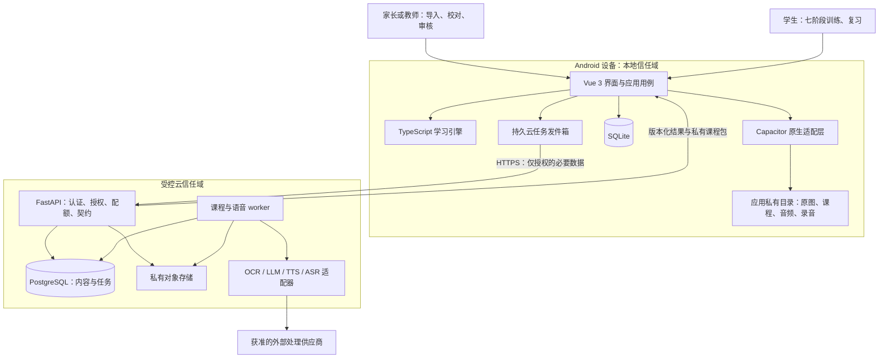

图中的数据库和原生设施由应用服务经端口调用；领域引擎不直接读写它们。Outbox 是 SQLite 中的持久队列。云正文、观察和课程资源通过鉴权下载网关读取，每次请求检查归属、scope、到期时间与 tombstone；学习记录不随下载或课程生成上传。

### 21.2 权威归属与传输清单

| 数据或决定 | 权威位置 | 云端能获得什么 |
|---|---|---|
| 原图与校对工作副本 | 本地；云处理副本限时 | 用户选择的图像、页面顺序和任务标识 |
| 已审核 TranscriptVersion | 本地保留；生成请求冻结一份云工作输入 | 必要课文、来源引用、目标配置，不含学习档案 |
| 冻结课程包 | 发布服务或本地授权导入；客户端再次校验 | 私有内容包及审核记录；不含学生提交 |
| Learner、Session、Attempt | 本地 SQLite | 默认不传；ASR 不上传整个 Attempt |
| 录音 | 本地私有文件 | 云语音授权下的单个录音及必要识别配置 |
| FrozenSpeechObservation | 云返回一次观察；本地固化为事实 | 临时任务结果，处理期后删除 |
| Grade、Evidence、SkillState、ReviewState | 本地 TS 引擎与事务 | 默认没有学习分数、掌握矩阵、复习队列 |
| 云处理凭据与配额 | 云 principal + 安装凭据 | 不包含儿童真实身份；仍按需保护 |

本地家长入口与云访问凭据分离。本地可不注册账号；试点云接入由运营通过受控渠道向监护人发放单次、短期 enrollment token，服务端仅保存 token 哈希、用途、到期时间与兑换状态。监护人在家长入口兑换安装凭据，服务端在同一事务消费 token 并创建安装 principal，返回短期 access token 与可撤销、轮换的受限 refresh credential；客户端放入原生安全存储。重复兑换返回已消费错误，丢失凭据需由运营撤销并重新发放。APK 不内置共享 secret，不注册儿童姓名或身份。本地 PIN 只保护入口，不能被服务端当作身份凭证；创建 processing scope 仍需已认证的安装会话和明确同意。安装标识不是匿名性的保证。

### 21.3 关键不变量

1. 已下载且通过门禁的课程，离线可进行文字学习、确定性评分、排程、示范播放与本地录音回放。
2. ASR 不可用只产生 pending / unscorable / needs_review；不产生学习失败证据。
3. 一份首次提交在所有重试、恢复、回调路径只应用一次；幂等唯一键和事务共同保证。
4. 包、课文、观察、评分、策略版本不可静默覆盖；纠错生成新实体或替代事件。
5. 所有云任务先验证 consent scope，再执行；撤回和删除能压制迟到结果。
6. 生成模型不能发布包、调用学习数据库、改评分规则或发出外部工具指令。

<a id="architecture-22"></a>

## 22. Android Vue 3 / Capacitor 客户端分层

### 22.1 层次、职责和依赖

| 层 | 目录示意 | 责任 | 禁止事项 |
|---|---|---|---|
| 展示 | `pages/`、`components/` | 题面、提示、进度、错误恢复操作 | 在组件内计算掌握度或直接执行 SQL |
| 界面协调 | `composables/`、`stores/` | 异步用例状态、导航、活动档案、媒体交互 | 把未落库数据当作成功提交 |
| 应用用例 | `application/` | Import、Compile、StartSession、SubmitAttempt、Review、Delete | 绕过授权检查或持久事务 |
| 领域 | `packages/learning-engine/` | 确定性评分、证据、状态、队列、阶段策略 | 引入 Vue、Pinia、Capacitor、fetch 或数据库 |
| 端口 | `ports/` | Repository、UnitOfWork、Clock、Media、Cloud | 绑定具体供应商、路径或平台对象 |
| 基础设施 | `infrastructure/` | SQLite、文件、网络、原生插件、时间源 | 实现另一套评分公式 |

Vue composable 用于复用有状态界面逻辑，生命周期清理放在其内部；学习纯函数独立于 composable。此分工基于 [Vue composables 官方说明](https://vuejs.org/guide/reusability/composables.html)，具体目录是本项目建议。

Pinia 只保存当前视图、pending 标识和读取快照；应用重启后重新从数据库装载。表单校对文字定时持久化为 draft，冻结审核前不传给学习引擎。接口结果先验证再写库，再通知 UI；页面乐观显示“正在保存”，只在事务提交后显示“已记录”。

### 22.2 原生能力端口

```typescript
// 新增接口示例；属于适配层，不修改原文 Attempt / GradeResult。
interface NativeMediaPort {
  requestMicrophone(): Promise<"granted" | "denied" | "restricted">;
  startRecording(input: { learnerId: string; maxDurationMs: number }): Promise<string>;
  stopRecording(): Promise<{ recordingId: string; durationMs: number }>;
  play(assetId: string): Promise<void>;
  stopPlayback(): Promise<void>;
}
interface LocalFilePort {
  stageImport(handle: string): Promise<{ stagedId: string; sha256: string }>;
  commitStaged(stagedId: string, assetId: string): Promise<void>;
  deleteByAssetId(assetId: string): Promise<void>;
}
```

端口只接受受控 assetId 或系统选择器返回的句柄；网页不得传任意绝对路径让插件读写。Capacitor 插件提供 JavaScript 到原生 API 的桥接能力；SQLite、录音与安全存储实现需要单独选型或自建窄接口插件，不能因为使用 Capacitor 就假定存在全部官方插件。[能力依据：Capacitor 插件文档](https://capacitorjs.com/docs/plugins)

录音建议用原生 Android 适配器完成，保存单声道压缩音频；格式和采样率由已验证 ASR 接口决定，转码在隔离 worker 进行。首版最大录音块建议 90 秒，用户可提前停止。播放示范与录音互斥；耳机断开、来电、音频焦点丢失时结束或暂停并说明原因，不能把示范回声识别成学生作答。Android 录音有运行时权限与后台限制，因此本版只在训练前台录音，切后台立即结束当前采集并保存可恢复状态。[依据：Android MediaRecorder](https://developer.android.com/media/platform/mediarecorder)

### 22.3 生命周期与任务恢复

会话状态为 `created → active ↔ paused → completed / abandoned`，与单题 `presented → drafting → submitted → graded / needs_review` 分开；`pending_speech` 是独立语音任务状态，不是 Grade 状态。音频首答即创建 `needs_review` 的空分数 Grade，离线也有可人工评价的持久对象。保存 `exerciseId、presentedVariantId、stageId、hintLevel、answerWasExposed、draftResponse、activeDurationMs、lastPersistedAt`；已经展示过答案的题恢复后仍是订正，不能重新变成首次验证。

切后台保存游标、停止录音、暂停活动计时；杀进程后从 SQLite 恢复最近事务成功的状态。录音文件先落 staging，完成关闭和哈希后登记；损坏文件标为 interrupted，不提交失败成绩。UI 操作取消只解除等待，是否取消持久云任务由专门命令决定。

V0.1 云任务在应用前台恢复轮询即可；长下载若采用原生 WorkManager，需要可取消的唯一任务与受约束重试。后台执行不是准点承诺，撤权后原生工作也必须停止。[依据：Android WorkManager 工作请求](https://developer.android.com/develop/background-work/background-tasks/persistent/getting-started/define-work)

<a id="architecture-23"></a>

## 23. 独立 TypeScript 学习引擎

### 23.1 子模块与纯函数边界

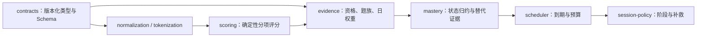

箭头表示数据处理顺序。代码依赖不得造成循环；公共领域类型放 contracts，评分器不依赖调度器，调度器不依赖 Vue。引擎可在 Android WebView 与 Node 验证进程中运行；不自动意味着在所有浏览器或 Python 中产生相同浮点结果。

| 模块 | 输入 | 输出与约束 |
|---|---|---|
| package-validator | LessonPackage、支持版本集合 | schema、引用、能力兼容、覆盖与资源问题；不能自动修正文意 |
| scorer | Attempt、GradingSpec、冻结观察 | 原文 GradeResult；不读取时钟、不随机、不调用模型 |
| evidence-policy | Grade、Attempt、Mapping、日历史 | 候选证据及排除原因；有限 ASR 与人工确认分开 |
| mastery-reducer | 排好序的事件及其事实实体 | SkillState；封顶后失败仍触发需复习 |
| review-reducer | 有效评价、已有 ReviewState、时间上下文 | level、dueAt、每日晋级标记 |
| planner | 快照、ReviewState、完整包、now、timezone、预算 | 固定排序队列及解释；未呈现不产生 Attempt |
| session-policy | 阶段状态、任务结果、显式 seed | 下一教学/验证任务；订正不伪造新题族 |

### 23.2 可重放输入与接口细化

事件采用 §13 的 `eventSchemaVersion=2.0.0` 判别联合；每条事件绑定不可变 `policyBundleVersion`，明确掌握、调度、引擎和时间规则。应用层加载引用的事实与版本，按档案全局 seq 构造确定的回放输入。已保存 Grade 的状态回放消费原始评分结果，不重新请求 ASR，不要求录音仍存在；重新评分使用冻结观察并作为单独操作保存新 Grade。未声明被删除而又缺失的事实属于错误，不能猜测零分。

```typescript
// 与§13公共类型一起编译；TimeContext只有§13中的一个定义。
interface ReplayFacts {
  attempts: Readonly<Record<string, Attempt>>;
  grades: Readonly<Record<string, GradeResult>>;
  decisions: Readonly<Record<string, ReviewDecision>>;
  packages: Readonly<Record<string, LessonPackage>>; // key含packageId和version
  policyBundles: Readonly<Record<string, PolicyBundle>>;
  migrations: Readonly<Record<string, ContentMigration>>;
  boundaries: Readonly<Record<string, PurgeBoundary>>;
  observations: Readonly<Record<string, FrozenSpeechObservation>>;
}
interface ReplayInput {
  learnerId: ID;
  events: readonly LearningEvent[];
  facts: ReplayFacts;
  targetSeq: number; scope: ReplayScope; asOf: TimeContext;
}
interface ReplayResult {
  skills: SkillState[]; reviews: ReviewState[]; lastSeq: number; scope: ReplayScope;
  effectiveEvaluations: Readonly<Record<ID, EvaluationRef>>; // key=attemptId
}
interface PlanInput {
  skills: readonly SkillState[]; reviews: readonly ReviewState[];
  package: LessonPackage; time: TimeContext; budgetSeconds: number;
}
interface LearningEngineV2 extends DeterministicScorer, LearningStateEngine {}
```

上述类型是可联合进行 TypeScript 严格检查的契约示意，不是已实现的 SDK；实现仍须交付 Schema、迁移、序列化及运行时引用校验。`gradeId` 由调用者通过评分输入传入，eventId 同样由用例预分配；纯函数不读取时钟或随机生成标识。只回放已有 Grade 时 observations 可以为空，不能因为录音或非必需观察已删除而否定有效历史结果。同分、同优先级按稳定 ID 比较，不使用依赖机器语言环境的默认排序。

`grade_recorded` 和 `review_decided` 仅登记不可变事实；正式有效评价完全由 `evidence_replaced` 构成的映射决定。初次选择使用 `from=null`；以后必须与当前映射精确匹配，且 from/to 必须属于同一 Attempt。先按目标 seq 构造有效评价映射，再按原 Attempt 的提交时间、原学习日及稳定序号折叠证据，重算题族/日上限、最新合格结果、延迟锚点和调度。人工复核日不充当新的学习日或独立练习。`session_closed` 仅为会话事实，对掌握值无直接影响；`answer_exposed` 按所列能力格重置延迟锚点，不产生成功证据、不推迟 dueAt。到期状态按显式 asOf 派生，回放禁止使用机器当前时间。

每个 Attempt 持久化 submittedTime，包含原 localDate、timezone、timeRulesVersion、clockConfidence；其 nowUtc 必须等于 submittedAt。LearningEvent.time 保存该事件实际发生时上下文且与 occurredAt 一致。迟到评分与人工决定使用原 Attempt.submittedTime 判定学习日和延迟资格，不用复核当时的可信时钟“洗白”异常时钟提交；asOf 只计算现在是否到期。本版不追补异常时钟下的延迟或晋级资格。原生时钟适配器取得可信服务器时间或已验证的单调时钟校准依据后，追加 clock_rebased：对受影响格把 delayedAnchorAt 重置为 calibratedAt，清空 delayedPassAt，dueAt 重设为不早于该时刻+24小时的推荐时段；level及alpha/beta不因校准提升，最近失败不解除。事件的 time.clockConfidence 必须为 normal、time.nowUtc=calibratedAt；没有可信校准依据就继续练习并保留异常状态。原始事件时间和学习日不改写，之后通过新的正常复测取得资格。

每个格按 `(learnerId, knowledgeNamespace, knowledgeId, semanticVersion, ability, mode)` 定位；V0.1 的 knowledgeNamespace 固定为 packageId，knowledgeId 在包内唯一，禁止不同包自动共享掌握。内容修订保持语义不变时可沿用 semanticVersion；语义变化发新版本并默认重测。显式 `content_migrated` 必须绑定审核后的映射，同命名空间且语义等价才允许 carry_equivalent，不能把字符串相同当作迁移依据。

初始 scope 为 `{epoch:0,boundaryId:null}`。课程数据删除按 §29.4 产生新的 `purge_boundary`，全局 seq 始终递增且不重用。新 scope 只接受边界 retainedEventIds 明示的存续事件及本 epoch 新事件；边界解释被删除造成的序号缺口，剩余实体仍须引用闭合。禁止加载旧 epoch 检查点或被删除的事实，不能用删除前的 alpha/beta 初始化新 epoch；使用保留事实从头重建。回放结果与检查点均绑定 scope，无法再回放已被彻底删除的数据。

数字运算固定实现与累加顺序；禁止 NaN / Infinity；显示才四舍五入，通过用原始分数。锁定 Unicode 归一化、token 规则、时区转换库及支持范围，随评分器版本保存金标准夹具。新旧引擎并存：课程要求未知 scorerVersion 时拒绝正式验证，不偷偷用最新规则替代。

### 23.3 事务外计算、事务内应用

应用用例读取档案 `revision` 与必要事实，在事务外做有限本地计算；提交时检查同一 revision，成功则一次写 Attempt、Grade、事件、证据和快照，并递增 revision。冲突时重新加载、重新计算，最多有限次数后返回可重试错误。也可在短事务内计算小任务，但不允许跨网络持有事务。

音频提交没有 ASR 观察时，仍在本地事务建立 `needs_review` Grade（score/passed/criticalChecksPassed 均为 null、components 为空、speechObservationId=null、原因 AWAITING_AUDIO_REVIEW），并用 from=null 的替代事件选为当前评价；ASR pending 是独立任务状态。家长可以直接回听并评价此 Grade，完全离线也能完成口语复核。静音、截断或不可回放的录音不能通过人工评价建立口语掌握证据。

人工改判携带 expectedActiveEvaluation；事务内比较当前有效映射，冲突返回 VERSION_CONFLICT，不能静默覆盖另一位评价者的结果。ReviewDecision 记录完整分项、关键检查与审核角色，分项必须与原题的 componentId 对齐；总分和 passed 按固定评分规格验证。提示、答案暴露和设备辅助等资格由 Attempt 决定，人工评价不能绕过这些限制。确认后原子写入决定、review_decided、evidence_replaced 及重建状态，不能先扣旧证据再异步加新证据。

ASR 完成后可保存新的 observation/Grade，但仅当当前评价仍是同一待评基线且无人工决定时，才通过 CAS 选择为正式评价；迟到 ASR 不覆盖人工结果。重建受影响格及后续调度要按原事件顺序重新裁定题族、日封顶和延迟门槛，不能只对 alpha/beta 加减。已经打开的今日会话保留已呈现题，尚未呈现题按新快照重新规划，并提示复核后任务已调整。事务同时验证 active 档案、replayEpoch 及未被删除的课程，迟到任务不得复活已删数据。

<a id="architecture-24"></a>

## 24. FastAPI 云端课程编译与适配器

### 24.1 服务内部分层

`routers → application services → domain / ports → repositories / adapters`。按 imports、transcripts、generation、packages、speech、consents、deletions 划分模块；共用认证、配额、存储和作业基础设施。FastAPI 的 APIRouter 支持这种模块路由组织，本项目不因此拆成多个网络服务。[依据：FastAPI 大型应用组织](https://fastapi.tiangolo.com/tutorial/bigger-applications/)

API 处理短请求：校验、鉴权、创建作业、查询结果、审核与发布。worker 执行 OCR、模型提取、模板出题、TTS 和 ASR。长任务使用持久作业表，API 重启不能丢掉已接受任务；不将课程生成仅放在进程内 BackgroundTasks。官方文档指出较重的后台工作可以采用独立任务工具，本项目选择 PostgreSQL 作业表作为首版实现。[依据：FastAPI Background Tasks](https://fastapi.tiangolo.com/tutorial/background-tasks/)

### 24.2 四类端口

| 端口 | 必要输入 | 输出 | 必须隔离的供应商差异 |
|---|---|---|---|
| OCRAdapter | 可访问的处理副本、语言、坐标系 | blocks、rawConfidence、engineVersion、transformId | 置信度尺度、坐标、旋转、手写识别；原结果保留到任务期限 |
| LLMAdapter | 已审核课文、目标、输出 Schema、模板/提示版本 | 带来源 ID 的候选知识、解释、题目建议 | 结构化输出能力、长度、模型版本、拒答、配额 |
| TTSAdapter | 精确审核文本、音色配置、语言 | audioRef、hash、时长、分段信息及来源 | 音色授权、格式、速率、文本一致性与可用区域 |
| ASRAdapter | 单个授权录音、语言、bias 配置 | FrozenSpeechObservation 候选 | 不同置信度、时间戳、儿童误差、文本偏置、质量 |

统一 `AdapterError { code, retryable, retryAfterSeconds, providerRequestId }`。供应商原始异常不直接返回学生端；凭据仅从 worker 的秘密管理设施取得。适配器不能访问 learner 表；没有该表的云库也不能靠后续“方便排障”新增全量学习数据。

```python
# 新增接口示意；DTO在contracts映射层定义，生产实现还需超时/取消。
from typing import Protocol

class OCRAdapter(Protocol):
    async def recognize(self, request: "OCRRequest") -> "OCRResult": ...

class LLMAdapter(Protocol):
    async def propose(self, request: "GenerationRequest") -> "CandidateContent": ...

class TTSAdapter(Protocol):
    async def synthesize(self, request: "TTSRequest") -> "AudioResult": ...

class ASRAdapter(Protocol):
    async def transcribe(self, request: "ASRRequest") -> "SpeechObservationDTO": ...
```

正式识别默认不传目标全文作强偏置；如启用参考偏置，必须记录 referenceTextBias，按原文降级诊断。供应商不返回置信度时为 null，不补造 1.0。LLM 温度设低不保证确定性；存储被审核的实际输出及哈希，不以相同 prompt 重新运行来重建历史。

### 24.3 持久流水线与人工门禁

```text
导入：validated → preprocessing → ocr_running → awaiting_transcript_review
生成：queued → structuring → extracting → awaiting_target_review
    → templating → building_audio / awaiting_audio_authorization → validating → awaiting_package_review
    → ready_to_publish → published
异常：retry_wait / failed / cancel_requested / cancelled / expired
```

导入状态与生成状态是两个作业族。人工等待状态不占 worker 租约，也不算失败；用户确认后创建下一步骤任务。阶段输出以 `inputHash + stepType + algorithmVersion + configHash` 作为复用键，复用范围只在同一云 principal 内。课文或目标变更使依赖步骤失效，不能复用旧正文的音频。

目标审核前只提取候选；批准的目标清单驱动 §5 的覆盖矩阵。模板编译负责答案、题族、criticalChecks 和 evidenceMappings；模型输出的“建议分数”一律忽略。编译持久保存 `authorizations.generation` 与 `authorizations.tts` 的 scopeId/epoch，LLM 与 TTS 步骤分别验证相应用途授权，不能以生成授权代替 TTS 授权。`tts=null` 时可以完成候选文字部分，然后停在 `awaiting_audio_authorization`；用户补充 TTS 授权或导入经审核的自有音频后再继续。TTS 文本从冻结课文或已审核生成题取得，缺必需资源仍为草稿。发布在同一事务验证审核版本、validation report 和 candidateHash，创建不可变包记录。

作业状态使用版本号 CAS 更新；worker 以短事务 `FOR UPDATE SKIP LOCKED` 领取到期任务、设置 leaseUntil 与 fencingToken，执行时不持锁，定时续租。过期作业可被接管，旧 worker 的结果因 fencingToken 失效而不能提交。SKIP LOCKED 可用于队列消费者，不能用于普通一致性查询。[依据：PostgreSQL SELECT 锁定说明](https://www.postgresql.org/docs/current/sql-select.html)

建议单任务最多 3 次自动重试，退避 2 秒、10 秒、30 秒并加抖动；429 尊重 Retry-After，供应商总超时和日预算分别限制。LLM schema 错误至多一次修复，仍不合法则转人工；参考断裂、未审核课文、授权撤回不重试。外部请求已经成功但本地结果未持久化时可能产生重复收费，不承诺 exactly-once；供应商支持幂等键时传 step key，否则记录不确定状态并避免无限重发。

### 24.4 成本与取消

每个步骤记录不含正文的用量、耗时、错误码和提供方请求标识；按 principal、导入、生成任务和日期设预算。初始预算值由运营在 M0 配置，测试以假供应商验证超额拦截。取消采用协作式标记，能取消提供方请求则发取消；不能取消的调用完成后丢弃结果并清理，禁止转为 published。

worker 调用前检查授权用途、epoch、expiresAt 和 deletion tombstone；外部结果仅写入按 job/step/fencingToken 隔离的 staging。接纳结果或发布时在短事务内锁定所依赖的 processing scopes（多 scope 按固定 ID 顺序加锁），重新核验 active、epoch、期限、tombstone、任务状态和 fencingToken，成功后才登记可读取的结果。撤回与删除锁定同一 scope 并递增 epoch，因此不留下“检查后撤权、撤权后提交”的空隙。未获接纳的对象不可经下载网关读取，由任务清单和孤立 staging 清理器删除；删除成功标记须等待本方所有已登记副本处理完毕。

<a id="architecture-25"></a>

## 25. SQLite 与服务端数据模型

### 25.1 本地物理存储

建议每次安装一个 `lingonest.db`，内容表和学习表在同一数据库，确保一次作答写入不跨数据库事务。学习表全部带 learner_id；Repository 由活动档案显式传入 learnerId，每个外键组合同时约束档案与实体。课程关联通过 learner_packages 控制，同设备多档案不自动看见彼此的录音、提交或错题。

图片、音频及录音在应用私有文件夹；数据库只保存相对受控路径、hash、长度、状态和引用。不要将大量音频以 Base64 放在 Pinia 或 JSON 包正文。导出包与应用内部目录分开，导出成功后清理临时文件。

| 表组 | 物理表及关键约束 | 主要索引/用途 |
|---|---|---|
| 档案与权限 | learners；consent_records(id, learner_id, scope, policy_version, epoch, granted_at, revoked_at) | 档案软删除状态；有效 scope + epoch |
| 导入 | imports；source_assets；ocr_runs；ocr_blocks；transcript_versions | import_id、asset_id；transcript_id + version 唯一；冻结版不可改 |
| 课程 | package_versions；learner_packages；knowledge_catalog；exercise_index | package_id + version；跨课 semantic_version；练习复合键 |
| 会话 | sessions；presented_variants(session_id, id, seed, ordered_options, hint_log, exposed_at) | 当前游标；呈现 ID 与题目对应，不重新抽题 |
| 提交与评分 | attempts；grade_results；review_decisions | learner_id + client_event_id；评分版本及 observation 唯一键 |
| 语音 | recordings；speech_observations | learner_id + attempt_id；expires_at；不可变观察 |
| 学习事实 | learning_events；mastery_evidence；active_evaluations | learner_id + seq；当前有效Grade/ReviewDecision的CAS映射，替代历史只追加 |
| 快照 | skill_states；review_states；queue_snapshots | 能力格复合键；due_at；last_applied_event_seq |
| 文件与作业 | asset_registry；outbox_tasks；file_operations；export_jobs；deletion_jobs | state + next_run_at；owner + hash；范围删除 |
| 迁移与检查点 | schema_migrations；replay_checkpoints；learner_revisions | migration checksum；策略版本、事件序号、快照hash |

active_evaluations 指向 Attempt 当前有效 Grade/ReviewDecision，并以 revision 执行 CAS；相关 MasteryEvidence 由有效评价映射重建，替代历史保留直到明确的课程数据删除或档案删除。日去重、题族与 2.0 权重封顶由按 seq 回放的规则裁定，不能简单给原始证据表设置“每天只有一个行”的唯一键而丢掉历史。删除后按新的 ReplayScope 与 PurgeBoundary 读取保留事件；当前边界内缺少必要关联仍是回放错误。

### 25.2 关键关系图

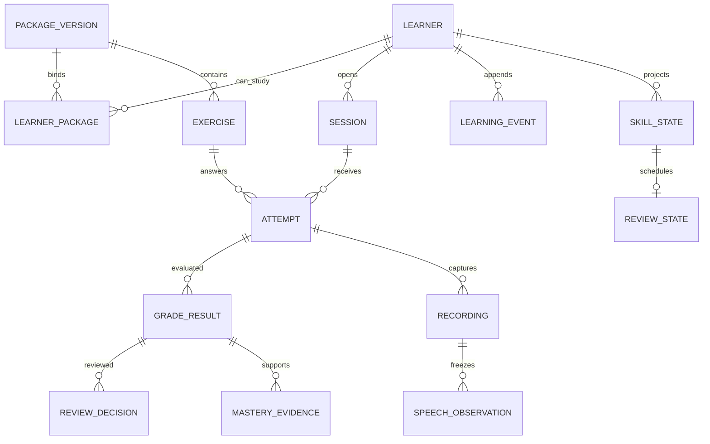

### 25.3 核心 DDL 示意

以下是能表达关键约束的 **SQLite 核心子集**，不是所有模块的完整迁移脚本。已包含人工决定、当前有效评价和删除边界；表组中尚未列出的 presented_variants、录音观察、会话阶段、内容迁移、队列与文件删除任务外键仍需在 M0 数据字典补齐。JSON 列依契约在应用层严格验证，DDL 的 TEXT 本身不保证有效 JSON。

```sql
PRAGMA foreign_keys = ON;
PRAGMA journal_mode = WAL;
PRAGMA synchronous = FULL;
PRAGMA busy_timeout = 3000;

CREATE TABLE learners (
  id TEXT PRIMARY KEY,
  nickname TEXT NOT NULL,
  timezone TEXT NOT NULL,
  revision INTEGER NOT NULL DEFAULT 0 CHECK (revision >= 0),
  replay_epoch INTEGER NOT NULL DEFAULT 0 CHECK (replay_epoch >= 0),
  next_event_seq INTEGER NOT NULL DEFAULT 1 CHECK (next_event_seq > 0),
  state TEXT NOT NULL CHECK (state IN ('active','deleting'))
);
CREATE TABLE package_versions (
  package_id TEXT NOT NULL,
  version TEXT NOT NULL,
  schema_version TEXT NOT NULL,
  sha256 TEXT NOT NULL CHECK (length(sha256) = 64),
  payload_json TEXT NOT NULL,
  PRIMARY KEY (package_id, version)
);
CREATE TABLE learner_packages (
  learner_id TEXT NOT NULL,
  package_id TEXT NOT NULL,
  package_version TEXT NOT NULL,
  PRIMARY KEY (learner_id, package_id, package_version),
  FOREIGN KEY (learner_id) REFERENCES learners(id),
  FOREIGN KEY (package_id, package_version)
    REFERENCES package_versions(package_id, version)
);
CREATE TABLE knowledge_catalog (
  knowledge_namespace TEXT NOT NULL,
  knowledge_id TEXT NOT NULL,
  semantic_version TEXT NOT NULL,
  definition_hash TEXT NOT NULL CHECK (length(definition_hash) = 64),
  payload_json TEXT NOT NULL,
  PRIMARY KEY (knowledge_namespace, knowledge_id, semantic_version)
);
CREATE TABLE policy_bundles (
  version TEXT PRIMARY KEY,
  payload_json TEXT NOT NULL
);
CREATE TABLE purge_boundaries (
  learner_id TEXT NOT NULL,
  id TEXT NOT NULL,
  previous_epoch INTEGER NOT NULL CHECK (previous_epoch >= 0),
  new_epoch INTEGER NOT NULL CHECK (new_epoch = previous_epoch + 1),
  payload_json TEXT NOT NULL,
  PRIMARY KEY (learner_id, id),
  UNIQUE (learner_id, new_epoch),
  FOREIGN KEY (learner_id) REFERENCES learners(id)
);
CREATE TABLE exercise_index (
  package_id TEXT NOT NULL,
  package_version TEXT NOT NULL,
  exercise_id TEXT NOT NULL,
  payload_json TEXT NOT NULL,
  PRIMARY KEY (package_id, package_version, exercise_id),
  FOREIGN KEY (package_id, package_version)
    REFERENCES package_versions(package_id, version)
);
CREATE TABLE sessions (
  learner_id TEXT NOT NULL,
  id TEXT NOT NULL,
  package_id TEXT NOT NULL,
  package_version TEXT NOT NULL,
  cursor_json TEXT NOT NULL,
  state TEXT NOT NULL,
  PRIMARY KEY (learner_id, id),
  UNIQUE (learner_id, id, package_id, package_version),
  FOREIGN KEY (learner_id, package_id, package_version)
    REFERENCES learner_packages(learner_id, package_id, package_version)
);
CREATE TABLE attempts (
  learner_id TEXT NOT NULL,
  id TEXT NOT NULL,
  session_id TEXT NOT NULL,
  package_id TEXT NOT NULL,
  package_version TEXT NOT NULL,
  exercise_id TEXT NOT NULL,
  client_event_id TEXT NOT NULL,
  request_hash TEXT NOT NULL,
  submitted_at TEXT NOT NULL,
  payload_json TEXT NOT NULL,
  PRIMARY KEY (learner_id, id),
  UNIQUE (learner_id, client_event_id),
  FOREIGN KEY (learner_id, session_id, package_id, package_version)
    REFERENCES sessions(learner_id, id, package_id, package_version),
  FOREIGN KEY (package_id, package_version, exercise_id)
    REFERENCES exercise_index(package_id, package_version, exercise_id)
);
CREATE TABLE grade_results (
  learner_id TEXT NOT NULL,
  id TEXT NOT NULL,
  attempt_id TEXT NOT NULL,
  evaluation_key TEXT NOT NULL,
  status TEXT NOT NULL CHECK (status IN ('scored','needs_review','unscorable')),
  score REAL,
  passed INTEGER,
  critical_checks_passed INTEGER,
  payload_json TEXT NOT NULL,
  PRIMARY KEY (learner_id, id),
  UNIQUE (learner_id, attempt_id, evaluation_key),
  UNIQUE (learner_id, id, attempt_id),
  CHECK ((status = 'scored' AND score IS NOT NULL AND score BETWEEN 0 AND 100
          AND passed IS NOT NULL AND passed IN (0,1)
          AND critical_checks_passed IS NOT NULL AND critical_checks_passed IN (0,1))
      OR (status <> 'scored' AND score IS NULL AND passed IS NULL
          AND critical_checks_passed IS NULL)),
  CHECK (passed IS NULL OR passed = 0 OR critical_checks_passed = 1),
  FOREIGN KEY (learner_id, attempt_id) REFERENCES attempts(learner_id, id)
);
CREATE TABLE review_decisions (
  learner_id TEXT NOT NULL,
  id TEXT NOT NULL,
  grade_id TEXT NOT NULL,
  attempt_id TEXT NOT NULL,
  payload_json TEXT NOT NULL,
  PRIMARY KEY (learner_id, id),
  UNIQUE (learner_id, id, grade_id, attempt_id),
  FOREIGN KEY (learner_id, grade_id, attempt_id)
    REFERENCES grade_results(learner_id, id, attempt_id)
);
CREATE TABLE active_evaluations (
  learner_id TEXT NOT NULL,
  attempt_id TEXT NOT NULL,
  grade_id TEXT NOT NULL,
  review_decision_id TEXT,
  PRIMARY KEY (learner_id, attempt_id),
  FOREIGN KEY (learner_id, grade_id, attempt_id)
    REFERENCES grade_results(learner_id, id, attempt_id),
  FOREIGN KEY (learner_id, review_decision_id, grade_id, attempt_id)
    REFERENCES review_decisions(learner_id, id, grade_id, attempt_id)
);
CREATE TABLE learning_events (
  learner_id TEXT NOT NULL,
  seq INTEGER NOT NULL CHECK (seq > 0),
  event_id TEXT NOT NULL,
  type TEXT NOT NULL CHECK (type IN ('attempt_submitted','grade_recorded',
    'review_decided','evidence_replaced','content_migrated','session_closed',
    'answer_exposed','clock_rebased','purge_boundary')),
  event_schema_version TEXT NOT NULL CHECK (event_schema_version = '2.0.0'),
  replay_epoch INTEGER NOT NULL CHECK (replay_epoch >= 0),
  occurred_at TEXT NOT NULL,
  policy_bundle_version TEXT NOT NULL,
  payload_json TEXT NOT NULL,
  PRIMARY KEY (learner_id, seq),
  UNIQUE (learner_id, event_id),
  FOREIGN KEY (learner_id) REFERENCES learners(id),
  FOREIGN KEY (policy_bundle_version) REFERENCES policy_bundles(version)
);
CREATE TABLE mastery_evidence (
  learner_id TEXT NOT NULL,
  id TEXT NOT NULL,
  attempt_id TEXT NOT NULL,
  grade_id TEXT NOT NULL,
  knowledge_namespace TEXT NOT NULL,
  knowledge_id TEXT NOT NULL,
  semantic_version TEXT NOT NULL,
  ability TEXT NOT NULL,
  mode TEXT NOT NULL,
  family_id TEXT NOT NULL,
  local_date TEXT NOT NULL,
  success_value INTEGER NOT NULL CHECK (success_value IN (0,1)),
  weight REAL NOT NULL CHECK (weight > 0 AND weight <= 1),
  replay_epoch INTEGER NOT NULL CHECK (replay_epoch >= 0),
  payload_json TEXT NOT NULL,
  PRIMARY KEY (learner_id, id),
  FOREIGN KEY (learner_id, grade_id, attempt_id)
    REFERENCES grade_results(learner_id, id, attempt_id),
  FOREIGN KEY (knowledge_namespace, knowledge_id, semantic_version)
    REFERENCES knowledge_catalog(knowledge_namespace, knowledge_id, semantic_version)
);
CREATE TABLE skill_states (
  learner_id TEXT NOT NULL,
  knowledge_namespace TEXT NOT NULL,
  knowledge_id TEXT NOT NULL,
  semantic_version TEXT NOT NULL,
  ability TEXT NOT NULL,
  mode TEXT NOT NULL,
  policy_version TEXT NOT NULL,
  last_applied_event_seq INTEGER NOT NULL,
  replay_epoch INTEGER NOT NULL CHECK (replay_epoch >= 0),
  payload_json TEXT NOT NULL,
  PRIMARY KEY (learner_id, knowledge_namespace, knowledge_id, semantic_version, ability, mode),
  FOREIGN KEY (learner_id) REFERENCES learners(id),
  FOREIGN KEY (knowledge_namespace, knowledge_id, semantic_version)
    REFERENCES knowledge_catalog(knowledge_namespace, knowledge_id, semantic_version)
);
CREATE TABLE review_states (
  learner_id TEXT NOT NULL,
  knowledge_namespace TEXT NOT NULL,
  knowledge_id TEXT NOT NULL,
  semantic_version TEXT NOT NULL,
  ability TEXT NOT NULL,
  mode TEXT NOT NULL,
  due_at TEXT NOT NULL,
  replay_epoch INTEGER NOT NULL CHECK (replay_epoch >= 0),
  payload_json TEXT NOT NULL,
  PRIMARY KEY (learner_id, knowledge_namespace, knowledge_id, semantic_version, ability, mode),
  FOREIGN KEY (learner_id, knowledge_namespace, knowledge_id, semantic_version, ability, mode)
    REFERENCES skill_states(learner_id, knowledge_namespace, knowledge_id, semantic_version, ability, mode)
);
CREATE INDEX ix_attempts_time ON attempts(learner_id, submitted_at);
CREATE INDEX ix_grade_attempt ON grade_results(learner_id, attempt_id);
CREATE INDEX ix_evidence_cell ON mastery_evidence
  (learner_id, knowledge_namespace, knowledge_id, semantic_version, ability, mode, local_date, family_id);
CREATE INDEX ix_review_due ON review_states(learner_id, due_at);
```

evaluation_key 由 `gradingSpecId、gradingSpecVersion、scorerVersion、observationId、evaluationPurpose` 固定组合生成；同一输入的自动重试沿用同键，明确重评使用新的 evaluationPurpose 修订标识。音频待评基线也有固定键，避免重试生成多个 needs_review。原包评分版本、提示与响应保存在 payload 中且校验索引列一致。seq 使用同一事务中的 learners.next_event_seq 递增；档案 revision 是事务版本，二者不能混作一个计数器，一次事务可能写多条事件。删除形成序号缺口但不回退 next_event_seq。

active_evaluations 是可由 evidence_replaced 事件重建的投影；复核 CAS、事件追加、映射更新和能力格重算必须同一事务提交。knowledge_catalog 的 namespace 在 V0.1 固定为 packageId，同命名空间/ID/semanticVersion 的不同语义定义哈希拒绝导入；哈希仅覆盖版本化的语义投影（kind、目标词义/结构/句子内容、能力模式），展示标签、资源路径和审核时间变化不单独形成新语义。掌握与复习表的所有主键、外键、查询均携带完整六元能力格。JSON payload 与这些索引字段不一致时拒绝写入。

删除课程时对事实、投影、文件作业和 purge_boundaries 使用 §29.4 的新 replay_epoch 边界。仍存续的历史事件保持原 seq 和原 epoch，retainedEventIds 明确授权其在新 epoch 中参与重建；不能只按 learning_events.replay_epoch 等于当前 epoch 查询而丢掉存续历史。事务提交前核验快照 epoch 等于 learner 当前 epoch，并清理旧 epoch 检查点。此 DDL 的外键用于防串档案和串版本，不能代替应用层的事件负载/删除边界校验。

所有连接显式打开并核验外键；WAL 能改进读写并发，但仍需要控制写事务和 SQLITE_BUSY，不意味着任意多个写入都不冲突。[依据：SQLite 外键](https://www.sqlite.org/foreignkeys.html)、[WAL](https://www.sqlite.org/wal.html)。本版采用单写入队列、短事务及有限 busy 重试；磁盘满时完整回滚，UI 保留待提交草稿。

### 25.4 PostgreSQL 服务端模型

云端不复制 §14 的 Learner、Attempt、MasteryEvidence 或 SkillState。以下为云处理数据字典建议，UUID 只是不可猜测标识的一部分，每次查询仍做 principal 归属授权。

| 表 | 核心字段、键与不变量 |
|---|---|
| enrollment_tokens / installation_credentials | token_hash、expires_at、consumed_at、installation_id；单次兑换 CAS；refresh hash、credential_version、revoked_at；不存明文凭据 |
| cloud_principals | id、credential_version、state、quota_plan；无儿童姓名、学校或生日 |
| processing_scopes | id、principal_id、consent_scope、epoch、status、expires_at；本地映射至授权档案，云不需要 learnerId |
| consent_grants | id、scope_id、policy_version、provider_policy_hash、granted_at、revoked_at；审核同意凭据最小化 |
| imports | id、principal_id、scope_id、ordered_asset_ids、status、revision、expires_at |
| cloud_assets | id、principal_id、scope_id、scope_epoch、staging_key、frozen_object_key/version、mime、byte_length、sha256、state、expires_at；verified 仅指向验证过的不可变版本 |
| ocr_runs / blocks | run_id、asset_id、engine_version、result_json、coordinate_space；记录真实置信度 |
| transcript_versions | transcript_id、version、principal_id、input_hash、review_status、payload_json、expires_at；复合唯一 |
| generation_jobs | id、principal_id、generation_scope_id/epoch、tts_scope_id/epoch（可空）、transcript_version、config_hash、state、state_version、progress、expires_at；按步骤验证用途 |
| job_steps | job_id、step_key、input_hash、frozen_input_ref、authorization_refs、result_ref、attempt_count、next_run_at、lease_until、fencing_token；step_key 唯一 |
| package_candidates | id、job_id、candidate_hash、schema_version、payload_ref、validation_ref、review_revision、expires_at |
| package_versions | package_id、version、principal_id、authorization_refs、manifest_hash、object_key、rights_scope、review_id、expires_at；冻结输入及生成/TTS依赖scope+epoch，不可变且仅私有 |
| speech_jobs / observations | job_id、principal_id、scope_id、recording_asset_id、config_hash、observation_ref、quality、expires_at；不含完整 Attempt |
| idempotency_records | principal_id、method、route、key 唯一；request_hash、response_ref、expires_at |
| deletion_jobs / tombstones | job_id、principal_id、scope_id、target_type、target_id、epoch、state、provider_delete_ref、control_log_seq；独立持久删除控制清单压制迟到写回与恢复复活 |
| usage_records / audit_events | 任务 ID、动作、角色、用量、错误码、时间；不存课文、作答或声音正文 |

每张有私有数据的表直接带 principal_id 或通过受约束父表关联；Repository 查询强制 principal 条件，对象存储也经资产记录授权。可加 PostgreSQL RLS 作为第二道隔离，但 API 与 worker 仍必须做归属检查，不能依赖表名或随机 ID 隐藏数据。

临时云处理原文、录音及结果按 §15 的最长 24 小时约束配置。创建处理根任务或接受初始上传时记录 `acceptedAt` 与不可延长的 `retentionDeadline`；后续根任务的期限取其新期限与所有引用输入原期限的最早者。依赖步骤、人工等待、重试、转码、缓存和发布交付副本继承不晚于该期限的 expiresAt，不能每步重新起算 24 小时。人工等待超过窗口时云副本到期清除，草稿留本地；继续需显式重新提交并核验当前授权。私有发布包必须在交付副本到期前下载，过期后使用本地导出或显式重新生成，不承诺无限远程可用。跨任务缓存仅在原期限内且同 principal、相容授权范围复用。

### 25.5 迁移与一致性检查

本地 migration 带单调编号、checksum 和最低客户端版本；升级前采用一致性备份、在事务中执行可事务化迁移，完成后核验 foreign_key_check、schemaVersion 与关键行数。`schemaVersion=2.0.0` 的来源隔离、评价引用和回放边界必须显式迁移，不能只改版本字符串。快照迁移可重建；事实表迁移失败时保留备份并进入修复模式，不删库重置。迁移备份属于含学习数据的受控副本，纳入 §29.4 的删除清单与恢复边界。

运行中的 WAL 数据库不能仅拷贝主 `.db` 作为完整备份，应通过原生适配器提供一致备份 API，或经测试的关闭连接/检查点流程生成快照。[依据：SQLite Backup API](https://www.sqlite.org/backup.html)。服务端迁移由独立发布步骤执行；扩展字段先兼容旧客户端，再升级读写，最后另一次发布移除旧字段。

<a id="architecture-26"></a>

## 26. 接口契约与命令边界

### 26.1 原逻辑接口的落点

| 原 §13.1 接口 | V0.1 物理实现 |
|---|---|
| imports、transcripts、compile、validate、publish | 云 `/v1/` 接口；本地用例先保存草稿，后发授权请求 |
| sessions、attempts、grades review、review-queue | 本地应用命令；不作为 FastAPI 公网学习 API |
| speech-observations | 本地创建/固化观察；需要云识别时调用 `/v1/speech-jobs` |
| exports、DELETE learners | 本地导出/删除命令；删除关联云 scope 用云删除任务接口 |

网页开发预览可用内存/浏览器替身模拟命令，但 Android 交付用 SQLite 实现同一端口。不能把原表所有 POST 路径都上线成 HTTP 服务并由此上传学习档案。

### 26.2 通用 HTTP 规则

API prefix 为 `/v1`（首版部署的 HTTP API），课程与本地学习 payload 契约为 `schemaVersion=2.0.0`，两者独立版本化；旧课程契约不得因 URL 含 v1 而被当作兼容。JSON 字段使用 camelCase；数据库使用 snake_case 由映射层转换。请求与响应都通过 JSON Schema / Pydantic 校验，生成 OpenAPI SDK；Pydantic 不作为课程包第二份手写权威 Schema，课程 payload 使用共享 Schema 校验。

时间用 UTC ISO 8601 带 `Z`，时区用 IANA 名称。分页使用 cursor 与固定排序，默认 50、上限 100 条。JSON 不允许 NaN、Infinity、重复键或不受控深度；字符串、数组、媒体尺寸在 API 与 worker 分别限制。契约变化采用版本号：兼容新增 minor，删除/改语义 major；未知评分模式拒绝。

认证 `Authorization: Bearer <short-lived-token>`；请求使用 X-Request-Id，响应返回 requestId。创建任务、完成上传、发布、取消及删除使用 `Idempotency-Key`。键按 principal + method + 规范化 route 隔离；同键同 requestHash 返回原结果，同键不同内容返回 409 IDEMPOTENCY_CONFLICT。记录建议保留 24 小时；过期后客户端先查询资源状态再决定新建，服务端仍对业务步骤唯一键防重。

错误体不包含正文或供应商凭据：

```json
{
  "error": {
    "code": "VERSION_CONFLICT",
    "message": "校对稿已更新，请合并后再提交。",
    "retryable": false,
    "details": { "currentVersion": "tr-3" }
  },
  "requestId": "req-example-001"
}
```

### 26.3 云 API 路由

| 方法与路径 | 输入契约 | 响应与状态 |
|---|---|---|
| POST `/installations/enroll` | 单次 enrollmentToken、随机 clientInstallationId、协议版本 | 201 安装 principal、短期 accessToken、受限 refreshCredential；过期/已消费拒绝；不接受自报管理员角色 |
| POST `/installations/token` | 受限 refreshCredential、credentialVersion | 200 新短期令牌与轮换凭据；被撤销安装 401 |
| POST `/processing-scopes` | 已认证安装会话、监护人明确同意、consentScope、policyVersion、providerPolicyHash | 201 scopeId、epoch、expiresAt；授权不充分 403 |
| POST `/assets/uploads` | scopeId、scopeEpoch、kind、mime、byteLength、sha256 | 201 assetId、仅写随机 staging 的 uploadUrl、requiredHeaders、expiresAt |
| POST `/assets/{id}/complete` | scopeEpoch、上传完成标记、sha256 | 200 verified（不可变对象版本）或 202 验证任务；不一致 422 |
| POST `/imports` | scopeId、scopeEpoch、orderedAssetIds 或 typedText、语言、范围 | 202 importId、jobId；图片需cloud_ocr，typedText可用cloud_generation仅建草稿而不调用OCR |
| GET `/imports/{id}` | 无正文 | 200 state、revision、assetStatus、OCR resultRef |
| PATCH `/transcripts/{id}` | baseVersion、编辑操作、scope、reviewedByRole | 200 新版本；409 并发冲突 |
| POST `/transcripts/{id}/approve` | version、contentHash、确认范围 | 200 冻结 reviewed version；未完成确认 422 |
| POST `/lessons/compile` | reviewedTranscriptId、transcriptVersion、config、authorizations: { generation: {scopeId, epoch}, tts: {scopeId, epoch} 或 null } | 202 jobId、state、pollAfterSeconds；tts=null 可生成文字候选，音频等待授权 |
| POST `/jobs/{id}/audio-authorization` | jobRevision、candidateHash、tts: {scopeId, epoch}；或经审核的私有音频资产引用 | 200 恢复缺失音频步骤；不改变已审核正文 |
| POST `/jobs/{id}/target-review` | jobRevision、候选hash、批准的目标与能力 | 200 恢复任务；目标环或引用断裂 422 |
| GET `/jobs/{id}` | 可选 If-None-Match | 200 阶段、步数、错误、resultRef，或 304；不声称总进度精确 |
| POST `/jobs/{id}/cancel` | 可选原因代码 | 202 cancel_requested 或 200 已终止 |
| POST `/packages/{id}/validate` | candidateVersion、candidateHash | 200 report、publishBlockers；资源仍 pending 不发布 |
| POST `/packages/{id}/review` | candidateHash、审核清单、reviewedByRole | 201 reviewId；记录应用角色，不冒充实名身份认证 |
| POST `/packages/{id}/publish` | candidateHash、reviewId、rightsScope | 201 冻结版本、manifestRef；sample/版本冲突 422/409 |
| GET `/packages/{id}/versions/{version}/manifest` | 归属、依赖 scope/epoch、tombstone 与期限验证 | 200 签名 manifest、expiresAt、各资源网关路径；无对象存储直读地址 |
| GET `/assets/{id}/content` | Bearer 安装令牌，可带 Range / If-Range | 网关每次验证归属、资源依赖的 scopes/epochs、tombstone 和期限，200/206 流；撤权/到期 403/410 |
| POST `/speech-jobs` | scopeId、scopeEpoch、recordingAssetId、language、adapterConfigVersion、referenceTextBias | 202 jobId；不接受 learnerId / 学习历史 |
| GET `/speech-jobs/{id}/result` | 归属验证 | 200 固化 observation 或 202 pending；失效 410 |
| POST `/processing-scopes/{id}/revoke` | baseEpoch、撤回范围 | 200 新 epoch；停止新工作并取消排队步骤 |
| POST `/deletion-jobs` | scopeId、targetType、targetId、baseEpoch | 202 deletionJobId；创建 tombstone |
| GET `/deletion-jobs/{id}` | 归属验证 | 200 state、本方/供应商删除状态与待处理原因 |

上传授权仅允许写入该资产随机 staging key，并限制方法、尺寸、校验和与短期有效窗口；`uploadExpiresAt ≤ min(scopeExpiresAt, retentionDeadline, now + 5分钟)`。预签名 URL 可能在期限内重复使用，不能当作一次性令牌，也不会因应用数据库 epoch 改变自动失效。[对象存储行为依据：Amazon S3 预签名 URL](https://docs.aws.amazon.com/AmazonS3/latest/userguide/using-presigned-url.html)

complete 幂等领取该上传的完成操作，固定当前对象版本并检查实际长度、MIME 解码、hash 与归属；随后复制或提升经验证的相同字节到客户端无写权限的不可变 key/version，再在授权检查事务内登记 verified。若存储不支持版本固定，则从一次读取的数据流校验并写入新不可变对象，不得校验一个版本后再次按可变 staging key 读取。后续 OCR/ASR/编译仅使用 frozenObjectRef。迟到覆盖只能影响 staging，不能改变 verified 内容；孤立 staging 到期清理。

云正文下载统一由鉴权网关流式返回，禁止 302 跳转到可绕过检查的长期直读 URL。网关每次请求（含 Range）检查归属、资源依赖的授权 epochs、tombstone 与 expiresAt，设置 `Cache-Control: no-store`；长流到期或收到撤回信号时终止。已经交付到设备的字节无法由网络撤回，本地按撤权/删除命令清理。客户端以 assetId + hash 标识资源，不以下载地址标识内容。撤回后仍允许安装 principal 对自己 scope 发起删除和查询删除状态，此维护权限不授权读取正文或重新处理。

示例 compile 请求引用第一部分 CompileConfig 的字段：

```json
{
  "reviewedTranscriptId": "tr-example-001",
  "transcriptVersion": "tr-2",
  "authorizations": {
    "generation": { "scopeId": "scope-generation-001", "epoch": 1 },
    "tts": { "scopeId": "scope-tts-001", "epoch": 1 }
  },
  "config": {
    "schemaVersion": "2.0.0",
    "templateVersion": "templates-1",
    "selectedRequirements": [
      { "knowledgeId": "kp-word-basketball", "ability": "spelling", "mode": "prompted_word", "required": true, "independence": "two_families" }
    ],
    "seed": "compile-seed-example-001"
  }
}
```

该示例仅演示请求结构，目标清单不足以生成完整课程；不能作为正式课程 fixture。selectedRequirements 必须引用已批准候选；服务端检查冻结源版本、同 principal 的来源访问权与各处理用途授权，按步骤核验 epoch，并重新检查完整目标覆盖。一个 OCR scope 不自动授权生成或 TTS；跨 scope 引用内容需由监护人显式选择输入并记录到不可变编译请求中。

```json
{
  "data": {
    "jobId": "job-example-001",
    "state": "queued",
    "pollAfterSeconds": 3,
    "expiresAt": "2026-10-12T00:00:00Z"
  },
  "requestId": "req-example-002"
}
```

### 26.4 本地命令契约

| 命令 | 输入及前置条件 | 持久输出 |
|---|---|---|
| StartSession | learnerId、包复合键、预算、时间上下文；包已安装且允许该档案 | Session、固定 presentedVariantId 与恢复游标 |
| SubmitAttempt | Attempt、expectedLearnerRevision；验证呈现ID、响应模式及提示日志 | Attempt、Grade、事件、证据和状态快照；音频即建 needs_review/null Grade 与独立语音任务 |
| AttachSpeechObservation | 任务绑定 learnerId、attemptId、jobId、scopeEpoch、冻结观察、expectedActiveEvaluation | 不可变 observation；同评价键至多一份 Grade；迟到自动评价不得覆盖人工评价 |
| ReviewGrade | learnerId、gradeId、expectedActiveEvaluation、人工决定、原因、家长入口凭据 | CAS 验证当前有效评价后写 ReviewDecision、替代事件、受影响格重建；冲突须重新展示当前评价 |
| BuildReviewQueue | learnerId、now、timezone、包版本、预算、输入seq | ReviewTask[] 和 queue snapshot；没有网络依赖 |
| ExportLearner | learnerId、范围、家长入口确认 | 加密或明确保护的本地导出、hash清单 |
| DeleteLearner | learnerId、家长入口确认、删除范围 | 本地 deleting 状态、云删除任务、最终删除证据 |
| UninstallCourseMedia | learnerId、包复合键；显示仍保留的正文/学习历史范围 | 删除可卸载媒体、标记需要重装；保留事实可回放 |
| DeleteCourseData | learnerId、课程/源资产范围、家长入口确认 | 删除原图/正文及相关事实、媒体、备份副本；新 replay epoch 与剩余事实重建结果 |

命令返回 `ok + persistedRevision + entityIds` 或结构化错误，不能把“正在提交”当成功。音频提交即原子保存 `GradeResult { status: needs_review, score: null, passed: null, criticalChecksPassed: null, reasonCodes: [AWAITING_AUDIO_REVIEW] }`，其余标识/版本字段按§13填齐，初始 components/errors 为空，evidenceEligibility 为 needs_review，不产生失败证据。pending_speech 是独立云任务状态，因此离线和拒绝云授权时也能针对该 Grade 人工评价。初始 Grade 不可变；自动观察到达后建立新的候选评价，只有 expectedActiveEvaluation 仍匹配且当前不是人工评价时才能原子切换有效评价。人工决定优先于迟到 ASR；CAS 冲突保留候选用于展示，不覆盖人工结果或重复应用证据。

### 26.5 错误分类与用户操作

| 类别/HTTP | 示例错误码 | 客户端动作 |
|---|---|---|
| 授权 401/403 | TOKEN_EXPIRED、CONSENT_REQUIRED、CONSENT_REVOKED、FORBIDDEN | 更新凭据或回家长入口；不能自动重新取得同意 |
| 输入 413/415/422 | FILE_TOO_LARGE、INVALID_MEDIA、SOURCE_UNCONFIRMED、REFERENCE_BROKEN | 定位字段/文件，允许校对或拆分 |
| 门禁 422 | PACKAGE_INCOMPLETE、MISSING_AUDIO、UNSUPPORTED_SCHEMA、UNKNOWN_SCORER | 保留草稿/旧可用版本，展示缺项 |
| 冲突 409 | VERSION_CONFLICT、IDEMPOTENCY_CONFLICT | 合并或查询原提交；不随意换键重复发布 |
| 到期 410 | PROCESSING_EXPIRED、RESULT_DELETED | 本地保留草稿，按当前授权重新创建任务 |
| 资源 429/503/504 | QUOTA_EXCEEDED、PROVIDER_UNAVAILABLE、PROVIDER_TIMEOUT | 有限退避；继续已缓存课程 |
| 语音业务状态 | ASR_UNSCORABLE、LOW_CONFIDENCE、AUDIO_INTERRUPTED | 重录或人工复核；score=null |
| 本地错误 | STORAGE_FULL、DB_BUSY、CLOCK_SUSPECT、LOCAL_DATA_INCOMPLETE | 不计失败，保留待提交草稿或进入修复 |

<a id="architecture-27"></a>

## 27. 导入、生成、学习、评分与复习时序

以下六个图都是新增建议；云调用只有在对应授权有效时发生。图中的事务框表示持久化边界，不跨网络等待。

### 27.1 导入与校对

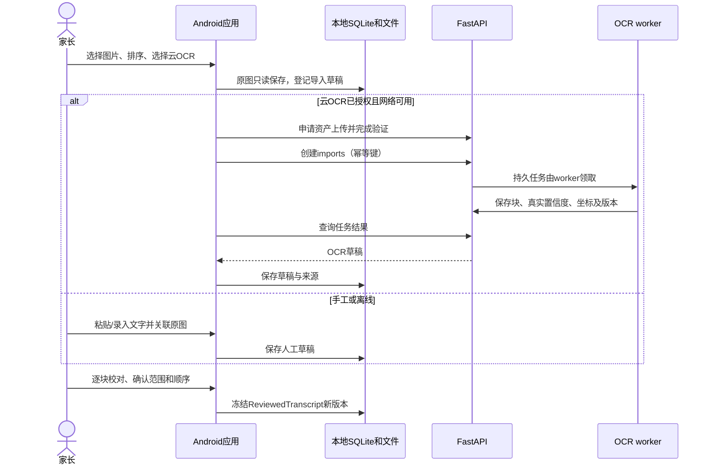

OCR 完成不等于审核通过。云结果到达时如本地用户已编辑，按 baseVersion 展示合并建议，不能覆盖校对。云生成前上传冻结审核版本并再次检查 required 确认状态。

### 27.2 课程生成与发布

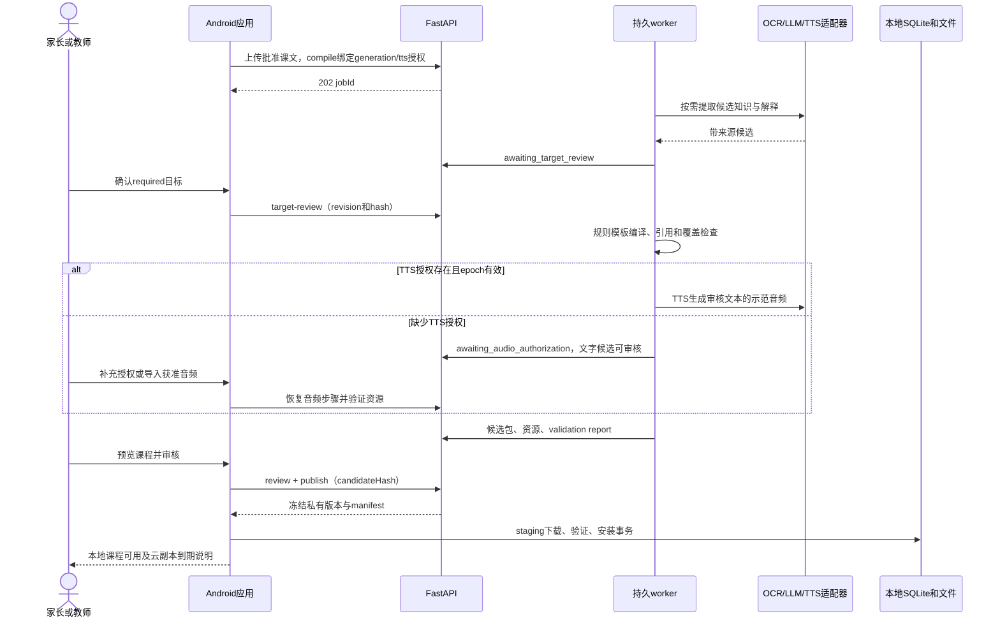

publish 只建立私有包版本；“public”不在 V0.1 接口参数内。发布响应丢失时按原幂等键或包版本查询；不重复审核生成另一份相同版本。

### 27.3 七阶段学习与断点续学

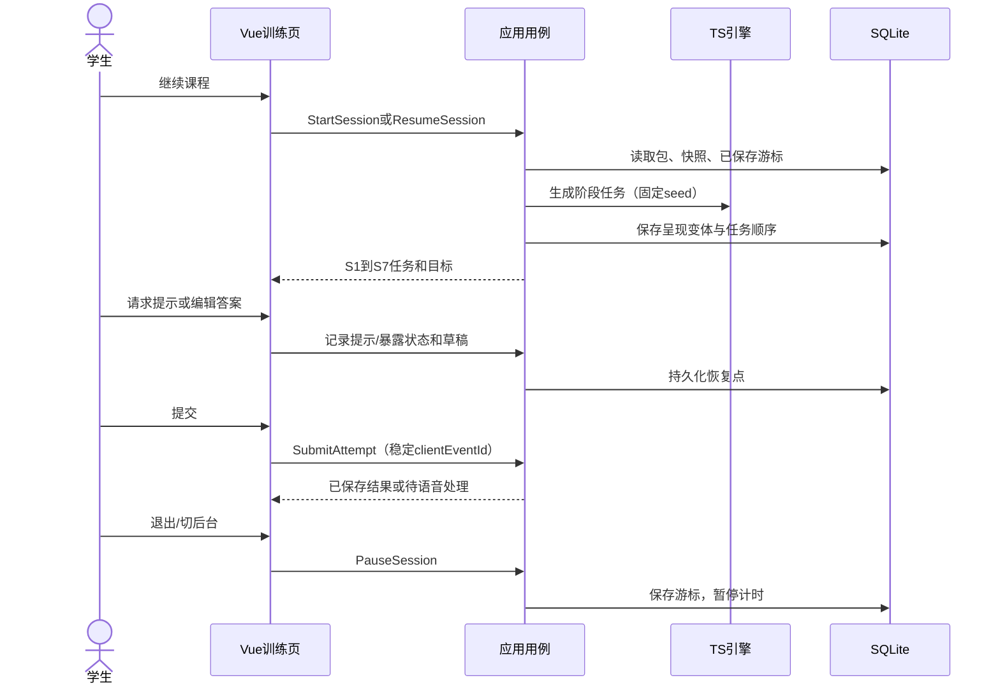

一次题目呈现锁定 evidenceFamily、变体、响应模式和题干资源；恢复不得换题来“刷新”题族资格。学习完成与跨日掌握分开显示，S4/S5 验证不足可为任务完成待复核。

### 27.4 本地确定性评分事务

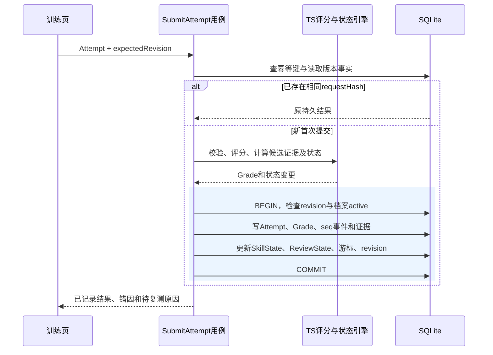

同 clientEventId 不同 requestHash 是冲突，不能悄悄覆盖首答。事务失败不显示“已记录”，本地待提交草稿继续可恢复。

### 27.5 云 ASR、固化观察与人工复核

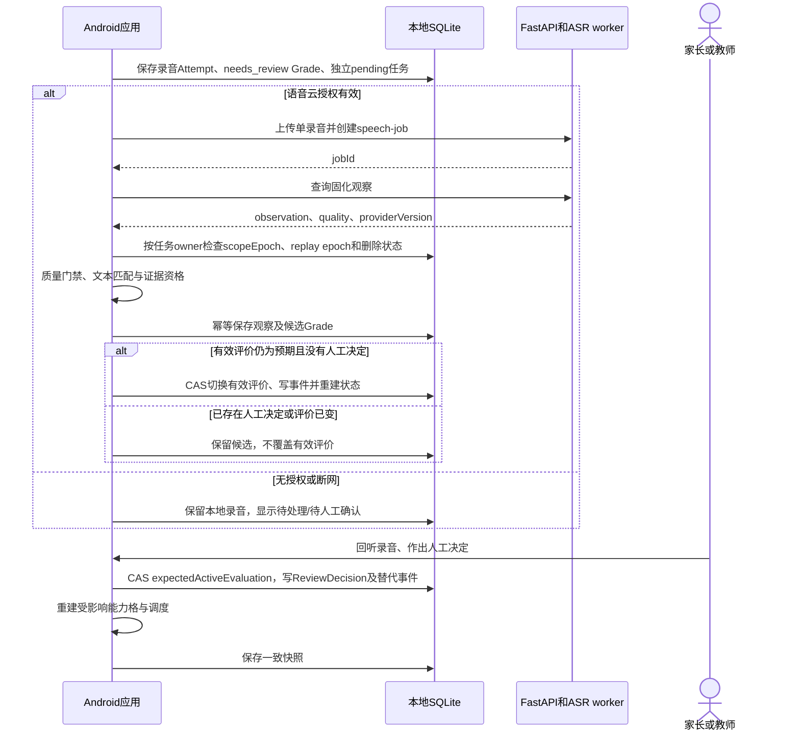

音频任务失败不等于学生失败；无云观察仍可对初始 needs_review Grade 人工评价，仅 ASR 文本匹配不能声明发音达标。录音按期限删除时删除声音及可访问路径，保留最小 recording tombstone 维持关联；冻结观察足以回放旧评分，不能代替再次人工听音。UI 显示“录音已删除，无法回听”，不能用识别文本完成 human_audio_review。

### 27.6 今日复习与延迟复测

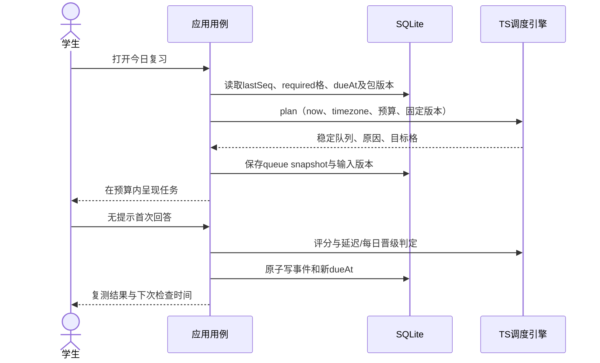

时区切换不重写旧 localDate；24 小时门槛用绝对 UTC 差值。时间疑似倒退或异常跳变时照常练习，暂停授予延迟达标及自动晋级，标记 CLOCK_SUSPECT。按 §23.2 的 clock_rebased 事件校准受影响格后重新安排可信的延迟复测，不追补异常提交资格，不直接改历史时间。

<a id="architecture-28"></a>

## 28. 离线课程、缓存与安装策略

### 28.1 离线能力矩阵

| 操作 | 离线行为 | 恢复联网后 |
|---|---|---|
| 拍照/系统选图、粘贴文字、校对 | 本地保存草稿及范围；OCR可手工替代 | 当前授权有效时继续云OCR/编译 |
| 云生成课程、云TTS | 显示待处理；不伪装已生成 | 显式任务或已授权待办恢复，检查scope epoch |
| 已完整下载的七阶段文字任务 | 正常运行，评分与排程本地完成 | 不自动上传作答 |
| 已缓存示范音频 | 正常播放 | 不为相同hash重新下载 |
| 本地录音与回放 | 可用；语音自动诊断待处理，允许人工确认 | 在授权仍有效且录音未过期时按待办处理 |
| 今日复习、掌握矩阵、历史解释 | 从事实与快照计算 | 不依赖云校验成绩 |
| 新课程包下载 | staging中断保留，旧包可用 | 校验ETag/hash后续传或重下 |
| 导出、删除本地档案 | 本地完成；云删除可为pending | 删除请求最高优先级发送，结果到达不复活档案 |

WebView 静态页面、JS/CSS 与引擎随 APK/AAB 打包；原生文件存储提供离线媒体，不以浏览器 Service Worker 或系统 HTTP 缓存作为唯一课程存储。网络监听只是提示，实际请求仍要处理 DNS、超时、断链和服务错误。

### 28.2 包规范、哈希与签名

包结构为 `lesson.json + manifest.json + assets/`。manifest 包含 manifestVersion、packageId、packageVersion、schemaVersion、canonicalizationVersion、lessonSha256、每个资源的相对路径/hash/byteLength/mime、minEngineVersion、signingKeyId 和来源信任信息，不携带学生数据。所有包 ID/版本只作受校验的不透明标识；实际目录由本地安装器分配，不把外部 ID 直接拼成可逃逸路径。

课程正文哈希细化：以 **RFC8785-JCS-v1** 规范化 `lesson.json` 的 payload，排除 `validation.packageSha256` 字段，保留其余字段和字符串原值后计算 SHA-256；验证时采用完全相同的投影。哈希不做评分用的 Unicode / 缩写标准化。manifest 存该正文hash及资源hash；manifest 签名排除 signature 字段。RFC 8785 定义 JSON 的确定规范化方式，属 Informational 文档；这里只将其选作项目协议。[依据：RFC 8785](https://datatracker.ietf.org/doc/html/rfc8785)

云服务私有包强制使用 Ed25519，`signature={alg:"Ed25519", keyId, value}`，value 为 64 字节签名的无填充 base64url 编码。签名输入是移除顶层 signature 后的整个 manifest 按 RFC8785-JCS-v1 序列化所得 UTF-8 字节，不额外预哈希，不混用 Ed25519ph；被签正文同时包含顶层 signingKeyId，必须等于 signature.keyId。客户端仅从随 APK 分发的信任库或已信任根签名的单调版本更新取得公钥/吊销状态，不能信任包自带的任意公钥。缺签名、未知/已吊销 keyId、算法或 keyId 不匹配均拒绝新安装。常规轮换保留旧验签公钥直到所支持包完成迁移；吊销不静默删学习事实，已安装包按安全更新标为待复核。离线只能使用最后获知的信任状态，不声称能立即获知云端吊销。[算法及测试向量：RFC 8032](https://www.rfc-editor.org/rfc/rfc8032)

用户本地导入未签名包标为 user_import，经相同 Schema、路径、引用、覆盖与权限检查后必须在家长入口逐项审核，才能在私有范围使用；本地来源身份单独记录，禁止其覆盖同 packageId/version 的已签名包或伪装云来源。同来源同 ID/版本同 hash 安装幂等，不同 hash 返回冲突。签名证明来源及完整性，内容正确与教材授权仍须审核。§12 sample 的空 hash 保持为空，不将示例伪装成已签名正式包。

### 28.3 下载与原子安装

```text
读取manifest与客户端支持范围
  → 申请私有下载授权
  → 写staging/<installTaskId>/，不覆盖已用目录
  → 校验总大小、数量、hash、签名、Schema、引用、音频与覆盖
  → 文件搬至immutable packages/<localPackageKey>/<localVersionKey>/
  → 短SQLite事务写安装记录和索引，切换active指针
  → 清理staging和过期未引用资源
```

文件移动与数据库提交不是天然同一事务：使用 file_operations 操作日志记录 planned/files_ready/db_committed；只有 db_committed 的版本可进入学习。若移动成功而数据库未提交，启动恢复时继续验证安装或清除无引用目录；若活跃记录引用文件缺失，标为 corrupt、禁止依赖该资源的任务并提供修复，保留旧可用版本。

断点续传由下载网关支持 Range / If-Range，并将进度绑定不可变对象版本、ETag 和预期 hash；每个 Range 请求都重新鉴权。ETag 变更丢弃局部文件，无 Range 支持则重下，不能拼接两版资源。令牌失效后更新安装凭据，在 scope 撤回或云副本到期时终止下载并清理对应 staging，不能刷新凭据绕过授权。

建议初始课程包限制：解压总量 300 MB、最多 2000 个文件、单资源不超过 30 MB、压缩比不超过 100、路径深度不超过 8；图片仍遵循原 §4 的 20 张及 15 MB 限额。限额为可配置工程初值，M0 以目标设备验证；超限拒绝而非削减正文或音频。

### 28.4 缓存分级与清理

| 资源类别 | 缓存策略 |
|---|---|
| 当前/固定课程的必要示范音频 | pin，不自动驱逐；删除课程时检查共享引用 |
| 未固定、可重新取得的下载资源 | 有上限的 LRU；云副本已过期时须先告知无法直接重下 |
| 原图与审核课文 | 内容资产，不作为普通缓存清理；用户明确删除 |
| 录音 | 按默认7天等选择的TTL删除声音/可访问路径；仅留无声音无路径的关联墓碑，优先于LRU |
| staging、转码临时文件、导出副本 | 任务完成或取消后清理；异常由恢复作业清理 |
| 评分策略、历史包正文与事实 | 普通缓存清理不删除；显式 DeleteCourseData 按§29.4删除相关正文/事实并建立新回放边界 |

建议可驱逐缓存预算 500 MB，预留至少 100 MB 可用空间；录音、源图与固定课程单独统计并提示。磁盘不足先清 staging 和可驱逐缓存，再让用户选择删除，不自动删学习事实。全设备内容去重可以用于不含学生信息的同授权资源，录音不跨档案去重。hash 命中也要验证引用权限。

<a id="architecture-29"></a>

## 29. 错误恢复、事件回放与降级

### 29.1 本地 Outbox

Outbox 只用于云OCR、课程编译、ASR及删除，不是学习事件同步。记录 `taskId、localOwnerId、replayEpoch、authorizationRefs、operation、frozenPayloadRef、inputVersion、inputHash、requestHash、idempotencyKey、state、attemptCount、nextRunAt、expiresAt、cloudResourceId`；frozenPayloadRef 指向受保护的不可变请求快照及固定资产版本，不指向可编辑草稿。发出前重新核验字节/输入 hash、授权和期限。编辑正文/配置产生新版本和新任务，旧待办取消，不能沿用旧幂等键发送新正文；正文不复制到无保护日志。

先在本地事务写业务待办和 outbox，再发网络请求；收到服务器资源ID后持久保存，然后查询结果。重复发送沿用同键；timeout是未知完成状态，不直接新建同任务。默认只有前台 worker；可采用原生后台下载实现，但其读同一持久任务并验证取消/删除状态，不另建不受控队列。

### 29.2 恢复处理表

| 故障点 | 恢复规则 | 学习结果影响 |
|---|---|---|
| 首答落库前杀进程 | 从草稿恢复；同键再提交 | 不算失败，不多次加证据 |
| 事务成功但UI未收到 | 查clientEventId返回原持久结果 | 只算一次 |
| 文件保存中断 | 校验封装/长度/hash；损坏移入清理，不当作有效录音 | 待重录，不记零分 |
| ASR已成功但回包丢失 | 查job结果；同评价键固化一次 | 不重复更新能力格 |
| 重复或迟到云结果 | 校验job持久绑定的owner、授权epoch、replay epoch与tombstone；写回所属档案，UI仅订阅当前档案 | 切换UI档案不丢合法结果；删除/撤权后丢弃；ASR不覆盖人工评价 |
| LLM输出结构错误或引用缺失 | 有限修复，失败后保留审核候选及错误 | 不生成半包替代正式课 |
| TTS部分失败 | 保留成功步骤；只重试缺音频 | 不声明七阶段资源齐全 |
| 数据库busy/磁盘满 | 有限重试或回滚、保留待提交草稿 | 不当作答错 |
| 快照损坏或seq不匹配 | 从有效检查点和后续完整事实重建 | 暂停报告更新，显示恢复中 |
| 事实实体缺失 | 先检查删除清单与replay epoch；当前epoch内非预期缺失才进入修复 | 合法隐私删除不会被当成损坏，不从旧备份补回 |
| 包更新、策略升级 | 新版本并存，历史会话固定旧版本，显式迁移 | 不追溯静默改成绩 |
| 云服务长期不可用 | 手工课文、私有导入包、本地训练/人工语音评价 | 仍可学习已可用内容 |

### 29.3 检查点与重建

建议每 200 个学习事件或关闭会话后保存一个快照检查点，记录 `learnerId、replayEpoch、boundaryId、policyVersion、engineVersion、lastSeq、factsDigest、snapshotHash`。重建先验证检查点匹配当前 ReplayScope、策略、事实和序号，再加载后续事件；不匹配就回到同一 epoch 的更早检查点或当前 epoch 的保留事实边界重建。不能跨隐私删除边界自动回退到旧检查点。checkpoint 数值是工程初值，验证后调整，不改变教学门槛。

旧评分库随历史策略可查，原始 GradeResult 已保存时掌握回放直接消费当时结果；“重新评分”是另一个明确操作。录音 TTL 删除音频文件、该录音专用解密材料（如有）和播放路径，并把 recordings 改为仅含 id、owner、deletedAt、reason 的 tombstone；不级联删除 Attempt、冻结观察或 Grade，因此回放不变，人工听音复核不可再做。人工改判的日去重和权重重新裁定后，可用后续事实重建避免双算。

### 29.4 删除作业恢复

删除本地档案先标 deleting、阻止新学习、取消录音与 outbox，再在独立于 learner 外键的持久删除清单中登记其云 scopes、文件、迁移备份、导出临时副本与待清理资产；清单仅保留范围 ID 和删除所需最小信息。联网时先创建云 tombstone，离线则先持久化等价本地标记；随后按依赖顺序删学习事实/快照、数据库记录、私有文件、临时导出并清理无引用内容。文件清理失败继续重试，完成后移除路径，不因先删表而丢失清理目标。

离线时可先完成本地删除，最小云删除待办作为独立 tombstone 保留到云确认或既定云 TTL 清理有可验证结果；UI 区分“本地已删除，云处理待确认”与“全部完成”。删除任务不引用已删 learner 的强制外键，而持有所需最小 scope 和只允许删除/查询回执的受限凭据；scope 已撤回或过期不阻断该维护权限。

课程提供两个明确命令。`UninstallCourseMedia` 仅释放示范音频等可卸载媒体，显示正文与学习历史仍保留及重新下载是否可用。`DeleteCourseData` 删除选定课程的原图、课文、包正文、练习内容、音频，以及包含该内容/响应或依赖它回放的 Attempt、Grade、观察、人工决定、证据、事件和快照；不能以“历史引用”为理由强留用户要求删除的正文。命令先计算并展示受影响课程/档案；如果同源图片或文本被其他课共用，用户选择的源内容删除范围须覆盖这些引用，或者明确只解除本档案的课程关联并保留其他获准拥有者的资产，不能把解除关联显示为物理删除。

DeleteCourseData 在停止受影响提交后创建可恢复删除任务，先落 tombstone 并登记删除集合，再删除相关事实/文件、取消依赖 outbox，清除包含这些事实的旧备份/检查点；保留事实的稳定实体 ID、原事件时间和原排序依据不改写，原 seq 不重用。完成后创建新的 `ReplayScope { epoch, boundaryId }` 与 `PurgeBoundary`，记录 removedPackageRefs、retainedEventIds 及事实摘要；从保留事件引用的完整事实重新计算所有受影响的掌握格、复习和队列，最后原子切换档案当前 ReplayScope。删除边界不计作学生失败，也不把边界声明的序号空洞视作遗失事实；后续回放由保留清单与边界后本 epoch 新增事件组成，禁止回退到更早 epoch 补数据，保留清单内部未声明的缺失仍报错。重建期间相关报告显示处理中，云迟到结果必须匹配创建时的 epoch/boundaryId，失配则丢弃。最小删除摘要不保留题文、响应或课程标题；如用户要求只保留匿名汇总，明确标注不可重放。

云端删除控制清单写入独立持久控制存储，含单调 controlLogSeq、范围 ID、epoch、删除/到期时间及状态，不含正文。业务数据库恢复必须先取得比备份更新的清单并应用过滤；清单缺失或新旧水位无法确认时禁止正文读取及 worker 处理。tombstone 至少保留至所有可能恢复的备份窗口、未完成作业及请求凭据窗口结束，之后按最小化策略清理。设备内自动恢复同样先应用独立删除日志；不再使用含已删数据的迁移备份。用户自行复制至应用之外的导出文件无法由应用保证远程擦除；导入旧导出时必须核对本机已有删除清单，检测到冲突则拒绝自动恢复并清楚提示删除范围，不能静默复活。

<a id="architecture-30"></a>

## 30. 安全、儿童隐私与授权实现

本节为原 §15 的技术落实建议，沿用其保存期限及私有教材边界。上线的法律适用与供应商合规审核仍按原文处理，本次没有扩大可分发或可收集的数据范围。

### 30.1 威胁与控制映射

| 威胁 | 控制措施 | 可验证证据 |
|---|---|---|
| 任意用户访问别人的任务或资源 | 每路由和worker检查principal/scope归属；正文经逐请求鉴权网关 | 越权接口、下载与任务消费返回拒绝 |
| WebView脚本调用任意原生能力 | 静态本地页面、严格CSP、外链用系统浏览器、插件窄接口 | 恶意富文本不能运行JS或访问路径 |
| 课程/ZIP目录穿越与解压炸弹 | 规范化路径、拒绝绝对路径/.. /符号链接、流式限额 | 攻击fixture被拦截，已有包保持可用 |
| OCR提示注入影响生成 | 教材为不可信数据；模板隔离、结构输出、来源lint、无工具权限 | “忽略规则”不会改权限/正文或上传其他文件 |
| 声音与教材泄漏 | 最小上传、私有对象、TTL、日志脱敏、供应商不训练约束 | 日志扫描、资产过期、删除回执 |
| 客户端或供应商密钥泄漏 | APK无供应商密钥；短期令牌、受限刷新凭据、服务端秘密管理 | APK与构建产物扫描及撤销演练 |
| 同设备档案串读 | Repository限定learnerId、复合外键、UI切换清空状态 | 档案A不能读取B录音/报告 |
| 撤权后的队列仍上传或写回 | scope epoch在排队、执行及结果事务中检查；撤回与提交用同一scope锁 | 撤权/提交竞态、迟到对象清理与下载拒绝测试 |
| 自动化任务耗尽配额 | 逐principal/步骤限速、输入限额、生成预算、供应商熔断 | 429、预算门禁且不丢本地草稿 |

### 30.2 本地加密与凭据

私有目录依赖 Android 沙箱保护；APK中的JS不能含服务商秘密。刷新凭据和主加密密钥由原生安全存储封装；Android Keystore 支持保护密码密钥，实际硬件能力按设备核验。[依据：Android Keystore](https://developer.android.com/privacy-and-security/keystore)

建议首版通过经验证的加密SQLite适配方案保存敏感库，录音及含个人信息导出采用认证加密；具体 SQLCipher/加密插件与许可证在 M0验证并锁定，标准SQLite/WAL本身不提供这种数据加密。密钥不放 Preferences、localStorage 或源码。若目标插件无法稳定支持加密及恢复，必须记录风险并调整交付范围，不能声称“数据已加密”。

Android 自动备份规则建议排除学习数据库、录音、密钥材料、临时课程与导出；V0.1跨设备备份只走监护人明确的本地导出导入。密钥丢失不绕过加密，提示无法解密并提供已授权导出恢复路径。共享设备家长 PIN用于角色入口，不作为严格身份或磁盘加密强度保证；限制尝试次数并支持设备级身份验证作为后续增强。

### 30.3 细粒度同意与撤回

本地 consent scope 至少拆分 `cloud_ocr、cloud_generation、cloud_tts、cloud_asr、recording_retention_extension`；每项记录目的、传输字段、供应商策略版本、保留期限、grant/revoke 时间和epoch。操作前显示将上传的内容；仅选择云OCR不授权上传儿童录音。

客户端 scopeId 对应一种具体处理用途与本地档案，云端只见不含 learnerId 的处理 scope；默认不把不同孩子录音混入同 scope。编译的 generation/tts 授权分别绑定，OCR 授权不隐含后两者；每个步骤校验有效 grant、输入种类、目的及 epoch。客户端本地同意勾选、家长 PIN 或自报 reviewedByRole 都不替代安装凭据身份验证；试点凭据签发使用 §21.2 的运营单次 enrollment token。

撤回停止后续处理请求和队列；服务端与结果接纳事务争用同一 scope 锁并增加 epoch，下载网关立即拒绝后续正文请求，正在进行的流尽力终止。已发出的上传地址不能假定瞬间吊销：其只能写 staging，撤回后 complete 与后续处理均拒绝，迟到对象清理；供应商调用尽力取消，迟到结果不接纳。删除与回执查询使用独立受限维护权限继续执行。处理地域或提供方改变需新的策略确认，不能默默跨区域。遥测默认只发不含正文的操作错误统计，传输目的仍需告知；不采集声纹、位置、广告标识或学校班级。

### 30.4 删除与期限执行

TTL 清理同时覆盖对象的所有版本、未完成上传、转码副本、OCR/ASR 结果、数据库正文、provider 侧缓存、worker staging 和临时地址。诊断/用量信息按默认 7 天清理，正文不得混在 audit 里永久留存。云默认 24 小时 TTL 在根处理任务 accepted 时写 retentionDeadline，所有派生步骤继承且不得顺延；API、worker 和下载网关实时禁止过期使用，清理作业执行物理删除并记录时间。部署必须验证供应商删除与所有对象版本清理时限，不能把禁止访问当作已物理删除。

删除指标区分本方删除、供应商确认、未知/失败；供应商不能满足不训练与保留约束则不启用其适配器。云工作数据库/对象备份恢复先应用 §29.4 独立删除控制清单及到期过滤，临时正文不得以备份名义延长保留期限；清单不可用时关闭正文访问而不是跳过过滤。§15.3 的 30 天云备份仅为后续自愿学习备份选项，**不适用于本版临时 OCR/ASR 内容**。本地录音 TTL 保留的关联墓碑不含声音和路径，整档案删除仍删除这些墓碑。

<a id="architecture-31"></a>

## 31. 部署、配置、运维与发布

### 31.1 环境与最小部署

| 环境 | 拓扑与数据 |
|---|---|
| 本地开发 | Android模拟器/真机 + Vue预览；FastAPI、worker、PostgreSQL、私有对象服务可用Compose；假供应商默认开启 |
| 联调/预发布 | 与生产一致的协议、存储权限和TTL；仅合成/已授权样本，不复制真实学生库 |
| 初期生产 | HTTPS入口/反向代理、API容器、worker容器、PostgreSQL、私有对象存储、秘密与监控设施 |

推荐从模块化单体和一个worker进程开始，按供应商并发配额设独立OCR/TTS/ASR/生成并发数；LLM和TTS长任务不阻塞ASR结果交付。API无进程内业务状态，扩容时仍以数据库租约和幂等键协作。首版不要求 Kubernetes、Redis 或消息总线，容量确需增长时再新增ADR。

### 31.2 配置与发布单元

| 发布单元 | 固定或可配置内容 |
|---|---|
| Android APK/AAB | Web资产、TS引擎、原生插件、支持schema/scorer列表、签名公钥 |
| API镜像 | OpenAPI、安装凭据兑换/轮换、鉴权/授权、下载网关、错误映射、接口版本、Schema校验 |
| worker镜像 | 编译器、模板、适配器、prompt、转码工具、生成门禁 |
| 数据库迁移 | 本地schema编号；服务端Alembic revision；回滚/恢复说明 |
| 规则与课程 | 已冻结policy/template/package版本；不靠修改全局配置改变历史 |

服务端配置包括DATABASE_URL、OBJECT_STORAGE_ENDPOINT、处理区域、上传限额、任务租约、TTL、各provider超时/并发/预算、授权策略版本；秘密由运行时注入且禁止输出。应用只含API base URL与公开验证材料；开发HTTP仅在受限开发构建使用，生产只用HTTPS且不允许明文回退。

依赖清单、lockfile、SBOM与许可证审核进入交付；本文不指定未经验证的“最新版本”。Android最低/目标SDK、WebView版本、Java/Gradle组合、Node/Python版本及插件矩阵列入兼容报告。关闭生产WebView调试，Android应用签名密钥独立保管并有恢复流程。

### 31.3 发布与回滚流程

```text
契约/核心夹具 → 构建锁定依赖与扫描 → 假供应商联调
  → 真机离线/恢复/音频验证 → 预发布完整课程审核
  → 服务端兼容迁移 → worker/API发布 → Android小范围发布
  → 观察门禁 → 扩大范围
```

服务端先支持新旧接口，再发布客户端；课程包声明 minEngineVersion，旧端不能导入不支持模式。服务回滚镜像不回滚用户事实；数据库使用兼容迁移或恢复方案。客户端数据库已升级时，不能直接装一个不认识新schema的旧APK；提供兼容修复版或经用户确认的数据恢复流程。

### 31.4 运维目标与监测

| 指标 | 监控与动作 |
|---|---|
| API成功/错误率、p95延迟 | 分鉴权、验证、创建任务、查询任务，不混入供应商长任务 |
| 队列等待、过期租约、重试次数 | 超限告警，暂停接收超预算生成任务，仍允许取消和删除 |
| 每步骤耗时与成本 | OCR/LLM/TTS/ASR分别统计，按principal限额 |
| 不可评分率 | 语音quality按设备授权统计；只用于选择降级，不推断发音成绩 |
| 内容发布阻断原因 | 引用、覆盖、音频、授权问题定位至候选包 |
| 删除与TTL滞后 | 提前告警，过期结果不可读取；供应商失败需要追踪 |
| 本地事务/恢复错误 | 默认不传作答正文，仅匿名错误码和版本；按告知规则采集 |

建议初期健康目标：不含外部供应商的轻量API p95 <500ms，创建任务不等待生成完成；这是预发布要验证的目标，不是已达成SLA。原本地评分/队列/训练页目标沿用 §16.3。云语音/生成时延按提供方实际样本报告，不编造固定秒数。

API `/health/live` 只验证进程；`/health/ready` 检查必要存储与数据库；worker监测最近心跳与领取任务时间。关联trace使用requestId/jobId，日志不得含课文与声音。建议元数据恢复目标RPO≤24小时、RTO≤4小时，仅用于仍允许保留的配置/必要元数据，临时正文24小时期限优先，不为达成RPO扩大备份保留。

<a id="architecture-32"></a>

## 32. ADR：主要架构决策记录

以下 ADR 为 **1.0.4 文档设计基线（2026-10-11）**，用于指导实施；不是供应商合规签收、插件兼容确认或试点发布批准。M0 补实际验证证据、负责人和版本；失败时以新 ADR 明确变更，不把“待验证”当作架构完全未定。

| ADR | 决策与理由 | 代价/替代方案 | 重新评审触发 |
|---|---|---|---|
| ADR-001 | 本地优先、云只加工内容/语音，保证已下载课程离线学习 | 需本地迁移与恢复；全云模式离线和隐私成本更高 | 明确新增跨设备学习同步需求 |
| ADR-002 | Android用Vue 3/Capacitor，复用TS规则和Web界面 | 需原生音频/SQLite桥接及真机测试；原生UI是可比较方案 | WebView交互/插件无法达到验收 |
| ADR-003 | 无框架TS学习引擎，评分与掌握同版本运行 | 必须隔离I/O并存旧策略；Python实现只消费契约 | 新平台无法运行TS且有等价性证明 |
| ADR-004 | SQLite事实表+事件+可重建快照 | 比简单总分表复杂；事件不含全部实体需事实装载 | 数据量/恢复时延超目标 |
| ADR-005 | FastAPI模块化单体+独立worker，不拆微服务 | 故障隔离依靠进程和并发池；扩容边界较粗 | 多团队或吞吐需要独立扩展 |
| ADR-006 | PostgreSQL任务表、租约与fencing，不使用进程内长任务 | 需任务领取和恢复逻辑；成熟任务框架可后续替换 | 队列吞吐/编排复杂度明显增加 |
| ADR-007 | 模型生成候选、规则编译、人工审核后发布 | 完全自动发布更快但不满足原文可靠性门禁 | 具备独立内容质量证据且产品批准改变范围 |
| ADR-008 | ASR文本匹配是诊断，口语掌握需人工/验证评测 | 人工有成本；不能提供未经证明的音素分 | 儿童样本专用评测达到独立门槛 |
| ADR-009 | 不可变私有课程版本、资源hash、Ed25519签名及鉴权下载网关 | 需公钥轮换/吊销、网关流式传输及安装恢复 | 资源规模增长或外部授权渠道加入 |
| ADR-010 | 单设备多档案隔离，不开放学习事件同步API | 无实时跨设备续学；导出/导入需显式操作 | 用户明确要求且有冲突/删除同步协议 |
| ADR-011 | 按用途scope+epoch、同锁提交与撤权、独立删除控制清单 | 需所有执行边界检查、回放epoch及供应商删除配合 | 新供应商/处理地域/保留目的改变 |
| ADR-012 | Schema为内容契约单一来源，OpenAPI生成云SDK | 需要生成器与一致性检查；双手写类型容易漂移 | 原Schema无法表达新增规范并经版本评审 |

每条基线补 owner、实施状态、相关 PR 与验证报告；负责人签收只在实际完成时填写，不虚构已批准记录。被替换的 ADR 不删除，注明新 ADR 与迁移影响。

<a id="architecture-33"></a>

## 33. 模块依赖与代码目录

### 33.1 依赖规则

| 模块 | 允许依赖 | 不允许依赖 |
|---|---|---|
| contracts | JSON Schema与纯类型/验证生成物 | Vue、Capacitor、数据库、供应商SDK |
| learning-engine | contracts、经锁定纯算法/时间规则 | UI、HTTP、文件、SQL、Python服务 |
| Android application | contracts、engine、ports | 具体供应商SDK；直接把云输出当成绩 |
| Android infrastructure | ports、contracts、原生插件、api-client | 重写评分/掌握规则 |
| Vue presentation | application facades、view models、composables | SQL、provider SDK、secret |
| api-client | OpenAPI生成物、transport port | 本地掌握数据自动同步 |
| Python domain/compiler | contracts的Schema、模板、ports | Android UI、运行时学习数据库 |
| FastAPI routers | application、DTO、认证依赖 | 直接执行长生成或在路由拼题 |
| Python adapters/repositories | ports、提供方SDK/存储库 | 决定正式掌握度、越过发布门禁 |

CI依赖规则拒绝环和跨层import；端口类型放低层，启动组合根注册具体实现。UI只调用应用facade，应用服务通过注入的UnitOfWork使用Repository。跨语言共享Schema及fixtures，不把两个语言“同名类”当作等价证明。

### 33.2 建议仓库结构

```text
lingonest/
├─ apps/
│  └─ android-client/
│     ├─ src/
│     │  ├─ pages/                 # 家长、导入、训练、复习、报告
│     │  ├─ components/           # 题型呈现与媒体控件
│     │  ├─ composables/          # 录音UI、生命周期与任务状态
│     │  ├─ stores/               # Pinia视图状态
│     │  ├─ application/          # 提交、改判、课程安装、删除用例
│     │  ├─ ports/                # Repository、UoW、Media、Clock
│     │  ├─ infrastructure/
│     │  │  ├─ sqlite/            # 查询、事务与迁移
│     │  │  ├─ files/             # staging、hash、资源注册
│     │  │  ├─ native/            # 录音、安全存储、选择器适配
│     │  │  ├─ cloud/             # 请求、轮询、outbox
│     │  │  └─ recovery/          # 文件日志、删除与快照恢复
│     │  └─ bootstrap/            # 注入与组合根
│     ├─ android/                 # Android项目和窄原生插件
│     ├─ capacitor.config.ts
│     └─ vite.config.ts
├─ packages/
│  ├─ contracts/
│  │  ├─ schemas/                 # 包、Attempt、Grade、事件等
│  │  ├─ generated/               # TS类型与校验器
│  │  └─ fixtures/                # 合法/非法结构与版本迁移样本
│  ├─ learning-engine/
│  │  └─ src/
│  │     ├─ normalization/
│  │     ├─ scoring/
│  │     ├─ evidence/
│  │     ├─ mastery/
│  │     ├─ scheduler/
│  │     ├─ session-policy/
│  │     └─ replay/
│  └─ api-client/                 # 由OpenAPI生成，不手改生成物
├─ services/
│  └─ cloud/
│     ├─ app/
│     │  ├─ main.py
│     │  ├─ routers/              # imports、jobs、packages、speech等
│     │  ├─ application/          # 授权用例、工作流、发布门禁
│     │  ├─ domain/               # 内容编译、模板、目标覆盖
│     │  ├─ ports/                # 四类处理与存储端口
│     │  ├─ adapters/             # OCR、LLM、TTS、ASR具体实现
│     │  ├─ repositories/         # PostgreSQL与对象元数据
│     │  ├─ workers/              # 领取、租约、步骤、清理
│     │  └─ security/             # 身份、scope、限速、脱敏
│     ├─ migrations/             # Alembic
│     ├─ schemas/                 # 共享Schema打包副本，校验hash
│     └─ tests/
├─ content/
│  ├─ gold/                       # 原图金标准及审核记录
│  ├─ templates/                  # 版本化受控出题模板
│  └─ sample-packages/            # sample与complete分目录
├─ tests/
│  ├─ golden-scoring/
│  ├─ replay-and-migration/
│  ├─ contract/
│  ├─ fault-injection/
│  └─ device/
├─ deploy/                        # 容器、环境模板、监控与恢复说明
├─ docs/                         # 产品、设计、架构与技术选型说明
│  ├─ architecture/
│  ├─ adr/
│  └─ api/
├─ issues/                       # review、问题分析、修复与验证报告
│  └─ acceptance/
└─ workspace配置、lockfiles、许可证与版本清单
```

目录树为实施结构，**本次没有创建上述应用仓库**。docs/ 与 issues/ 及其子目录的 Markdown 均按 `<xxxxx>_<YYYYMMDDHHMMSS>_<主题>.md` 命名；两目录各自扫描已有编号、独立递增，时间采用 Asia/Shanghai，已编号文件后续编辑保留编号/时间。验证报告归 issues/，设计说明归 docs/，引用优先相对链接。工作目录与部署目录不存生产秘密；真实材料与 gold 样本必须在其授权范围内受控访问。

<a id="architecture-34"></a>

## 34. 实施里程碑、先后依赖与交付物

原 §17 的约6周安排保留。本节将架构任务映射到原M0～M6，属于建议计划；没有已验证插件/供应商时不能保证6周完成。可以先完成无云文字闭环，再接入内容和语音，但最终发布仍遵循原范围与门禁。

| 原里程碑 | 架构工作及依赖 | 可审查交付物 | 退出条件 |
|---|---|---|---|
| M0 契约与基线 | 选真机、验证SQLite/录音/安全存储/Ed25519；确认schema2、依赖版本、运营凭据发放与供应商策略 | ADR实施清单、数据字典、兼容矩阵、核心fixtures、OpenAPI初稿 | 无阻断插件问题；单次凭据兑换及双用途授权可验证；原图基线及required目标有审核负责人 |
| M1 导入校对 | M0后建设原图/草稿持久化、OCR端口、坐标、冻结版本、outbox | 真机导入校对流程、OCR假/真适配器、版本冲突样例 | 杀进程不丢校对；未确认正文不能进入正式编译 |
| M2 课程编译 | 目标审核、模板、TTS、持久worker、覆盖lint、私有发布及安装 | 完整候选包、manifest、Schema校验报告、审核记录 | required格覆盖/资源齐全；sample被拒绝发布 |
| M3 训练与评分 | TS评分库、七阶段运行、提示日志、首答幂等、音频与录音原生端口 | golden-scoring报告、可离线训练APK、呈现变体与恢复记录 | 本地评分金标准一致；事务失败不假报保存 |
| M4 状态与调度 | 原子事件更新、证据、回放、人工改判、队列与跨日规则 | 回放/改判/迁移报告、能力矩阵、dueAt解释 | 重复提交无双算；封顶失败可见；24小时门槛准确 |
| M5 语音与安全 | ASR观察、质量门禁、撤权/删除、TTL、缓存清理与发布运维 | 真机语音诊断报告、删除演练、泄漏扫描、预发布环境 | 不以ASR宣称发音掌握；离线/权限拒绝/迟到回包正确 |
| M6 授权试用 | 全部阻断门禁通过后小范围试用与内容复核 | 按能力的延迟复测报告、已知限制、候选发布说明 | 无阻断缺陷；隐私与内容审核签收；不虚报学习效果 |

实施关键路径：`契约与原生存储验证 → 本地首答事务与引擎 → 完整包编译与安装 → 证据/复习 → 语音诊断与删除演练 → 小范围试用`。OCR与模板可在契约冻结后分别推进，但正式发布必须等待内容与资源门禁；引擎可先使用明确标注sample的测试夹具。

M0 必须验证并锁定：最低/目标 Android 版本、典型与低端真机、插件和加密能力、课程规模上限、供应商处理区域、审核负责人、运营 enrollment token 发放渠道、私有导入来源授权、签名键轮换及导出密码策略。凭据协议、签名算法、处理边界和删除规则已在本版明确；供应商与具体依赖版本须实测，不填入虚构服务信息。

<a id="architecture-35"></a>

## 35. 架构验收标准与发布门禁

### 35.1 新增验收矩阵

以下 **A01～A34 为架构验收要求**，实际开发后执行；本次文档修订不代表已运行应用测试。T01～T30 与课程清单继续有效。记录设备、依赖版本、输入 fixture、期望结果、实际结果及证据路径。

| 编号 | 验收场景 | 可检查标准 |
|---|---|---|
| A01 | 原生能力验证 | 目标真机上SQLite事务、录音/回放、切后台、安全存储与权限流程均通过；Web替身不代替真机 |
| A02 | 引擎隔离 | 引擎依赖图没有Vue/Capacitor/HTTP/SQL；Node与目标WebView金标准分数及错误定位一致 |
| A03 | 首答幂等 | 同clientEventId并发重发100次，Attempt只有1份、有效评价只有1份、状态仅更新一次 |
| A04 | 同键不同请求 | requestHash不同返回冲突，原首答及历史结果保持不变 |
| A05 | 档案和包外键 | 档案A的session不能写档案B Attempt；错误包版本/练习引用被拦截 |
| A06 | 事务中断 | 在每个持久步骤注入进程终止，恢复后完整提交或完整回滚，不留半份证据 |
| A07 | 完整离线闭环 | 飞行模式冷启动已安装课程：文字任务、评分、队列、示范及录音回放可用，云任务状态诚实显示 |
| A08 | 校对恢复与冲突 | OCR迟到不覆盖本地编辑；baseVersion冲突可定位合并；杀进程恢复已保存草稿 |
| A09 | worker租约与fencing | 同步骤被接管后旧worker写回被拒；API/worker重启不丢已接受任务 |
| A10 | 编译检查点 | 模型、TTS超时后从有效步骤恢复；课文更改使后续输出失效，不混用旧音频 |
| A11 | 发布门禁 | sample、未审核正文、引用断裂、缺required资源、目标覆盖不足均不能发布 |
| A12 | 包完整性 | 资源改1字节、manifest签名无效、未知schema/scorer、路径穿越均被拒，旧可用包保留 |
| A13 | 原子安装恢复 | 文件移好但DB未提交、DB已提交但清理未完成两类故障都可恢复，无半包进入学习 |
| A14 | 待复核与不可评分 | 音频首答原子创建needs_review/null Grade；无云也可人工评价；ASR静音/低置信/超时不生成0分；不宣称发音达标 |
| A15 | 人工改判 | 旧证据替代后回放与从头计算一致；日封顶、最近失败、dueAt均重算，无双算 |
| A16 | 时间与提示门槛 | 跨午夜2分钟、系统倒退、提示后正确、重排选项均不能伪造延迟或独立证据 |
| A17 | 撤回授权 | 撤权后待办不发新正文/录音请求，服务端拒绝旧epoch，迟到结果不落库 |
| A18 | 归属与对象授权 | 非本人任务、资产、scope、网关下载与发布入口均不可访问；每次Range重验；到期/撤权正文请求被拒 |
| A19 | 删除闭环 | 本地表/文件/快照/临时导出/云副本与供应商状态可追踪；恢复备份不复活tombstone数据 |
| A20 | TTL与日志 | 录音按选择期限，临时云正文按默认最长24小时，日志按默认7天；日志扫描无课文/声音/首答正文 |
| A21 | 迁移与回滚 | 合法旧库升级不丢事实；失败保存备份；旧包可解释；不支持新schema的旧客户端拒绝打开 |
| A22 | 空间与缓存 | 磁盘满提交回滚、可恢复；清理不删除固定课程必要音频、原图或回放事实 |
| A23 | 性能 | 按§16.3本地目标验收；包含1000题包、长期事件与多档案样本；报告具体设备，不用桌面代替 |
| A24 | 真实授权试用 | 分能力记录即时及延迟复测；报告语音不可评分/误判和交互观察，样本不足不作效果承诺 |
| A25 | 分用途编译授权 | 仅generation授权能完成文字候选且不调用TTS；补tts授权后续跑；任一旧epoch提交被拒 |
| A26 | 上传不可变与网关撤回 | complete后反复使用旧上传URL只能改变staging，verified字节/hash不变；撤回后网关及Range拒读，staging清理可追踪 |
| A27 | Outbox冻结输入与跨档案返回 | 排队后编辑正文不改变旧请求hash；同键不同内容拒绝；A任务返回时切到B仍只写A，已删owner不写回 |
| A28 | 人工评价CAS与迟到ASR | 离线音频可人工评价；两个复核并发仅一个CAS成功；之后ASR仅留候选，当前有效评价/证据不被覆盖 |
| A29 | 录音TTL与课程隐私删除 | 录音到期无路径/声音但外键有效且回放不变；DeleteCourseData删除正文及相关事实，剩余事实新epoch重建不补回已删内容 |
| A30 | 删除恢复与竞态 | 每个删除阶段杀进程可恢复；撤回与结果提交并发仅产生符合锁顺序的状态；独立删除清单缺失时备份恢复禁止正文访问 |
| A31 | Ed25519互通与来源隔离 | Python/Android对同一JCS fixture验签一致；错key/算法/签名被拒；未签本地包需审核且不能覆盖云包同ID/版本 |
| A32 | 试点安装凭据 | 单次enrollment token仅兑换一次；过期/已消费拒绝；refresh轮换/撤销有效；APK无共享secret，本地PIN不能签发云身份 |
| A33 | 处理期限继承 | 重试、人工等待、TTS、发布及缓存均不延长根retentionDeadline；期限后无正文读取/新处理，所有副本及对象版本删除有回执 |
| A34 | schema2及删除边界迁移 | 旧结构不得仅改版本号导入；已迁移事实有完整引用；旧epoch检查点、云回包和旧导出不能静默复活删除集合 |

### 35.2 测试层次与最小有效证据

评分和调度采用金标准夹具、边界样本与性质检查；契约使用合法/非法包和跨版本fixture；事务、worker、安装和删除用故障注入验证恢复；音频、WebView、权限及生命周期必须真机验证。UI以关键流程检查为主，不堆积镜像实现的低价值测试。

首次发布最低证据：T01～T30 相关范围无阻断项，A01～A23、A25～A34 通过或有明确记录的产品范围缩减且界面如实标注；隐私删除、授权、来源验签和首答一致性不得仅以注明风险代替验证。正式完整课程审核清单签收，依赖/安全与供应商约束已核验，A24 小规模试用没有阻断安全或内容问题。若 ASR 未达到门槛，可发布明确的人工评价路径，不能声称自动发音评测已完成。

### 35.3 交付签收表

- [ ] 架构ADR、边界、目录与依赖规则已采纳并与代码对应。
- [ ] 共享Schema、OpenAPI、生成类型、migration、规则版本及fixture同版归档。
- [ ] 所有required知识与能力格有内容、训练、验证族及媒体审核证据。
- [ ] 本地事实、幂等事务、事件回放、改判、离线和原子安装经过故障验证。
- [ ] OCR/LLM/TTS/ASR供应商能力与数据处理约束经过实际核验。
- [ ] 授权、撤回、TTL、日志与本方/供应商删除演练有可审查记录。
- [ ] Android真机兼容、性能、迁移和权限报告齐全。
- [ ] 运行手册、备份恢复、签名密钥、配额与已知限制已交接。

<a id="architecture-36"></a>

## 36. 本次修订记录与交付说明

### 36.1 修订记录

| 文档修订 | 日期 | 内容与状态 |
|---|---|---|
| 1.0.2，产品V0.1 | 2026-10-08 | 产品、七阶段学习、评分规则、原图引用与结构示例 |
| 1.0.3，产品V0.1 | 2026-10-09 | 增加第20～36节架构、数据、契约、可靠性、安全与验收设计 |
| 1.0.4，产品V0.1 | 2026-10-11 | 合并修订正文；解决朗读证据、状态、延迟复测、人工评价与回放冲突；统一schema2.0.0、知识作用域、云授权、删除和包信任协议 |

第0～19节已随架构同步修订，旧版“原文逐字节保留”声明和旧附件哈希不再适用于当前文件。课文引文及三张图片的内容保持原有来源边界，评分与工程设计则以本版统一规则为准。修复记录与文档验证结果见 [issues/00001 设计复审修复与验证记录](../issues/00001_20261011111714_设计复审修复与验证记录.md)。

### 36.2 文件与实施交付

设计主文档为 UTF-8 Markdown，图片位于相邻 `assets/unit1-lesson1/`，相对路径可离线查看。图片未旋转、重绘或重新压缩，其 SHA-256 见 §12。当前仓库没有 ZIP 交付物；需要分发目录时应同时包含文档与 assets，并重新生成交付清单。

实施顺序为：冻结真机兼容与依赖 → 交付 Schema、规则夹具及本地首答事务 → 用单课完整包打通文字与人工口语评价 → 验证回放、复习、删除及离线 → 接入获授权的自动内容与语音服务。单课闭环的实际工作量用于重估 §17、§34 的建议周期。

代码块是开发契约与核心子集；类型检查和 SQL 约束检查不能代替应用、语音、设备或教学效果验收。完整生产迁移、SDK、服务部署、正式题库与音频仍需按 M0～M6 实现，sample 包继续被正式发布门禁拦截。
