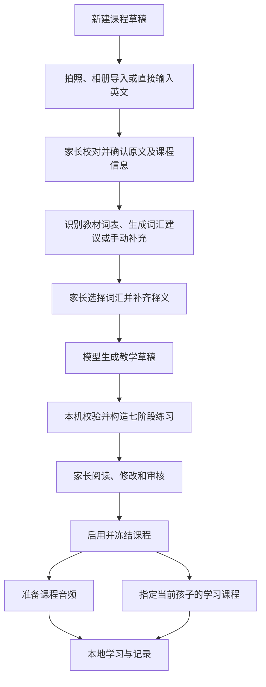

# 课程生成设计回顾

建立时间：2026-10-15 13:56:48（Asia/Shanghai）。回顾基线：工作区应用版本 `0.1.14`，Git 提交 `dbfab12`。

本文以当前代码为依据，汇总课程从教材输入到审核启用的实际设计，说明模型、本机规则和家长各自承担的职责，并标出与最初完整方案的差距。本文为现状回顾，不引入功能或修改既有课程数据。

## 1. 当前方案概览

当前实现是一条由家长控制的本地课程准备流程：先确认原文和重点词汇，再让模型产出有限的教学草稿，本机把草稿编译成七阶段练习，家长审核后启用。课程内容和音频在设备内共享，孩子的学习选择与学习记录分别保存。

核心分工如下：

| 参与方 | 当前职责 | 产物或边界 |
|---|---|---|
| 家长 | 校对标题、教材信息、原文、词汇；审核释义与题目；启用课程并指定孩子 | 内容真实性、难度与答案合理性的最终确认 |
| 识别模型 | 从课文图片提取正文和可见元信息；从词表图片提取词汇 | 可编辑的识别候选，不自动确认 |
| 生成模型 | 建议重点词汇；生成逐段释义、理解题、受控情境应用题 | 结构化教学草稿 `CourseRecipe` |
| 本机课程编译器 | 解析课文、校验草稿、生成练习与知识点引用 | `CoursePackage = { course, exercises }` |
| 学习引擎 | 对选择、排序、拼写和受控短句本地评分；投影学习证据 | 不在作答时调用内容模型判题；口语由家长确认 |
| 原生层 | 图片导入、模型配置、网络调用、SQLite 保存及音频资源管理 | Android 是真实识别和生成能力的运行端 |

源码入口：[课程流程](../src/modes/seven-step/components/CourseManager.vue)、[提示词与桥接](../src/content.ts)、[课程数据与编译](../src/course-library.ts)、[学习引擎](../packages/learning-engine/src/index.ts)。

## 2. 从输入到学习的完整路径



“准备音频”和“指定孩子”是启用后的独立操作。当前代码没有把整课音频齐全作为启用或指定课程的前置条件；需要听示范、听写时，应先准备对应音频。课程文字和已保存音频可用于离线学习，识别、内容生成及 AI 音频生成需要访问配置的服务。

没有孩子档案也能先准备课程；指定学习课程时必须有孩子档案。浏览课程、编辑草稿或给另一门课程准备音频，不改变孩子当前课程。

### 2.1 原文输入与校对

支持直接输入英文，也支持拍摄或从相册导入课文图片。图片分课文与词表两组，每组最多 6 张，可查看、旋转、排序和移除；只有主动点击识别才发送给模型。

课文识别一次返回 `text`、`title`、`subtitle`。正文必须有效；标题和教材信息为可选字段，缺失、类型不符或过长时忽略，不阻断有效正文。提示词要求保留原文顺序、角色和标点，不翻译、不改写，无法识别处使用 `[待校对]`，不凭常识猜测教材信息。

| 现有内容 | 识别结果处理 |
|---|---|
| 标题、教材信息为空 | 自动补全对应字段，仍可手动修改 |
| 标题、教材信息已有值 | 保留原值，有不同建议时提供单独采用按钮 |
| 原文为空 | 自动填入识别正文 |
| 原文已有值 | 单独展示新结果，由家长决定是否替换 |

继续前必须填写标题、勾选原文确认并处理 `[待校对]` 或替换字符 `�`。识别建议和原文确认勾选是界面临时状态，切换课程后不会作为另一门课程的输入。

### 2.2 重点词汇准备

词汇可来自教材词表识别（`photo`）、依据已确认课文生成的建议（`auto`）或手动补充（`manual`）。每条保存词条、中文释义、可选例句、是否选中及来源。

合并按去除首尾空格后的英文小写词条去重。已有词条优先保留；新建议不会自动覆盖已有释义、例句或选择状态。当前不做词形归一，因此 `skill` 与 `skills` 仍是不同词条。

列表默认紧凑显示词条和释义，按项展开编辑。确认时至少选中一条，选中项必须有词条和释义；空白未选词条会被清理。例句虽然保存在草稿中，但当前不直接用于练习编译，也不会传给最终课程生成请求。

### 2.3 生成与审核

最终生成请求只发送解析后的英文段落及选中词汇的词条、释义，不再次发送原图，也不发送孩子档案或学习记录。标题、教材信息和说话人标签没有进入这次提示词；角色信息仍保留在本机课程话轮中。

模型返回的教学草稿只包含三个部分：

```ts
interface CourseRecipe {
  translations: string[];
  comprehension: {
    question: string;
    options: string[];
    answerIndex: number;
    explanation: string;
  }[];
  applications: {
    prompt: string;
    answers: string[];
    explanation: string;
  }[];
}
```

新结果先完成 JSON 解析、教学草稿校验和整课编译，再保存为审核阶段。所有步骤成功后才替换当前记录。家长已修改过的旧草稿，在重新生成失败、取消或保存失败时保留；重新生成成功会整体替换旧教学草稿，包括人工改过的释义和题目。

审核页面按“课文释义、理解题、情境应用”分区阅读，按项展开编辑，另外提供全部学习任务的折叠预览。修改教学草稿会取消审核勾选；启用前需要重新确认，且整课必须可成功编译。原文和词汇的修订通过返回前面步骤处理。

详见[元信息补全](00012_20261015123256_课文识别自动补全课程信息.md)、[词汇界面](00013_20261015124021_重点词汇紧凑列表与按需编辑.md)、[审核界面](00014_20261015125250_课程审核阅读式界面设计.md)。

## 3. 草稿状态与修改规则

持久化状态为 `source → vocabulary → generation → review → published`。前四个是草稿阶段，`published` 表示已审核启用；音频准备不是独立的 `CourseRecord.status`，有自己的资源状态。

| 状态 | 数据含义 |
|---|---|
| `source` | 原文及课程信息尚待确认，允许不完整的词汇草稿 |
| `vocabulary` | 原文已确认，重点词汇尚待确认 |
| `generation` | 原文和词汇已确认，等待生成；`recipe/package` 均为空 |
| `review` | 已有合法教学草稿与课程包，等待家长审核 |
| `published` | 已启用，保存层拒绝对既有记录作内容修改 |

界面的 `viewStep` 只表示正在查看的步骤，`record.status` 表示实际到达的阶段。例如已经到达 `review` 后可以返回生成页，此时仍保存审核阶段的数据，并非降级到 `generation`。重新打开时按持久化阶段恢复，临时浏览位置不保存。

| 操作或实际变化 | 当前处理 |
|---|---|
| 查看已经到达的步骤 | 先保存，保留教学草稿；不调用模型；保存失败则不切换 |
| 修改标题、教材信息或原文 | 若已到达下游，退回 `source`，清空 `recipe/package`，保留图片和词汇，重新确认 |
| 修改选中词汇的词条、释义、例句、顺序或选择集合 | 若已到达下游，退回 `vocabulary`，清空 `recipe/package`，重新确认词汇 |
| 修改未选中词汇内容 | 不使已有教学草稿失效 |
| 修改审核中的释义、题目或答案 | 保持 `review`，重新构造课程包，并取消审核勾选 |
| 仅调整图片引用、顺序或旋转 | 当前不直接使下游失效；图片重新识别并实际改变课程字段后，按字段变化处理 |
| 修改已启用课程 | 界面不提供回退编辑，保存层也拒绝修改；修订需新建课程 |

自动保存采用 600 ms 防抖，同时提供显式保存；确认、导航和请求前也会尝试保存。保存仍受数据校验和写入成功约束，不能把自动保存理解为任何未完成输入都必然已落盘。原文确认和审核勾选不会作为独立审核记录写入快照。

最新规则以[步骤往返与重新生成](00015_20261015130528_课程草稿步骤往返与重新生成规则.md)为准，取代[早期创建说明](00008_20261014152914_课程新建词汇确认与多课程管理.md)中“返回前置步骤即清空生成内容”的旧行为。

## 4. 本机如何构造七阶段练习

### 4.1 原文结构化

`sourceTurns()` 按换行拆分非空段落或话轮，不按教材章节语义拆分。`Name: text` 形式可提取英文角色名，其他行的 speaker 为“课文”。每条生成顺序 ID，并按累计正文长度依次放入最多 A/B/C 三个区块，每块最多 2400 字符；区块是当前的长度分组，不代表模型理解出的场景。

编译时再按英文 `. ! ?` 切句。它是轻量规则，缩写、小数和复杂引号等情况没有专门的语言学处理。后续排序、听写、朗读和回忆都依赖这份分段分句结果。

### 4.2 练习映射

| 阶段 | 来源与当前编译方式 | 评分或确认 |
|---|---|---|
| S1 读懂故事 | 每道模型理解题生成一道选择题 | 本地核对正确选项 ID |
| S2 认识单词 | 每个选中词条生成一道根据中文释义拼写的任务 | 本地规范化后精确匹配词条 |
| S3 搭好句子 | 每个多词原文句生成一道词块排序题，初始词块逆序 | 本地核对完整词块顺序 |
| S4 开口朗读 | 每个实际存在的 A/B/C 区块生成一道录音任务，提供原文及示范文本 | 录音保存后等待家长回听确认 |
| S5 试着回忆 | 每个实际区块生成一道脱离原文回忆的录音任务 | 录音保存后等待家长回听确认 |
| S6 听写句子 | 每个原文句生成一道听写任务，原句作为示范文本与参考答案 | 本地短句评分，编译阈值为 100 |
| S7 换个情境 | 每道模型应用题生成一道受控短句任务 | 本地按预先批准的多个答案分别评分，编译阈值为 100 |

所有练习 ID、题族 ID 和知识点 ID 都带课程 ID 前缀，避免不同课程的记录相互覆盖。排序、朗读和回忆还设置相关的答案暴露目标，使学习引擎能识别看过答案后产生的练习证据。

短句评分会规范化大小写、空白及部分字符，综合词和字符匹配，并检查否定等关键内容；不是模型语义判分。自建课程 S6/S7 当前继承 100 分门槛，不应沿用早期完整方案中的“句子默认 90 分”来描述现状。

若理解题数为 C、选中词条数为 V、原文句数为 S、多词句数为 M、非空区块数为 B、应用题数为 A，则当前总练习数为：`C + V + M + 2B + S + A`。总量由全文和词汇清单直接推导，尚未按教学目标的覆盖矩阵和任务预算筛选。

### 4.3 提示要求与硬校验的区别

| 项目 | 提示词要求或建议 | 程序实际接受范围 |
|---|---|---|
| 原文 | 保留英文、角色、顺序和标点 | 总长 6000 字符以内，最多 60 段；每段含英文、正文不超过 2000 字符；最多三个长度区块 |
| 词汇建议 | 面向小学高年级，最多 30 条，例句引用原文 | 最多 80 条；词条最长 100、释义 300、例句 1000 字符；检查字符及来源等字段 |
| 逐段释义 | 与输入段落逐一对应 | 数量必须等于话轮数，每条非空且不超过 2000 字符 |
| 理解题 | 2～5 道，依据原文 | 1～8 道；每题 2～4 个不重复选项，答案为合法索引；检查字段长度 |
| 应用题 | 1～3 道，明确限定答案范围，不能是开放写作 | 1～8 道；每题 1～5 个非空且含英文字母的答案；检查字段长度 |
| 原文句子 | 用于本地练习 | 最多 80 句，至少有一个多词句以构造 S3 |

因此，提示词要求的年龄适配、事实依据、中文释义质量、应用题是否真正受控、答案语义唯一及例句是否确实来自原文，目前都不能由结构校验保证，仍需家长审核。

JSON 解析接受外围 Markdown 代码围栏，并对 JSON 字符串内误输出的裸换行等控制字符作有限修复；其他语法错误继续拒绝。单次模型文本最多 200000 字符，避免无界解析。

## 5. 模型接入、取消与失败保护

识别与生成分别配置 HTTPS base URL、模型和 Key。识别需要图片输入能力；词汇建议与最终课程生成共用 `generation` 配置。语音服务使用另一套配置，不由内容生成请求隐式触发。

当前 Android 插件直接发送 `POST <baseUrl>/chat/completions`，使用 Bearer 认证和非流式响应。只有一条 `user` 消息；图片请求用文本加 JPEG data URL，纯文本请求用字符串内容。读取 `choices[0].message.content` 后交由前端解析。

实现没有为全部服务统一设置 JSON Schema 或 `response_format`；对 `api.xiaomimimo.com` 有专门适配，增加 JSON object 输出要求并关闭 thinking。其他服务主要依赖提示词和本机校验，兼容性需要按服务验证。

| 保护点 | 当前行为 |
|---|---|
| 并发 | 界面 `job` 和原生 `requesting` 限制同时处理；原生使用单线程执行器 |
| 请求前保存 | 草稿保存失败则不继续发送；已有审核草稿也先保存人工修改 |
| 超时和大小 | 连接超时 15 秒、读取超时 90 秒；响应体最多 2 MiB；提示最多 60000 字符 |
| 停止与离开 | 界面增加 `jobEpoch`，原生增加 `requestEpoch` 并断开连接；迟到结果不能覆盖当前课程 |
| 错误显示 | 显示可操作的错误信息或 HTTP 状态，不展示服务原始错误正文 |
| 替换结果 | 新草稿完成结构校验、课程编译和保存后才替换当前编辑记录 |

停止只取消本次处理，保留已保存内容。当前没有持久化的内容生成作业、自动重试队列或跨进程续作；应用进程结束后需要家长重新发起请求。音频的暂停续作属于另一条资源生成流程。

实现依据：[CourseContentPlugin.java](../android/app/src/main/java/cn/lingonest/app/CourseContentPlugin.java)、[配置界面](../src/components/ContentSettings.vue)。

## 6. 数据保存、启用与课程生命周期

`CourseRecord` 是设备课程库中的记录，包含课程 ID、标题和教材信息、原文、两组图片、词汇、持久化阶段、更新时间、教学草稿和编译包，以及可选的删除时间。自建课程 ID 为 `user.` 加 32 位随机十六进制字符串；当前编译出的自建课程版本固定为字符串 `"1"`。

审核中及启用后的包必须等于按同一份原文、词汇和教学草稿重新构建的结果；保存和加载会校验这一约束，拒绝题库与来源不一致的数据。`source/vocabulary/generation` 阶段则要求 `recipe/package` 为空。启用后的内容冻结由 `saveCourse()` 额外执行，不能仅通过界面绕过。

当前课程库和学习记录一起放在 `LocalState.formatVersion = 2` 快照中。Android 通过 SQLite 事务和 `expectedRevision` 校验原子保存，界面串行排队写入，持久化成功后才更新应用状态；浏览器预览使用 localStorage。快照总容量上限为 10 MiB。

设备最多保留 30 门未删除自建课程，含未完成草稿；存储的自建课程记录总数上限为 300，包含已删除记录。内置示例来自静态代码，不占这 30 门自建课程名额。

启用不会自动指定给孩子。指定时保存 `learningCourseIds[learnerId]` 和课程版本核对信息，原课程进度保留；学习恢复点携带课程 ID。普通删除是可恢复归档；彻底删除才移除本课学习事实并排队清理资源，跨课程共享文件保留。

这套快照与课程包结构仍是当前应用的简化实现，不等同于总设计中的正式 `schemaVersion = 2.0.0` Lesson Package。详见[本地仓储](../src/storage.ts)、[课程保存与指定](../src/useLearning.ts)、[彻底删除规则](00011_20261014170029_已删除课程彻底删除与入口隐藏.md)。

## 7. 音频、图片与隐私边界

课程启用后，`makeCourseAudioSpec()` 收集全部原文话轮和练习中明确设置的 `speakText`，在本课内按去除首尾空格、NFC 规范化后的文本去重。资源按课程 ID 和版本独立保存，整课生成支持暂停和继续；安装包不预装生成好的课程音频。

当前自建词汇拼写题没有设置 `speakText`，因此音频清单不会单独收录所有重点词汇。可生成的主要内容是课文话轮、句子和朗读区块，不能将“整课音频”解释为覆盖所有词汇听辨训练。

图片导入后保存到应用私有 `course-images/`。单次输入最多 20 MiB，按 EXIF 修正方向，以解码采样缩小到最长边不超过 1600 像素，再保存为 JPEG。上传前应用用户设置的旋转；读取和上传只接受受约束的私有图片路径。此前从草稿移除引用的孤立图片尚无统一清理机制。

模型配置复用 Android Keystore 与 AES-GCM 加密存储。Key 首次由配置界面输入后交给原生层保存，读取配置只返回 `hasKey`，不把已存 Key 回传前端或写进学习快照；更换服务 origin 时需重新提供 Key。图片文件和 SQLite 学习快照没有做应用层静态加密。

图片识别发送所选图片和识别提示；词汇建议发送课文；教学草稿生成发送段落及选中词条和释义。内容请求不携带孩子录音、作答或学习历史。提示词要求模型不执行教材内容中的指令，但这属于提示约束，仍需结构校验和人工审核共同把关。

参考：[音频规格](../src/course-speech.ts)、[课程音频资源设计](00005_20261013203408_课程音频长期资源设计.md)、[无预装音频与用户配置](00006_20261013210250_用户配置生成课程音频与无音频安装包.md)。

## 8. 与完整课程编译方案的差距

[最初总设计第 5、11、27 节](00001_20261011111714_LingoNest_英语小窝_开发设计文档_V0.1.md)提出了结构化、知识提取、目标选择、教学加工、模板出题、音频构建、覆盖检查和正式发布。当前已经形成可用的家长准备闭环，但其中若干概念仍为简化版本。

| 方面 | 当前实现 | 完整方案尚未落地的部分 |
|---|---|---|
| 来源与结构化 | 图片引用、英文角色、顺序话轮、长度区块 | 图文坐标关联、句子来源定位、语义命题、场景分块 |
| 教学目标 | 选中词汇、按句按题生成知识点 ID | required/optional 能力格、先修关系与正式目标审核 |
| 题目编译 | 模型题加固定本地模板；S3 只有原句排序 | 受控变式、句型独立输出、经过审核的同知识点多题族 |
| 质量校验 | 字段、长度、引用和重编译一致性 | 事实与答案冲突检查、覆盖 lint、完整资源发布门槛 |
| 版本与追溯 | 随机课程 ID、固定版本 `1`、启用后冻结 | 模型及提示词版本、模板版本、审核人/时间、内容哈希、修订关系 |
| 运行设施 | Android 直连配置服务、前台等待 | 持久作业、后台恢复、统一重试策略 |
| 正式交付 | 本地快照中的 `CoursePackage`，音频另存 | 正式 Schema、manifest、签名、包导入导出及安装校验 |

### 8.1 需要优先处理的题族覆盖问题

当前自建课程编译器为每道题设 `familyId = exercise.id`，并通常为每个理解、词汇、句型使用和迁移知识点只生成一道题。即使生成多道理解题，它们也分别指向不同的 `meaning.<index>`，不会自动成为同一知识点的不同题族。

学习引擎对非固定原文能力要求至少两个可信学习日、两个题族，以及其他独立证据和延迟复测条件；固定原文的朗读、回忆、听写则使用跨日会话条件。因此按当前自建课程的知识点和题族映射，S1/S2/S3/S7 对应能力格缺少达到“已掌握”的第二个题族。反复完成同一题或仅重新排列选项不能补足该条件。七阶段有任务可做，不代表掌握验证覆盖完整。

后续应先明确知识点语义，再为同一能力格编译并审核独立题族，补充覆盖检查；需要同时检查 S3 当前用排序任务承载 `usage/written` 目标，是否满足原设计对无选项独立输出的要求。以上是依据编译器与引擎规则作出的静态设计判断，本次未新增跨日学习仿真测试。

### 8.2 后续演进顺序

1. **先补教学闭环。** 对齐知识点、能力格、题族及评分条件，加入发布前覆盖检查；明确自建课程哪些能力可训练、哪些已有完整掌握证据路径。
2. **再补审核依据。** 保存生成模型、提示词及模板版本、生成/审核时间和内容摘要；改善角色上下文、分句和来源定位，使家长能逐项核对。
3. **收敛状态管理。** 将当前主要集中在 `CourseManager.vue` 的导航、失效、异步请求和保存逻辑抽成可独立验证的流程服务；按明确契约决定元信息、例句及图片变化是否应使教学草稿失效。
4. **按使用规模补工程能力。** 增加持久生成作业与资源清理；在需要跨设备或课程分发时，再落实正式包版本、导出导入和发布完整性校验。

这些是本次回顾形成的后续建议，不表示已实施。

考虑到教学设计可能发生较大变化，模式拆分与切换的具体方案见[课程设计模式独立化方案](00017_20261015140801_课程设计模式独立化方案.md)。该方案将课程结构、生成流程、教学运行算法、学习界面和报告整体纳入独立模式，以七步教学和多邻国式教学的较大差异验证边界；同一课程可保存多种模式的内容，由家长空间统一选择一个全局模式，缺少该模式的课程由家长补生成并审核。此为后续提案，不属于本回顾基线的已实现能力。

## 9. 回顾依据与验证范围

本次阅读了课程流程、提示词、数据校验与编译、审核和词汇组件、Android 内容插件、配置存储、快照保存、学习引擎及音频规格代码，并对照已有分阶段设计说明。当前代码优先于早期文档；旧文档中的历史实施范围不能直接视为现状。

本次执行：`npm run test -- tests/course-library.test.ts tests/course-audio.test.ts tests/engine.test.ts`，3 个文件、37 项测试全部通过。现有用例覆盖识别 JSON 与元信息解析、七阶段编译、包一致性、草稿约束、数据迁移、音频规格及学习评分/证据规则；通过这些测试不等于已经消除上述题族覆盖缺口。

交互覆盖参考现有[课程端到端测试](../tests/e2e/course-management.spec.ts)及[最新步骤往返验证报告](../issues/00018_20261015130528_课程步骤往返与生成草稿保留验证.md)，包括生成、审核、导航、失效、失败保护、迟到响应与独立音频。本次只新增回顾文档，没有重新运行端到端测试、调用真实识别/生成服务或执行真机验证；历史报告中的结果保留其原有时间和验证边界。
