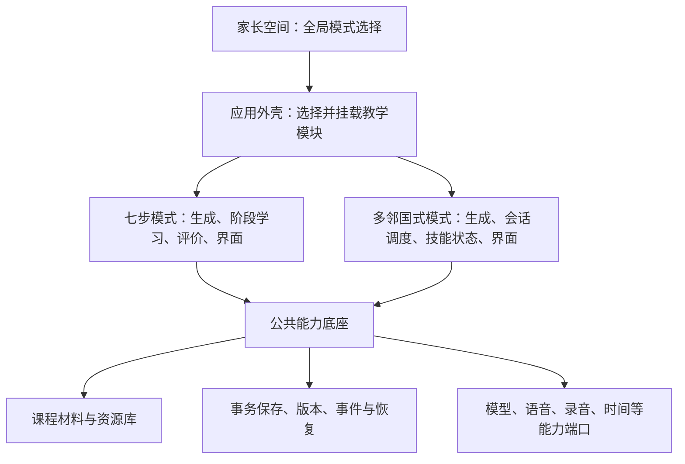

# 课程设计模式独立化方案

界面边界后续方案：见[统一应用框架与学习模式插件界面边界方案](00022_20261017091925_统一应用框架与学习模式插件界面边界方案.md)。公共导航、家长空间、教材管理和设置归应用框架；模式拥有教学区域及其内容准备、审核和报告组件。本文保留原阶段的架构说明。

建立时间：2026-10-15 14:08:01（Asia/Shanghai）。依据：应用 `0.1.14` 当前代码及[课程生成设计回顾](00016_20261015135648_课程生成设计回顾.md)。

文档状态：总体架构方案；七步模式独立化首阶段已实施，见[首阶段实施说明](00018_20261015162414_七步教学模式独立化首阶段实施说明.md)。2026-10-16 已实现家长全局模式选择、切换准备机制和独立文档存储，见[全局课程模式选择与存储隔离](00019_20261016100613_全局课程模式选择与存储隔离.md)。跨模式共用教材/档案目录的迁移及其他真实教学模式仍待接入。目标是在教学设计可能大幅调整的前提下，把课程设计做成独立、可版本化、可替换的模块。**一门课程保存共同教材，并可同时拥有多个模式的内容；家长空间提供一个全局模式选择，每次只启用一种模式，作用于本机全部课程。课程缺少当前模式时，由家长重新生成该模式内容并审核。** 每个模式的学习记录仍有明确解释。

需求修订（2026-10-15）：课程是长期存在的管理对象；全局只开放一个模式，由家长统一切换。按“七步模式与多邻国模式可能差异很大”的补充，**模式明确为一套独立的教学系统，拥有自己的课程结构、学习流程、运行状态、调度算法、孩子端界面和评价报告**。公共底座不预设固定阶段或统一学习循环。

## 1. 设计判断

课程阶段、教学顺序、重点词汇、练习形式、提示方式、题量和掌握门槛都包含教学取舍，也会随学习目标、年龄和实际使用反馈变化。当前七阶段可以作为一种完整模式保留，但不适合作为所有模式必须遵守的基础结构。

建议将“七步教学”整体封装为一个教学模式，把未来的“多邻国式教学”作为另一个独立模式接入。模式定义如何准备内容、怎样组织一次学习、每次作答后做什么、何时复习及怎样显示进步。公共系统提供身份、材料、保存、版本、音频和模型等能力，不替模式决定教学流程。

此前只把模式描述成“生成规则加阶段配置”，边界仍偏窄。例如即使把 `StageId` 改成动态数组，也不能完整表达按学习表现不断选题的短练习流程。独立化需要同时覆盖 **authoring（内容准备）、runtime（教学运行）、experience（界面交互）、reporting（评价报告）** 四部分。

本文中的“多邻国模式”指待设计的“多邻国式教学模式”，用于验证架构能承载较大的方法差异。短课、混合训练和个性化练习参考[多邻国官方使用介绍](https://blog.duolingo.com/duolingo-101-how-to-learn-a-language-on-duolingo/)；动态调整练习顺序与难度的方向参考[官方教学方法介绍](https://blog.duolingo.com/duolingo-teaching-method/)。下文的会话长度、技能模型、经验值等均是本项目可选方案，不是对其内部算法的复现，也不是已经确定的产品规则。

### 1.1 课程、模式、版本与全局选择

```text
家长空间：当前全局模式 = 多邻国式教学
├─ 课程一（稳定的 courseId）
│  ├─ 教材：原文、图片、词汇候选及材料修订
│  ├─ 七阶段综合训练：已审核，内容及进度保留
│  └─ 多邻国式教学：已审核，当前可学习
└─ 课程二（稳定的 courseId）
   ├─ 教材：原文、图片、词汇候选及材料修订
   ├─ 七阶段综合训练：已审核，内容及进度保留
   └─ 多邻国式教学：尚未生成，等待家长生成并审核
```

“教学模式实现”是一整套随应用发布的教学模块；“课程模式实例”是该模块在某门课程下生成的内容和配置；“模式发布版本”是审核后冻结的可学习产物。新增模式保留同一个 `courseId`，另分配 `modeInstanceId`，重新生成或升级则产生新的包版本。全局选择模块后，孩子端也挂载该模块对应的学习入口和交互流程。

内容准备状态与全局选择分开：未生成、草稿、待审核、已审核描述每门课各模式的内容成熟度；全局设置只保存一个 `activeModeId`。孩子端按该值解析每门课程的已审核运行包。不是当前模式的内容继续保留，切回时恢复相应进度；孩子不能自行选择其他模式。

全局选择作用于本机所有课程和孩子档案。孩子原本正在学习哪门课仍按已有课程选择保存，但该课程可使用的学习模式统一服从全局设置。

## 2. 目前的耦合位置

| 位置 | 当前写死的教学假设 | 独立化方向 |
|---|---|---|
| [course-library.ts](../src/course-library.ts) | 必选词汇；释义、理解题、应用题固定草稿结构；最多 A/B/C；七阶段编译 | 整套规则归入七步模式，公共包仅规定身份、版本与资源外壳，内容结构由模式定义 |
| [content.ts](../src/content.ts) | 统一词汇建议和课程生成提示词 | 传输端口共享，教学提示和模型输出解析由模式提供 |
| [CourseManager.vue](../src/modes/seven-step/components/CourseManager.vue) | 原文、词汇、生成、审核固定步骤；字段变化统一使整个草稿失效 | 公共流程管理身份、保存/取消/发布；模式提供自己的准备过程和编辑状态 |
| [CourseReview.vue](../src/modes/seven-step/components/CourseReview.vue) | 审核内容只分三类 | 七步模式保留此界面；其他模式可提供自己的审核页，并复用基础控件 |
| [learning-engine/model.ts](../packages/learning-engine/src/model.ts) | `StageId` 固定 S1～S7，能力类型固定 | 这些类型归七步模式；公共层不要求所有模式使用统一阶段、能力或题型模型 |
| [useLearning.ts](../src/useLearning.ts) | 从内置课程读取阶段；所有前序阶段完成后解锁；按 S4/S5 处理提示和暴露 | 当前阶段推进归七步模式；新模式可使用独立选题器和会话状态机 |
| [App.vue](../src/App.vue) | 根据 S4/S5/S6 决定原文显示、音频和文案 | 应用外壳挂载模式入口，模式拥有学习首页、练习流程和反馈界面 |
| [learning-engine/index.ts](../packages/learning-engine/src/index.ts) | 全部课程共用同一掌握及复习算法，评分版本固定 | 当前算法归七步模式；可复用评分函数，不强迫其他模式使用相同投影和复习算法 |
| [parent-report.ts](../src/parent-report.ts) | 按固定能力类型和掌握状态生成报告 | 模式解释自身进度、技能和复习状态，公共报告只汇总含义一致的事实 |
| [storage.ts](../src/storage.ts) | 按当前编译器重新构建旧课程，接受固定评价版本 | 公共存储保存版本化数据封套，模式校验其内容、状态和事件载荷 |

现有音频收集已按课文和任务文本工作，课程 ID 也已隔离不同课程的题目与知识点，可作为拆分基础。同一课程新增多个模式后，还需加入模式实例和包版本的命名空间。音频在某一任务中是题干、示范还是额外提示，也需从阶段判断改成显式声明。

## 3. 建议的模块边界



### 3.1 公共底座：负责运行条件和可靠性

公共层固定的内容应保持有限：

- 孩子档案、课程身份、家长操作入口和全局模式选择。
- 原文、图片等材料的校对、修订和引用；模式可复用的词汇候选。
- 草稿与发布包的保存、版本、事务、取消、资源引用和删除。
- 学习事件的可靠追加、状态保存、并发检查和进程恢复。
- 模型调用、TTS、录音、文件、时间等能力端口，以及可复用的基础交互控件。
- 挂载模式界面、执行其请求的受支持操作，并校验操作归属和当前模式。

`SourceSnapshot` 保存已确认的原文、角色段落、图片引用和材料修订。把原文分成学习区块、提取技能、决定必学词和生成哪些任务，都由模式处理。当前 `sourceTurns()` 的角色解析可以复用，A/B/C 长度分组留在七步模式。

每次生成固定一份材料快照。同一课程各模式固定各自使用的材料修订；修改原文不会直接改写已审包。共享图片和音频的清理依据全部存活引用判断。

### 3.2 模式模块：拥有完整的教学闭环

| 组成 | 模式拥有的内容 | 七步模式示例 | 多邻国式模式示例 |
|---|---|---|---|
| 内容准备 | 输入要求、生成步骤、提示词、课程内容 Schema | 确认词汇，生成释义、理解题、应用题 | 建立技能目标、路径节点、带难度和标签的题库或受控模板 |
| 家长审核 | 编辑过程、审核页、发布前质量校验 | 核对释义和题目，预览七阶段任务 | 核对技能覆盖、题目与变体、短课示例和路径安排 |
| 学习组织 | 学习入口、导航、会话开始和结束 | 进入某个阶段，完成本阶段任务 | 进入路径节点或复习入口，开始一轮短练习 |
| 运行算法 | 下一题选择、错误处理、解锁、补救与复习 | 阶段前置条件与既有复习队列 | 根据答题表现、错误标签和技能状态选择后续活动 |
| 状态模型 | 可持久化的学习状态及其解释 | 阶段完成、能力格、跨日证据 | 路径位置、技能熟练度、当前会话队列、待复习项目 |
| 孩子端体验 | 首页、任务页面、反馈、结算及交互节奏 | 阶段卡片、课文、录音、能力进度 | 路径页面、短任务串、即时反馈、会话结算 |
| 评价报告 | 本次评价、长期状态和家长报告 | 练习完成、独立证据、掌握情况 | 技能变化、会话表现和复习建议；激励指标按本模式定义 |

模式能够读取公共层提供的、限定到当前孩子和允许课程范围内的历史事实，用来决定下一步。课程内容生成通常只使用教材；运行时选题可以使用学习记录。模式通过端口调用网络、录音和保存能力，不能自行读取其他孩子的数据或绕过家长发布流程。

一个模式可以分成不依赖 Vue 的核心模块，以及依赖 Vue 的界面模块。核心拥有生成与运行算法；界面拥有该模式的页面，注册到应用外壳。复用已有题型控件是可选的工程复用，不能要求新模式必须适配旧页面或当前固定的 `ExerciseKind` 联合类型。

### 3.3 宿主运行器：管理生命周期，教学决策交给模式

应用外壳按全局模式找到课程对应的已审包，加载兼容的模式运行实现和界面，然后恢复该模式自己的状态。没有已审包时显示待生成或待审核，不自动回退。

宿主只提供统一的“接收操作 → 调用模式处理 → 原子保存事件与状态 → 更新界面”机制。孩子点击下一步、回答问题、使用提示或完成一轮练习后，由模式决定是继续、补题、返回讲解、结束会话还是解锁路径。

“阶段图”“同一种掌握投影”“固定题目队列”均不能成为宿主的必填概念。七步模式可以使用阶段运行器；多邻国式模式可以使用会话选题器。两种运行器都调用同一公共保存和设备能力。

### 3.4 两类扩展的成本应不同

同一教学体系内的题量、阈值和内容侧重变化，可以通过模式配置或新版本实现。由七步教学转向多邻国式教学，则允许新增完整的模式代码、数据结构、运行算法和页面。

“方便切换”表示家长可在已安装模式之间统一切换，课程内容与状态各自保留；“方便扩展”表示新增模式时主要在其模块内部开发并注册，不需要把新教学分支散落到全局页面、存储和原生层。它不意味着任何全新教学方法都能只写一份 JSON 配置。

## 4. 接口与课程包草案

以下为边界示意，不是已经存在的类型或完整 Schema。公共契约统一身份、版本、存储和生命周期，模式的课程载荷、草稿、命令、学习状态和界面模型均可独立定义，并由对应 Schema 校验。

```ts
type VersionedRef = { id: string; version: string };

interface LearningModeSettings {
  activeModeId: string; // 家长选择的全局模式 ID，同一时刻只有一个
}

interface CourseRecordNext {
  id: string; // 新增模式时保持 courseId
  title: string;
  source: SourceSnapshot;
  modes: CourseModeRecord[];
}

interface CourseModeRecord {
  id: string; // 课程内的模式实例 ID
  designModeId: string; // 同一课程内唯一，匹配全局 activeModeId
  draft: ModeDraftEnvelope | null;
  approvedPackages: ModeCourseEnvelope[];
  publishedRevision: string | null; // 家长审核并采用的确切包版本
}

interface ModeCourseEnvelope {
  schemaVersion: string;
  courseId: string;
  modeInstanceId: string;
  revision: string;
  previousRevision?: string;
  mode: VersionedRef;
  runtime: VersionedRef;
  payloadSchemaVersion: string;
  sourceRevision: string;
  payload: unknown; // 模式专属课程，不强制 stages/exercises/skills 等字段
  resources: ResourceManifest;
  provenance: GenerationProvenance;
  requiredCapabilities: string[];
}

interface TeachingModeCore<TCourse, TDraft, TState, TCommand, TView> {
  ref: VersionedRef;
  parseCourse(payload: unknown): TCourse;
  authoring: {
    validateInput(input: AuthoringInput): Diagnostic[];
    generate(input: AuthoringInput, ports: AuthoringPorts): Promise<TDraft>;
    parseDraft(raw: unknown): TDraft;
    compile(input: AuthoringInput, draft: TDraft): TCourse;
    validateCourse(course: TCourse): Diagnostic[];
  };
  runtime: {
    parseState(raw: unknown): TState;
    initialState(context: RuntimeContext<TCourse>): TState;
    transition(
      context: RuntimeContext<TCourse>,
      state: TState,
      command: TCommand,
    ): RuntimeTransition<TState>;
    view(context: RuntimeContext<TCourse>, state: TState): TView;
  };
  reporting: ModeReporting<TCourse, TState>;
}
```

`RuntimeContext` 提供已审课程、作用域内的历史、公共材料引用及显式的时间和随机种子输入。`RuntimeTransition` 返回新状态、模式结果事件和所需设备操作。播放、录音等异步结果由宿主转为后续命令，模式收到成功结果后再推进相应状态；播放失败不能被当成完成任务。

公共宿主记录真实提交输入和操作归属；模式可以追加评分、技能变化等解释，不能改写原始作答。命令带唯一 ID，状态更新带 revision，事件与状态在事务中保存；失败重试不能重复计分或重复授予模式奖励。

界面通过单独的 `TeachingModeRegistration` 注册学习首页、学习会话、家长审核和报告入口，并绑定对应的核心实现。模式可以提供自己的 Vue 页面，也可以组合公共题型控件；公共宿主不要求所有模式生成同一种页面描述。核心模块仍可脱离 Vue 进行测试。

每个模式保存自己的 payload Schema、state Schema、事件 Schema 及迁移函数。七步载荷可包含 `stages/exercises/evidencePolicies`；多邻国式载荷可包含 `skillGraph/lessonNodes/itemBank/selectionRules`。公共层不把两者合并成一组多数为空的通用字段，也不将持久状态简化成无法校验的任意对象。

公共校验负责包身份、版本、资源引用、能力支持和载荷大小；模式负责其内部引用、教学覆盖和逻辑合法性。只有使用阶段图的模式才执行阶段图校验。编译不访问网络或隐式读取时间，相同输入、草稿和编译版本应输出相同结果；生成来源、模型及提示版本记录在 `provenance`。

全局选择稳定的模式 ID；每门课的已审包固定精确模式和运行版本。包中只携带受校验的数据；实现代码随应用注册，不能从课程包执行任意脚本。`publishedRevision` 只能指向已经审核且可运行的包，不另设与全局冲突的课程级模式开关。

### 4.1 冻结课程内容，不冻结每个孩子的练习顺序

审核发布的包固定教材、题目或受控模板、合法答案、内容引用和教学规则版本。七步模式可以直接保存完整任务列表；多邻国式模式可以保存候选题库和调度规则，运行时根据孩子的状态选择题目、安排顺序和结束会话。

动态选题不等于每次重新生成课程，也不要求公开一条固定的七阶段路线。宿主需保存本次实际选中的题目、变体参数、随机种子和结果，使中断后能继续，历史题面和评价也能复查。

首轮多邻国式验证模式在已审核题库和受控变体范围内调度；若未来引入学习时即时模型生成新题，需另外定义内容校验、审核边界和离线退化规则，不能默认沿用“整包已审核”的结论。

## 5. 评价与掌握也要支持变化

两种模式可以复用“这次选择是否正确”“短句是否匹配”这样的基础函数，也可以使用自己的评分实现。长期学习模型由模式拥有，不要求全部模式继承当前的能力格、`alpha/beta` 投影、两题族门槛和复习间隔。

| 判断 | 七步模式可采用 | 多邻国式模式可采用 |
|---|---|---|
| 本次结果 | 对错、阈值通过、口语待家长确认 | 对错、提示使用、重试及本题结束反馈 |
| 当前过程完成 | 本阶段任务覆盖，允许特定人工待确认状态继续 | 本轮短会话达到结束条件，错题安排补练或进入后续复习 |
| 长期学习状态 | 能力格、独立题族、跨日会话和延迟复测 | 技能状态、路径进度及本模式定义的复习需要 |
| 下一次训练 | 既有阶段与复习队列 | 按技能、错误类型和复习需要组题 |
| 报告 | 本课七阶段完成与能力证据 | 短课表现、技能变化、路径进度和复习建议 |

例如经验值、连续学习天数可以成为多邻国式模式的激励设计，但不能直接显示为英语能力掌握程度。公共家长概况可汇总“今天提交了多少次作答”“有多少录音待确认”等语义稳定的事实；模式详细报告由其自行生成和展示。

七步模式要求两个题族时，就必须为同一目标生成相应任务；这回应[现状回顾中的题族覆盖问题](00016_20261015135648_课程生成设计回顾.md#81-需要优先处理的题族覆盖问题)。多邻国式模式若采用另一种学习状态模型，应独立说明它的解释和可达条件，不为了接入系统而伪造第二题族或套用七步完成比例。

状态分两种作用域：本课任务、会话和恢复点按 `learnerId + courseId + modeInstanceId + packageRevision` 保存；如果模式有跨课程的每日目标或技能模型，则另有按 `learnerId + modeId + modelVersion` 保存的模式级状态，并引用实际来源课程。两者都不与另一模式的状态混合。

原始作答、录音、提示使用、评价和人工复核继续保存，绑定实际任务、包修订和运行算法版本。需要新算法重新分析时，建立带版本标识的新投影，并保留原解释依据；不能用最新版模式重算后覆盖历史得分和奖励。

不同模式中的掌握比例不直接合并或排名。只有能力语义、评价条件及证据口径经过显式映射，才讨论跨模式迁移；相同英文单词或相同文本不能自动证明两种目标等价。

模式切换也不能把刚看过的相同原文答案当成全新独立证据。能够映射到同一材料片段的答案暴露，应按材料语义引用记录，并由证据策略判断其影响；没有可靠映射时，不自动迁移掌握结果。

## 6. 全局切换与课程补生成

### 6.1 家长空间的唯一切换入口

家长空间设置“课程学习模式”，显示当前模式，允许一次选择一种模式，保存后统一作用于全部课程。孩子端不提供模式切换，课程详情也不提供覆盖全局设置的独立开关。

模式选择旁可显示“已有 X 门课程可用，Y 门待生成/审核”，便于家长判断准备情况。允许选择尚未覆盖全部课程的模式；切换本身只保存全局设置并刷新课程可用状态，不触发模型调用、不批量重新生成，也不要求先补齐全部课程。

例如从“七步教学”切换为“多邻国式教学”：孩子端入口改为多邻国式模式自己的学习首页和会话流程，已有对应内容的课程可以进入；仅有七步内容的课程显示待生成。家长进入这些课程点击“按当前模式生成”，进入该模式自己的内容准备与审核流程，完成后即可使用，课程列表仍保留原有的一门课程条目。

| 场景 | 建议行为 |
|---|---|
| 新建课程 | 复用全局模式，按该模式要求准备输入、生成和审核 |
| 已有当前模式的已审核包 | 挂载该模式的界面和运行算法，读取已审内容并恢复对应状态 |
| 没有当前模式 | 显示“当前模式待生成”；家长在同一课程内补生成，保留已有模式 |
| 当前模式只有未完成草稿 | 显示继续生成或继续编辑入口，恢复该模式自己的草稿步骤 |
| 当前模式只有待审核内容 | 家长进入审核；通过并发布前孩子不能进入该模式 |
| 当前模式已有已审核包，正在重新生成 | 原发布包保持可用；新候选经审核并采用后才更新发布版本 |
| 切回之前的模式 | 直接读取此前保留的内容和对应进度，无需重复生成 |
| 当前孩子所学课程缺少新模式 | 保留该孩子的课程选择，学习入口显示待家长准备；不切到其他模式或另一门课 |
| 模式实现升级 | 已审包保持原版本；家长重新生成并审核后采用新包版本 |

“重新生成课程”在数据上表示为原课程创建或更新当前模式的内容，不分配新的 `courseId`，不覆盖其他模式。生成时复用已确认的材料，按新模式要求补充缺少的输入；不强迫家长重复输入原文或重新导入图片。

孩子只能开始或恢复全局选中模式的已审核版本。家长仍可查看所有模式的内容、历史记录、录音和待处理口语复核；未选中模式的复习任务不进入孩子当前复习队列。

### 6.2 保存与异步边界

切换前调用旧模式的暂停与状态保存流程，并正常结束录音和播放。保存失败则保留原全局模式；保存成功才更新设置、卸载旧模式页面及计时/监听任务，再挂载新模式。再次开始、继续练习以及恢复应用时都重新解析全局模式，避免旧页面继续提交到错误模式。

生成请求固定绑定课程、模式实例、材料修订、候选 ID 和模式实现版本；切换全局模式时停止当前内容请求，保留已保存草稿。迟到结果由请求代次检查丢弃，不写入新模式。家长随后可回到对应模式继续生成。

重新生成采用候选保存机制：原发布包及人工修改稿先保留，新候选生成成功后进入审核；失败或取消不覆盖旧内容。审核采用新版本也不改写历史练习恢复点：旧版本记录保留，新版本按自身任务开始，除非另有经过验证的显式迁移。

## 7. 七步模式与多邻国式模式的具体对照

这两种模式应当作为两个完整模块验证。用三阶段替换七阶段只能验证阶段配置，不能充分验证运行方式、界面和学习状态独立。

| 维度 | 七步模式 | 多邻国式模式的候选设计 |
|---|---|---|
| 课程结构 | 全文、重点词汇、释义及七阶段任务 | 技能目标、路径节点、题库/模板、难度与先修信息 |
| 学习入口 | 选择本课某个可用阶段 | 路径入口或“开始一轮练习” |
| 一次学习单位 | 一个阶段内的任务 | 混合技能与题型的短会话 |
| 下一题来源 | 当前阶段列表或七步模式复习队列 | 根据本轮表现、技能状态和复习需要动态选择 |
| 错误后行为 | 本题反馈、重试及既有阶段推进规则 | 可以安排较简单活动、稍后再测或调整后续会话 |
| 复习方式 | 按能力证据与复习间隔安排 | 在路径或短会话中混入需要复习的目标 |
| 记录状态 | 阶段位置、能力证据、跨日测评 | 技能模型、路径位置、会话队列和错题状态 |
| 孩子界面 | 阶段卡片、课文对照、题型页面和能力进度 | 路径页面、连续短题、即时反馈与会话结算 |
| 家长审核 | 释义、选中词汇、理解与应用题、阶段任务 | 技能覆盖、题目与受控变体、短课示例及评价安排 |
| 进度解释 | 阶段完成与已验证能力 | 路径进度、会话表现、模式定义的技能状态 |

### 7.1 同一段课文，两种学习流程

以已确认的 `Will you join us?` 和 `I like playing basketball.` 为例，以下是本项目两种模式的流程示意，不是多邻国产品的内部规则：

**七步模式：** 家长先确认重点词汇与教学草稿。孩子依次进入理解、词汇、句型、朗读、回忆、听写和情境应用阶段；每阶段按其任务与证据规则推进。

**多邻国式模式：** 家长准备并审核 `join`、`basketball`、邀请表达和爱好表达等目标的内容库。孩子开始一轮练习，可以先选词义、再做听力选择、补全邀请短句，然后在后续会话复习薄弱目标。若 `join` 作答错误，运行器可插入经过审核的较简单任务并稍后再测；如果已熟练，则选择其他目标。具体规则由该模式实现，宿主无需知道是哪种技能或为什么选这道题。

两种模式可能复用同一个音频文件、文字输入框或选择题控件，但不共享“七阶段当前位置”这类进度。七步模式完成 S2，不直接等于多邻国式模式的词汇节点完成。

### 7.2 如何证明隔离有效

添加多邻国式模式时，允许新增自己的课程 Schema、生成流程、调度器、状态迁移、学习页面和报告。只需在公共注册表登记模式与版本，由已有端口提供材料、网络、存储和设备能力。

如果必须把多邻国式路径压成 S1～S7，或为了它在 `App.vue`、全局 `useLearning()` 和公共仓储中增加大量教学判断分支，说明隔离还不够。若需要新的底层设备能力，例如新的音频处理方式，可合理扩展公共端口，但教学选题和进度算法仍留在模式内部。

## 8. 渐进实施安排

### 第一步：保留旧语义，建立模块边界

建议采用以下职责划分；实际文件名可在实施中调整：

```text
packages/learning-modes/
  contracts/                 模式生命周期、封套和能力端口
  seven-step/
    authoring/               原有生成、编译和课程校验
    runtime/                 原有阶段推进、评分、掌握和复习
    reporting/               七步模式报告
  duolingo-like/
    authoring/               技能、路径与题库准备
    runtime/                 会话状态机、选题器及技能模型
    reporting/               该模式的进度与报告
src/modes/
  host/                      注册、挂载、切换及公共能力适配
  seven-step/                七步模式的孩子页、审核页和报告页
  duolingo-like/             多邻国式模式自己的页面
```

先把当前生成、阶段运行、学习投影和报告逻辑完整划入七步模式。全局应用只保留外壳、能力端口和家长控制。基础评分、录音控件等确实被两种模式复用后，再提取到公共库，不先把七步算法重命名为通用引擎。

每门旧课程迁移为一个课程对象及其七步模式实例，初始全局模式设为七步；内置示例与现有自建课程按各自原有产物和规则建立兼容适配，保持旧课程和题目 ID、答案、事件和评分解释。

旧记录缺少模式维度时，通过显式迁移为其绑定兼容模式和包版本，保留孩子原有课程选择。新增模式不占一个新的课程名额；模式候选和版本的容量需独立计入存储限制。内置课程可以保留原七阶段包，并在同一个课程对象下保存新模式的用户生成内容。

该步主要是行为等价拆分，保留现有已知局限；新的题族覆盖规则在后续模式版本中修正，避免把旧课程悄悄变成另一套课程。

### 第二步：建立教学模块宿主

建立模式注册、模式专属页面挂载、版本化内容/状态/事件封套、事务命令处理和能力端口。验证七步模式完整运行，但宿主接口没有 `startStage(S1)`、必填 `stages` 或固定的 `masteredPercent`。

原有 `S4/S5/S6` 特殊行为可以先保留在七步模式内部，再按需要整理；不能留在公共外壳里让新模式继承。模式需要新题型时可在其界面包中开发，不必先修改全局题型联合。

### 第三步：加入全局切换与课程内补生成

家长空间新增全局模式选择，统一解析全部课程的模式准备状态。用一个最小的多邻国式验证模块，实际覆盖独立题库 Schema、混合题型短会话、根据错误调整后续选题、自有状态以及自有学习页面和报告。

同时验证课程内补生成、家长审核、部分课程缺少目标模式、切回原模式的状态恢复。此步骤验证架构边界，不等于交付完整的多邻国式教学产品；该模式的具体教学规则仍需单独设计。七步模式的覆盖缺口则在其后续版本中修正。

### 第四步：完善版本与追溯

区分材料修订、设计模式版本、课程内模式实例、草稿格式、编译器版本、运行包格式、模式包修订和评价策略版本。全局设置仅选择稳定模式 ID；各课程实例的内容和评价引用使用精确版本，不能在读取旧包时自动选择最新实现。

新快照使用明确的格式迁移，升级前备份并在事务中写入。不能只修改现有 `formatVersion` 数字，也不能让旧事件在模式升级后指向新题目。

已发布包由对应版本的模式校验器解释，不调用最新编译器重新生成。对旧包保留原校验器或显式迁移适配；草稿需要其模式实现才能继续编辑。已发布包则需要兼容的运行和界面实现；生成器可独立停用。缺少必要实现时保留课程和记录，明确提示版本不支持，不把未知数据当损坏删除。

## 9. 验收标准

以下是后续实施的验收目标，本次未执行：

1. 同一个 `courseId` 下保存七步内容与多邻国式技能/题库内容，模式使用不同内容 Schema 和不同学习状态，课程列表仍只有一门课程。
2. 家长空间只有一个当前模式选择，切换作用于所有课程和孩子档案；孩子端没有模式选择，也没有按课程覆盖全局设置的开关。
3. 部分课程缺少目标模式时仍可切换；这些课程显示待生成或待审核，不自动回退，不自动请求模型。
4. 家长在缺少模式的课程内重新生成并审核后，即可按当前模式学习；原模式的内容和学习记录完整保留。
5. 切回旧模式恢复对应孩子、课程、模式包版本的进度；切换期间保存失败维持旧设置，迟到请求不污染其他模式。
6. 多邻国式验证模块拥有自己的路径/会话页面、混合短任务、根据错误调整选题和技能状态，能在不使用 `StageId` 或七步学习投影的情况下运行。
7. 新模式使用已有设备能力时，仅新增模式核心、自己的页面和注册项；公共宿主与仓储不增加该模式专属的教学分支。
8. 七步模式仍按原阶段和证据规则运行；多邻国式模式按自身会话及技能规则运行。两种状态都可校验、保存和恢复，不强行转换成共同的完成百分比。
9. 动态选题只在当前已审内容和受控变体范围内进行；实际题面、选择参数与算法版本可追溯，中断恢复后不会重选另一道题或重复授予奖励。
10. 模式声明的学习状态与实际内容覆盖相符；激励指标不冒充语言能力；可映射的答案暴露不会因切换模式而被抹去。
11. 已发布模式包保持精确运行和状态模型版本；升级后旧作答、口语复核和恢复点仍有原解释。未选中模式仍能在家长空间查阅历史与处理复核。
12. 旧课程迁移有效，共享资源按全部模式引用清理；未知模式、状态版本或必要能力保留数据并提示不支持，不静默套用七步规则。
13. 模式单测分别验证生成、确定性编译、状态转换、调度及报告；宿主契约测试验证注册、作用域、幂等保存和挂载；端到端覆盖全局切换、覆盖不齐、补生成审核、不同界面、动态会话恢复和异步隔离。

本次仅进行源码核对与方案整理，不改动业务代码。实施时应以行为兼容、第二模式验证和历史语义可追溯为主要边界，避免在首轮扩展中同时引入远程插件、任意脚本执行和完整云端课程平台。
