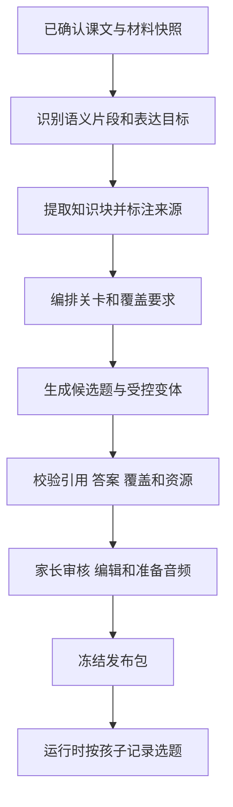

# 课文闯关课程模式方案

界面归属后续方案：见[统一应用框架与学习模式插件界面边界方案](00022_20261017091925_统一应用框架与学习模式插件界面边界方案.md)。闯关的路径、题库、调度和评价继续由模式拥有；公共应用外壳、教材管理、家长空间和设置统一归框架。

建立时间：2026-10-16 23:35:11（Asia/Shanghai）。状态：分阶段实施。

2026-10-17 已完成第一阶段独立核心及[自动化验证](../issues/00034_20261017002113_课文闯关独立核心首阶段实现与验证.md)、第二阶段[共享课程目录与跨模式数据协调](00021_20261017063925_共享课程目录与跨模式数据协调.md)，并接通孩子学习、原文、家长完整题库审核和音频发布，正式注册到通用设置。当前形成初版闭环，已完成[真机升级安装与双模式入口往返](../issues/00037_20261017080600_课文闯关模式真机安装验证.md)；真实模型与生成后的离线学习验收仍待进行，见[页面接入验证及后续范围](../issues/00036_20261017074456_课文闯关页面接入与正式注册验证.md)。

新增独立的“课文闯关”模式，模式 ID 为 `passage-path`。以家长确认的课文为内容边界，把有交流意义的表达组织成短关卡；孩子点击“继续学习”，在同一轮中接触新表达、练习旧知识并补强薄弱项。复习由模式安排，孩子无需先选择学习或复习。

方向承接[分享讨论](https://chatgpt.com/share/6ad2428f-6f68-83e8-aebc-f48d76b99356)最后形成的“知识块、关卡、题库、动态复习”设计。讨论前期的五个固定学习环节，以及分别设置学习和复习主入口，不作为本方案的流程。这里借鉴短练习与新旧穿插的体验，调度和评价规则由 LingoNest 自行定义。

它与七步模式并列，拥有自己的生成器、课程结构、运行算法、页面、进度和报告。沿用[全局课程模式选择与存储隔离](00019_20261016100613_全局课程模式选择与存储隔离.md)：家长在通用“小窝设置”的“课程模式”中统一切换，一次开放一个模式，作用于本机全部课程和孩子。已有七步内容与进度保留；课程缺少闯关内容时，由家长在原课程内补生成并审核。

## 1. 教学组织与七步模式的区别

| 方面 | 七步模式 | 课文闯关模式 |
|---|---|---|
| 内容组织 | 课文、重点词汇和七阶段任务 | 课文中的表达目标、知识块、关卡和候选题库 |
| 学习单位 | 某个阶段中的任务 | 一轮短关卡，混合意义、听辨、组句和应答 |
| 学习顺序 | 按原有阶段规则推进 | 按交流目标展开，在关卡内部由理解逐渐过渡到回想与使用 |
| 复习方式 | 原有七步复习机制 | 插入关卡，也可在路径完成后继续安排巩固轮次 |
| 错误处理 | 原有反馈与阶段推进规则 | 即时说明，间隔若干题后有限补练，薄弱目标进入后续轮次 |
| 进度解释 | 阶段完成、能力证据与原有掌握判断 | 路径完成与知识表现分别记录 |
| 内容审核 | 七步模式自己的教学草稿和任务 | 表达目标、关卡覆盖、全部候选题、答案、音频和调度规则版本 |

关卡可以同时出现词义、句子和对话，不再划成“先学完全部词汇，再学全部句型”。课文决定内容范围，交流目标决定编排。课文原文始终可以查看，不以通关解锁原文。

## 2. 孩子端的一次学习

### 2.1 课程首页

进入某门课后，首先看到课程标题、路径位置和一个主要按钮：“开始学习”或“继续学习”。下方提供“查看课文”和已完成关卡的重练入口。原文页可以显示译文、播放已有音频，帮助孩子重新理解上下文。

路径内按关卡推荐顺序前进，已完成关卡可以重练。课程之间不设先修锁，家长仍可指定学校正在学习的课程，不要求先完成整本教材。切换孩子或课程后，分别恢复对应孩子、课程和模式包的会话。

路径完成后，主要按钮继续进入本课巩固轮次，优先练习到期或薄弱目标；没有到期项时，安排本课已学内容的混合练习。页面同时显示“本课路径已完成”，不把巩固轮次伪装成尚未完成的新关卡。

### 2.2 练习与反馈

每屏处理一道题。新表达先给足理解线索，后续题逐步减少选项和提示。提交后显示反馈，再进入下一题。首版采用可在本机明确判定的题目：词义或句意选择、听音选择、词块组句、受控填空和对话应答。自由口语和开放写作留待后续单独设计评价方式。

答错时先给简短说明并保留真实错误记录，继续其他题，再从已审核题库选择同一目标的补练题。补练不要求机械重做同一道题；没有合适变体时，提供讲解并把目标留到后续轮次。补练次数受本轮预算限制，避免反复答错形成无限循环。

完成一轮规定任务即可推进路径。查看答案、使用原文或在补练中答对，都不会改写第一次作答，也不会直接成为独立掌握证据。提示和查看原文会记录作用范围；能够定位到当前目标时只影响相关目标，无法定位时保守标记本轮后续相关作答受到辅助。

### 2.3 首版参数建议

以下是首轮试用的配置起点，需通过实际使用调整；配置保存在模式规则版本中，不写入公共层。

| 项目 | 建议初值 | 边界 |
|---|---|---|
| 一轮时长 | 目标约 3～5 分钟 | 不按时间强行结束，不用速度判断掌握 |
| 常规题量 | 8 题 | 由已审内容覆盖决定，可调整为 6～10 题 |
| 新知识负荷 | 每关通常 1～2 个核心知识块 | 较复杂表达可单独占一关，巩固关可以没有新知识 |
| 常规选题 | 本关目标练习 5 题、到期复习 2 题、薄弱项补强 1 题 | 后三题均为已学内容，候选池不足时改用本关巩固题 |
| 错误补练 | 8 题常规轮最多追加 2 题 | 错误过多时留待后续轮次，不无限加题 |
| 跨课复习 | 每个 8 题常规轮最多 2 题 | 不挤占当前课的新目标与必要练习 |

本关的五道练习不代表五个新知识点，同一表达可以通过不同形式出现。第一关没有旧知识时，直接用本关的理解与练习填补复习位置，不导入未学课程。候选不足时可缩短轮次，但必须满足该关的最低目标覆盖；覆盖不足则提示家长补充内容，不能重复同题凑数。

## 3. 知识块与关卡如何生成

### 3.1 知识块围绕表达目标建立

一个知识块描述孩子要理解或使用什么，可以是词语、固定表达、句型或短对话。它包含来源片段、交流用途、必要词义、训练目标以及可用题目引用。例如 `Will you join us?` 可以作为“邀请对方加入”的表达块，相关 `join` 词义作为支撑，不必把每个词都拆成独立必学节点。

同一句话可能支撑多个目标，但目标应可解释。例如“听懂邀请”和“无选项补全邀请句”是不同表现，不能因为完成一次选择题就同时宣布全部掌握。目标模型属于本模式，不复用七步的能力格作为必填结构。

知识块与关卡没有一一对应关系。简单表达可以组合成一关，复杂表达可以跨关反复出现。识别课文中的角色和语义后再编排，不沿用七步按长度划分的 A/B/C 区块作为教学关卡。

### 3.2 从原文到可审核内容



生成器按同一语境组织目标，优先保持对话的问答关系和叙事顺序。每关明确新增目标、允许复习的已学目标，以及最低练习覆盖。是否需要听辨、组句或独立填空，由该目标决定，不把每种题型强塞进每一关。

关数由目标数量和复杂度决定。短课文可以少关，长课文按语义片段分组；模型生成的关数还要通过负荷与覆盖检查。家长可以合并或拆分关卡，修改后重新校验引用、顺序和覆盖。

题库保存完整的题面、合法答案、解释、知识目标、难度、来源和音频需求。运行时只选择已审核题目和已审核的有限变体。首版不在孩子答题时调用模型临时出题；选择题选项乱序不会被当成新的独立题型证据。

### 3.3 用现有课文举例

以“一起加入运动队”中部分邀请、爱好和擅长表达为例，可以编成以下路径。完整原文中的其他目标还需单独覆盖，示例关数不是固定模板。

| 关卡 | 本关交流目标 | 新内容示例 | 穿插旧内容 |
|---|---|---|---|
| 说说喜欢的运动 | 表达运动爱好 | `I like playing basketball.` | 首关用本关巩固题补足 |
| 邀请朋友加入 | 听懂邀请并肯定应答 | `Will you join us?`、`Yes, I will.` | 运动词义和爱好表达 |
| 问问是否擅长 | 理解并回答能力询问 | `Are you good at it?`、`Yes, I am.` | 邀请与应答 |
| 学会婉拒 | 理解否定和原因 | `No, I won't.`、`I'm not good at playing football.` | 肯定应答、运动词和擅长表达 |
| 完成一次运动队对话 | 综合理解并选择合适应答 | 不新增核心表达 | 前面各关的目标与薄弱项 |

“邀请朋友加入”的一轮可以包含：复习运动词义、听邀请选句意、看语境选应答、组出邀请句、补全邀请中的关键词、复习爱好句、理解短对话、在有限答案范围内完成邀请。孩子接触的是同一个交流目标的不同表现，而非先做一批孤立单词题。

## 4. 动态选题与复习规则

### 4.1 发布时固定内容 运行时选择顺序

发布包固定知识块、关卡、候选题、答案、合法变体以及规则版本。孩子开始一轮时，调度器结合本人的记录选择具体题目，并保存实际队列、选项顺序、变体参数和内容包引用。恢复应用时读取这份队列，不重新随机出题。

队列的组成来源和选择原因可追溯：本关目标、到期复习、薄弱补强或本轮错误补练。约束优先于比例：先满足本关必要覆盖和新表达的理解前置，再安排复习，最后控制题型与连续重复。学习了哪个目标，以实际完成的接触和作答为准，不因路径节点可见或课程已发布就进入复习池。

同一目标不在一轮中过度占用多个复习位置，具体题目去重。补练与首次作答分开记录，不能用补练正确率覆盖第一次表现。

### 4.2 复习池与课程范围

复习以知识块及其表现目标为单位，不只收集错题 ID。优先选择最近出错、已经到期或多次需要提示的目标，再选择近期学过但证据较少的目标。已学且表现稳定的目标逐步拉长复习间隔；错误和辅助作答缩短间隔。

首版先使用可解释的规则表，记录 `schedulerVersion`，不把固定权重包装成经过验证的记忆模型。时间和随机输入显式传入，时钟回拨时不提前认定到期；不能通过修改设备日期制造新的独立学习证据。

跨课复习仅从**同一孩子、同一模式、已实际学过且当前仍可用的已审课程版本**中选择。未生成、未审核、已归档、待彻底删除的课程均不参与。跨课题显示来源课程，并允许回看它的原文；七步已完成任务不自动转成闯关模式的已学目标。

首版不合并不同课程中“看起来相同”的词或句型。没有显式语义映射时，分别保存学习状态，必要时按题面文本去重，避免重复出题。这比仅按英文字符串合并掌握结果更容易保持解释一致。

### 4.3 路径与知识表现分别展示

家长报告分别显示已经完成的关卡、首次作答表现、提示使用、待补强目标和下一次建议练习。孩子端可以显示“第 3 / 5 关”等过程进度，但不把它标为“英语掌握 60%”。

知识表现首版用“尚未接触、练习中、待加强、表现稳定”等模式内状态。表现稳定需要不同轮次中的独立作答；刚看过答案后的正确和同轮反复作答不能单独达到该状态。具体门槛作为评价版本配置，在上线前随测试样本确定，不直接套用七步的跨日、题族和评分规则。

切换模式不能消除已经发生的答案暴露。能够按同一材料片段可靠映射时，由所属模式适配器提供只读的暴露事实，新模式按自己的策略解释；公共层不把它换算为掌握状态。旧记录无法可靠映射时，新模式首轮作为熟悉与诊断，不把它宣称为从未看过材料的独立验证。

## 5. 家长生成 审核与版本采用

### 5.1 在原课程内补充模式内容

切换全局模式后，每门课程仍占原来的一个课程条目，`courseId` 不变。没有闯关内容的课程显示“课文闯关待生成”，家长选择“为当前模式生成”，复用已确认原文和图片，生成本模式的候选草稿。七步重点词汇可供参考，不自动成为新模式的必学清单。

课程状态继续映射公共的 `missing / draft / review / ready`。只有存在可运行的已发布闯关包时才报告 `ready`。当前课程缺失内容时，保留孩子和课程选择，拦截开始、恢复和提交，不自动切换其他课程或七步模式。

### 5.2 审核对象是整个候选池

家长按“原文与目标、关卡安排、候选题与答案、资源和发布检查”查看内容。提供一轮练习预览帮助理解节奏，同时允许逐项查看全部候选题；预览中的八题不能代替对整个题库的审核。

修改目标、题目、答案或语音文本后，对应的校验和资源确认失效，重新检查后才能发布。发布内容固定为家长实际审核采用的候选，不能混入尚未审核的后续修改。

发布检查至少包括：

- 所有原文引用存在，教材原句与生成变式明确区分；对话人物、否定和事实不被改写。
- 每个必学目标有介绍和练习路径，需要独立回想的目标有相应题目；只能识别的内容不承诺独立表达能力。
- 题目有可判定答案，干扰项与说明经过核对；允许答案、空格和标点归一化规则明确。
- 关卡引用完整，负荷符合本包配置；不足以形成合法轮次时阻止发布，而不是让运行时随意补题。
- 必需音频已生成并可读取，题面、答案与音频一致；存储空间和应用能力满足运行要求。

首版将听辨题的音频准备放在发布前，避免发布后才发现整关无法使用。无音频的既有七步课程沿用原规则，不受这一新模式门槛影响。已发布闯关包的音频损坏时暂停受影响练习并提示家长修复；运行时不默默删掉听力题或把它算成完成。

### 5.3 重新生成形成新版本

重新生成先保存独立候选，原发布包继续可用。失败或取消保留旧包及人工编辑；成功并经家长审核采用后，才切换该课程的发布指针。

生成、编译、调度、评分和状态格式分别记录版本。新模式包不使用七步自建课程固定的版本字符串 `1` 作为自己的版本标识。每次采用产生唯一包修订，并固定材料快照与内容摘要。

首版采用新包后从新路径开始，不自动迁移旧包掌握状态；旧包的学习记录保留供家长查看。采用操作明确提示这一效果，并先保存所有引用旧包的活跃会话。未完成旧会话封存为中断记录，不再自动恢复；其他课程混入的旧包题也要停止恢复并重新开始一轮，已经提交的作答保持原解释。没有新包采用操作时，普通退出、换孩子、换课程和切模式均应恢复原队列。

## 6. 独立模块与持久数据

### 6.1 模块边界

建议新增以下模式目录，具体接口沿用当前泛型契约，不扩展公共层的固定阶段或题型枚举：

```text
packages/learning-modes/passage-path/
  identity / authoring / model / state
  runtime / scheduler / grading / reporting
src/modes/passage-path/
  register / Experience
  课程路径 / 练习 / 原文 / 家长审核 / 报告
```

以上是建议职责，不要求逐项同名建文件。课程编排、知识块、题型、补练规则和报告解释全部放在新模式内部。公共层提供身份、材料访问、持久化、资源、模型和音频能力，以及模式切换生命周期；不接受 `nextLevel`、复习比例或知识掌握门槛作为通用业务规则。

新模式不导入七步的 `StageId`、编译器、能力格、学习投影或教学提示词。控件确有共用需求时再提取基础输入、播放和反馈组件，并通过数据与回调组合，避免公共控件按模式 ID 分支。

### 6.2 模式内的数据关系

| 对象 | 主要内容 | 作用域 |
|---|---|---|
| 材料引用 | `courseId`、材料摘要、原文与图片快照引用 | 共用课程身份，固定本包采用的材料 |
| 内容包 | `packageRevision`、知识块、关卡、候选题、资源与规则版本 | 课程与模式实例 |
| 路径进度 | 完成关卡和下一关 | 孩子、课程、模式实例、包修订 |
| 知识表现 | 独立作答、辅助作答、薄弱标记和复习时间 | 孩子、来源课程、包修订、目标 |
| 当前会话 | 实际队列、来源包、题序、当前输入、补练预算和随机参数 | 孩子与发起课程；混练题另带各自来源 |
| 作答事实 | 提交输入、题面引用、结果、辅助情况、时间和判分版本 | 唯一作答 ID，绑定准确题目与版本 |
| 生成草稿 | 请求上下文、人工编辑、生成来源和审核状态 | 课程、模式实例、候选与材料修订 |

模式级复习索引可以汇总同一孩子在多门课中的目标引用，但不复制另一孩子或另一模式的数据。删除、归档或发布版本变化后先过滤资格，再调度。

初始存储建议使用独立 key `lingonest.passage-path.v1`，通过公共 `SnapshotRepository` 读写，禁止启用 `nativeLegacy`。一次作答的事件、评价、队列位置和知识状态在同一模式快照内原子保存；写入成功后再推进界面。提交 ID 幂等，失败重试不重复计分。

实际队列固定全部来源包。内容和资源按存活会话及历史引用保留，资源清理不能只看当前发布版本。题库与历史快照会占用当前单文档 10 MiB 容量，发布前检查预算；达到容量限制时停止新增并保留已有数据，不静默截断历史。

### 6.3 音频与样式隔离

资源身份使用模式实例和包修订构造独立命名空间，音频适配层映射到公共清单，不改变真实 `courseId`。当前七步音频键保持原样；新模式不能与同课程、同版本的旧音频清单相互覆盖。

首版可分别生成资源，暂不依赖跨模式音频去重。以后确需共享时，必须使用显式资源引用和所有存活引用计数后再清理，不能只因英文文本相同就删除另一模式的音频。

所有页面挂在自己的模式根节点内，样式使用限定根或局部作用域。动态弹层、滚动容器、间距回退和退出动画也检查归属；旧 WebView 不支持 flex gap 时使用可靠间距回退。

## 7. 共用教材与档案的兼容接入

### 7.1 首版采用兼容访问层

当前孩子档案、课程材料、课程选择与七步学习数据仍保存在七步历史快照中，注册第二模式本身不能解决共享问题。首版建议先建立公共 `CatalogPort`，由七步兼容适配器提供材料与档案访问，暂不整体迁移历史快照。

公共端口只暴露孩子身份、课程身份、教材信息、原文、图片、归档状态和当前选择。七步的草稿步骤、词汇必选规则、A/B/C 分组、题库和学习事件不出现在公共目录契约中。兼容适配器在七步边界内解释旧格式，宿主把模式无关的材料视图交给新模式，新模式不直接读取旧存储。

旧记录未提供独立材料修订时，对确认后的原文与图片引用计算稳定摘要，生成过程固定这份材料快照。首版保留既有已发布原文的编辑限制，不为新模式顺带改写七步冻结规则。需要修改已发布教材原文的版本管理另行实施。

目录保持一个事实来源，读取投影不形成另一份可独立编辑的课程库。新增课程仍分配现有合法课程 ID，只创建共同材料及兼容记录；新模式发布不把七步草稿标为已发布，也不生成七步任务。内置课程使用原 ID 复用材料，新模式包作为独立载荷保存。

### 7.2 共享写入与删除必须统一协调

建立一个共享写入协调器，七步体验与新模式的目录操作都通过它提交。协调器在最新 revision 上执行限定命令，保留无关字段，避免两个仓储实例用过期全量快照覆盖对方。切换孩子、指定课程、新建档案和材料等公共操作可以正常更新共享字段；新模式答题、复习和生成包不写七步教学字段。

普通归档沿用现有清除课程指定的行为，全部模式的内容和历史保留；闯关复习池立即排除该课。恢复后可重新指定课程，不能把恢复归档解释为恢复之前的课程指定。

彻底删除必须经过跨模式协调，不能继续直接调用仅收集七步资源的删除流程。协调器先持久化含操作 ID、课程 ID 和参与存储的删除计划，拦截该课使用，再幂等清除各模式数据，最后依据全部存活引用清理文件。多文档没有现成跨库事务，需要中断续作与完成标记；部分失败保留计划并重试，不提前宣布删除完成。跨课混练会话若引用被彻底删除的课程，也要停止恢复并清除相关队列、作答及派生状态，保留其他课程的独立事实。

这些目录、共享写入和删除边界是生产接入前置条件。后续如要迁移为独立公共目录，再单独设计备份、校验和回滚，首轮不同时进行存储迁移和教学算法替换。

## 8. 切换 保存与卸载

复用现有全局设置事务：家长确认 → 旧模式准备并保存 → 持久化模式选择 → 更新全局模式 → 卸载旧体验并挂载新体验。准备或设置保存失败时维持原模式和原界面。

新模式的切换准备保存当前孩子、发起课程、包版本、实际混练队列和未提交输入，不把保存草稿当成作答。更换孩子或课程后立即解除旧活跃会话绑定；后续切模式不能用新上下文覆盖旧恢复点。进入设置时编辑器继续挂载，直到保存成功才允许离开或切换。

播放、生成、录音和延迟任务绑定体验实例及操作代次。卸载后失效的播放启动回调不能再次开始播放；异步结束和取消只能影响自己拥有的操作。生成请求取消不能使用无归属的全局停止去误停后来实例的请求，迟到结果也不能写入另一课程、模式或材料修订。

新模式复用设备能力前需确认能力端口具有上述操作归属保护。若现有端口只提供全局取消，就在能力层补通用请求归属机制，由模式提供所有者标识；不把闯关的教学判断塞入原生插件。

恢复、开始和提交再次检查全局模式、当前孩子、课程状态及准确包引用。已归档、待删除、已失效包或未发布内容不能仅凭旧队列继续学习。切回七步直接使用原内容和恢复点，不要求重新生成、重新审核或从 S1 开始。

不支持的内容包或状态版本保留原数据并提示升级或恢复兼容版本，不能按空状态覆盖；已有孩子身份和课程原文确认继续遵循各自原有规则。

## 9. 实施顺序与验收

### 9.1 分阶段交付

| 阶段 | 交付范围 | 完成条件 |
|---|---|---|
| 第一阶段 | 模式内部的数据模型、知识块提取、关卡编排、题库编译和纯运行器 | 用现有课文完成可重现的生成、选题、判分、补练及恢复；不依赖七步教学模型 |
| 第二阶段 | 公共材料端口、单一共享写入、跨模式删除与资源归属 | 新模式能使用同一孩子和同一课程，所有管理操作保留七步语义 |
| 第三阶段 | 孩子路径页、原文页、练习页、家长生成审核和基础报告 | 发布包可离线练习；缺内容拦截、保存失败、卸载和设置返回覆盖完整 |
| 第四阶段 | 全局设置中正式注册，接入同模式跨课复习并完成兼容回归 | 已有课程与学习进度检查通过，真实第二模式可以来回切换 |

正式首版包含关卡内混练、跨关和跨课复习、有限错误补练、原文查看与所需音频、家长审核以及独立进度。先在本课完成闭环，再接跨课索引。自由 AI 对话、口语自动评分、排行榜和复杂奖励不进入首版。

### 9.2 正式回归要求

| 范围 | 必须覆盖的场景 |
|---|---|
| 七步历史兼容 | v1 与 v2、内置与自建、已发布与草稿、已归档、已有录音/事件/恢复点；进入新模式并切回后原课程、题目 ID、答案、评分版本及进度保持原含义 |
| 共享目录 | 同一 ID 只出现一门课；新模式新建材料不伪造七步发布；两种体验均用最新 revision；共享写入保留旧教学字段，冲突和保存失败不丢数据 |
| 全局选择与拦截 | 仅一个模式生效；部分课程缺失、草稿或待审核时禁止开始、恢复和提交；不自动生成或回落；切回七步不额外要求重新生成或审核，原有身份与原文确认规则保持 |
| 保存与设置返回 | 切孩子或课程后再切模式、输入未提交、草稿保存失败、存储冲突、切换设置写入失败、设置返回及原生返回；均保持准确上下文和恢复点 |
| 生命周期 | 播放真正启动前卸载、播放结束后迟到回调、生成请求卸载后另一实例发起请求、连续切换、计时器与监听注销；旧实例不复活、不误停、不写入新实例 |
| 调度与学习事实 | 无复习历史、候选不足、全部答错、补练上限、新目标先理解后回想、跨课题上限、不同孩子隔离；辅助作答及跨模式材料暴露不冒充独立表现 |
| 恢复与采用新包 | 实际队列与输入逐项恢复、重复提交幂等、保存失败不推进；采用新包后旧队列封存、跨课引用失效，不改写旧作答解释 |
| 资源与删除 | 音频键不覆盖七步、缺音频不假完成、归档不清历史、删除计划在各阶段中断可恢复、共享图片不误删、混练引用不会留下可继续使用的已删内容 |
| 样式与设备 | 两个模式往返后互不污染，动态弹层归属明确；旧 WebView 的间距回退、窄屏、长译文及长选项可用 |

单元测试验证编译、规则、幂等状态转换和可确定的调度；端到端测试验证真实两个体验的生成审核、全局切换、保存与恢复；Android 验证独立存储、音频生命周期和升级安装的数据保留。七步原有回归仍必须通过，不能仅用测试占位模式代替真实第二模式验收。

兼容验证应分别比较共享管理字段与七步教学字段：正常切换可能保存七步恢复点，共享课程指定也可能变化；这些预期写入要逐项解释。新模式练习本身不得新增、重算或删改七步作答和掌握记录，不能仅凭课程数量相同宣布兼容。

第一阶段已新增独立的 `passage-path` 核心，默认题量与补练预算可随包配置。评价版本 1 暂以三个间隔至少 24 小时的独立成功轮次作为稳定表现起点，首轮诊断和辅助作答排除；具体策略需在正式上线前评估。第一阶段未修改七步模式和公共教学契约，尚未注册新的孩子端体验。
