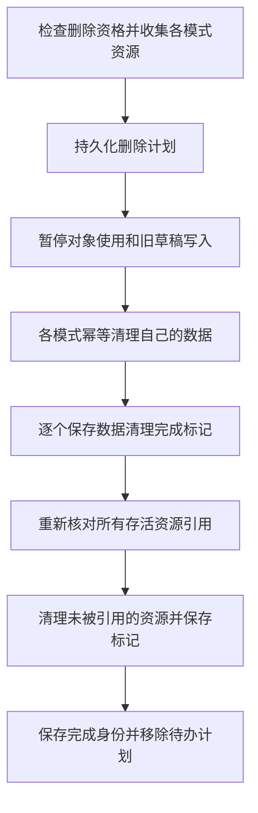

# 共享课程目录与跨模式数据协调

建立时间：2026-10-17 06:39:25（Asia/Shanghai）。承接[课文闯关课程模式方案](00020_20261016233511_课文闯关课程模式方案.md)第二阶段。验证记录见[共享目录与跨模式删除验证](../issues/00035_20261017063925_共享目录与跨模式删除第二阶段验证.md)。

两种模式通过同一个材料目录使用既有孩子与课程身份。材料和档案仍保存在七步历史快照中，由七步边界内的兼容适配器解释旧格式；本次不整体迁移该快照，也不创建另一份可独立编辑的目录。闯关内容与学习记录继续使用独立文档。

第二阶段提供共享读写、身份校验与跨模式删除能力。闯关学习页、生成审核页及正式模式注册属于后续阶段，当前通用设置仍只开放七步学习。

## 1. 目录契约与组合位置

公共 [CatalogPort](../packages/learning-modes/catalog.ts) 暴露孩子档案、课程身份、标题与教材信息、原文、图片、材料修订、归档状态和课程选择，以及相应管理命令。契约不包含七步草稿步骤、词汇必选规则、阶段、题库或学习事件。

| 位置 | 职责 |
|---|---|
| [application/services.ts](../src/application/services.ts) | 组合各数据所有者，建立一条应用写入队列，并通过应用级依赖注入提供共享实例 |
| [seven-step/catalog.ts](../src/modes/seven-step/catalog.ts) | 将历史快照投影为公共目录，执行兼容格式内的共享管理操作，保留七步发布冻结与容量限制 |
| [seven-step/services.ts](../src/modes/seven-step/services.ts) | 七步状态所有者、目录适配器、启动恢复和原删除任务接续 |
| [passage-path/services.ts](../src/modes/passage-path/services.ts) | 闯关存储协调、真实目录选择绑定、采用内容前的材料核对及资源清单 |
| [shared-snapshot.ts](../src/platform/shared-snapshot.ts) | 不解释载荷语义的共享快照与串行写入机制 |
| [deletions.ts](../src/platform/deletions.ts) | 不解释教学记录的持久删除计划、数据参与者与资源引用协调 |

应用入口 [main.ts](../src/main.ts) 创建一次服务组合。七步体验卸载、再次挂载时继续使用同一状态所有者，避免新体验另开一份过期全量快照。模式宿主和公共页面仍不判断知识块、阶段或掌握状态。

## 2. 材料修订与课程选择

课程保持原 `courseId`；新增一种模式不会新增课程条目，也不重复占用自建课程名额。内置课程同样使用原 ID。公共入口新建材料时只创建兼容的 `source` 记录，不编译七步包，也不伪造七步发布状态。

材料修订为 `source.<SHA-256>`，摘要输入固定为原文、原文图片和补充图片引用，含旋转方向。昵称变化不改变材料修订。目录只是计算并返回投影，不把修订或复制的材料目录写回历史快照。每个闯关包保留其实际采用的原文、图片和来源修订。

公共材料编辑入口仅处理尚未进入七步设计流程的 `source` 记录，并检查其他模式是否已经发布。已有七步设计稿继续使用原编辑流程；已经用于发布的材料保持冻结。采用闯关新包前重新读取材料，并核对完整来源投影，过期生成结果不能混入新的材料版本。

历史 `learningCourseIds` 扩展为可引用任意未归档材料课程，字段和 `formatVersion = 2` 保留。原来可读的版本一、版本二记录继续可读；读取不会主动重写旧快照。新增指定操作不向七步的 `confirmedCourses` 添加确认记录。

这使“只有闯关内容”的课程也能保留当前选择。切回七步时，七步显示该课程自己的待准备状态，返回空练习和空阶段列表，拦截开始、确认和提交；不会把内置课程任务当成这门课的内容。空音频清单也不会触发原生整课资源查询或生成。

既有七步页面的课程指定与原文确认行为沿用原规则，已有课程不要求重新审核。兼容目标是升级后读取既有数据；旧版二进制不具备新增的材料课程指定语义。

## 3. 统一写入与运行身份

每个存储文档由一个 `SharedSnapshot` 持有状态和 revision。写入时先读最新已提交版本，在其上执行限定变更，经过所属 codec 校验和原存储 revision 检查，持久化成功后才更新订阅方。只读取或无变化的操作不写回快照。

`MutationQueue` 串行处理七步、共享目录、闯关和删除操作。浏览器支持 Web Locks 时，还使用同名应用锁协调其他页面；Android 单 WebView 与不提供该 API 的环境仍使用当前应用的串行队列。各文档继续使用自己的 revision 和容量限制。

七步写入从完整旧草稿覆盖改为在最新快照上修改，保留其他入口刚提交的档案变化。排队命令固定调用时的孩子与课程范围；范围变化时拒绝旧命令。共享选择变化会解除旧七步活跃会话绑定，不把旧输入保存进新上下文。

闯关服务在每次写入前刷新共享目录和删除计划，将调用方上下文与真实当前孩子、课程选择交叉核对。归档、删除中或已彻底删除的课程不会被调用方的过期“可用”标记重新放行。已有孩子 ID 允许以数字开头，保持兼容原有随机十六进制身份。

## 4. 跨模式彻底删除

普通归档保留两种模式的内容、历史和资源，沿用清除课程指定的行为。恢复课程后需要重新指定，不自动恢复归档前的指定关系。

彻底删除采用独立文档 `lingonest.deletions.v1`。它保存对象、参与数据所有者、待释放资源、各阶段完成标记和已完成对象的身份，不保存教学算法。课程与孩子删除均走同一协调机制。

计划保存失败时不清理数据；某个模式写入失败时保留计划和未完成的数据；文件失败时保留待清理资源。数据写入已经成功但其完成标记失败时，下次重复执行幂等清理。应用启动或手动重试可以接续，缺少必要数据所有者时保留任务并提示需要原模式。

全部模式的数据清理完成后，七步原有页面可返回课程列表；文件尚未清理完成时继续显示资源清理提示与重试入口。未完成计划中的对象不能恢复、指定学习、继续作答或用旧草稿重新保存。已完成身份继续保留，用于拒绝迟到的旧草稿，随机生成的新对象不受影响。

七步参与者在自己的模块内清理原课程事件、恢复点和确认，闯关参与者清理自己的包、作答和队列。协调器不知道这些内部结构。旧版 `pendingCourseDeletions` 与 `pendingDeletions` 自动接入新计划，无需重新生成课程或重建档案。

## 5. 混练历史与资源引用

删除一门课时，其他课程中的混练记录会去掉被删来源。保留的作答保持原内容和评分，仅调整题序索引；其他课程已完成的关卡继续保留。未完成的混练会话封存，不再恢复含已删来源的队列。

会话使用可选的清理计数记录原题量与已删除的跨课题数量，旧会话无需补字段即可读取。校验器允许经过显式清理的历史队列缩短，同时继续核对保留作答与位置、反馈和完成记录的一致性。再次清理同一来源不改变结果。

图片、录音和音频由各模式报告其实际引用。共享图片仍被另一课程、归档课程或历史发布包引用时保留。音频以原生清单身份区分版本，清理闯关资源不会覆盖七步资源。删除孩子时保留公共教材和课程音频，录音目录若仍有其他存活记录引用，也不会整目录清除。

## 6. 验证与后续接入

本阶段补充共享读写、旧格式读取、数字开头的孩子 ID、过期来源与过期选择、删除各阶段中断、共享资源保留及混练清理回归。现有课程管理、模式设置返回、卸载和样式隔离端到端回归继续执行，详见[验证记录](../issues/00035_20261017063925_共享目录与跨模式删除第二阶段验证.md)。

随后已接入孩子路径、练习和原文页面，以及家长生成、全部候选审核和采用页面；加入家长确认、真实资源检查、请求归属和正式模式注册，见[页面接入验证](../issues/00036_20261017074456_课文闯关页面接入与正式注册验证.md)。未改动 Android 原生接口，也未执行真机安装。
