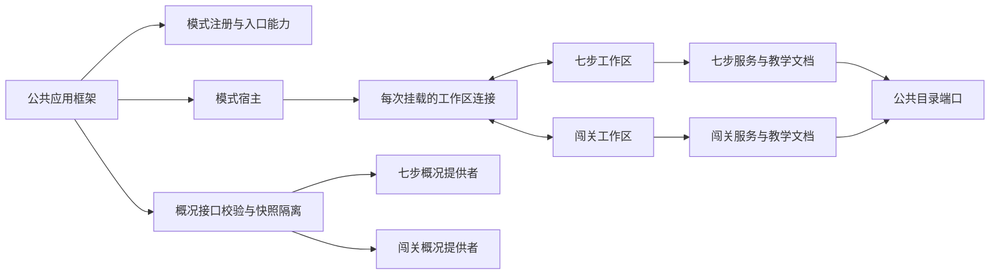

# 框架与双教学模式接口契约

本篇描述当前实际接口，替代早期界面边界方案中尚未落实的接口设想。公共目录、教学文档和删除协调的所有权继续遵循[公共数据独立存储设计](00025_20261024151055_公共目录与教学数据独立存储设计.md)。七步与课文闯关保持各自的内容生成、教学状态、题型、评分和复习规则。

## 1. 接口总览

| 接口 | 方向 | 职责与约束 |
| --- | --- | --- |
| `TeachingModeRegistration` | 模式 → 框架 | 声明身份、支持的工作区入口、确认入口文案、工作区加载及只读概况提供者 |
| `WorkspaceContext` | 框架 → 模式 | 提供工作区范围、导航、教材编辑、家长确认和消息通道；生命周期由宿主管理 |
| `ModeWorkspace` | 模式 → 框架 | 提供就绪、忙碌、专注、完成及启动错误状态，以及离页、返回、退出、刷新和教材阅读动作 |
| `ModeSelectionView` | 框架 → 模式 | 仅提供全局模式与忙碌等只读信息；不提供加载、切换或离页钩子注册命令 |
| `CatalogPort` | 公共服务 → 使用方 | 提供共同身份、教材和选择；公共变更只能经目录命令提交，不修改教学状态 |
| 模式自身服务 | 组合根 → 对应模式 | 持有本模式状态、写入规则和公共来源校验；不互相读取另一模式的教学载荷 |

## 2. 注册声明支持的入口

[contracts.ts](../packages/learning-modes/contracts.ts) 定义四种 `ModeSurface`：`learning`、`authoring`、`report`、`confirm`。每个模式必须声明 `surfaces`，包含学习入口，不允许重复或未知值；声明确认入口时必须提供非空 `confirmationLabel`，未声明确认入口时不能提供该文案。

- 七步声明学习、内容准备、报告与确认；确认入口文案为“口语确认”。
- 闯关声明学习、内容准备和报告，不声明确认入口。
- 框架根据声明展示入口，导航时再次校验；不能把一个模式不支持的确认入口当作报告页打开。
- `openParent` 只接受家长表面，不能用它请求学习入口。全局学习模式与家长正在准备的模式相互独立。
- 能力属于静态注册信息，不由某次概况读取是否成功决定。概况接口不再用 `canConfirm` 承载能力声明。

框架只使用通用入口标识和模式提供的文案，不把“口语确认”当成所有模式共有的教学步骤。

## 3. 工作区连接与失效

[workspace.ts](../src/application/workspace.ts) 提供范围引用：模式 ID、表面、指定课程、可见状态、家长空间状态及激活序号。学习页沿用当前孩子指定的课程；内容准备、报告和确认可以显式指定另一门课程。

[ModeHost.vue](../src/modes/ModeHost.vue) 每次挂载或重试都创建独立连接。旧组件卸载后，其连接不能再执行导航、显示消息、请求确认或注册适配器。隐藏工作区也不能主动导航或弹出家长确认；框架仍可调用其适配器刷新数据。

`connect()` 返回释放函数。旧连接释放时，只能释放自己注册的适配器，不能清除已经替换它的新适配器。模式切换、故障卸载和重试均会释放原连接。

`authorize(label, action)` 在用户取消或确认动作完成后才结束等待。取消不执行动作；即使用户随后确认，工作区模式、表面、指定课程或激活序号已经变化的旧动作也不会执行。调用方不能仅凭该 Promise 结束就认定业务已经提交，提交结果仍由动作自身的持久化反馈决定。

公共框架保存全局模式的完整控制器，公共模式设置显式接收该控制器。提供给模式的 `ModeSelectionView` 只包含只读引用和不可变的模式身份列表，避免教学组件直接切换全局选择或追加框架离页钩子。

全局模式控制器的首次读取失败会释放失败的初始化 Promise。公共设置提供重新读取应用数据的恢复入口，修复后的模式设置和公共目录可以重新加载，无需通过空数据覆盖原文档。

## 4. 模式适配器的方法语义

| 成员 | 成功语义 | 失败语义 |
| --- | --- | --- |
| `ready` / `loadError` | 已完成初始化，或描述尚未就绪时的读取错误 | 宿主提供统一的重新读取入口；不覆盖损坏文档 |
| `busy` | 有保存、生成或其他不可安全离开的工作 | 框架禁用会冲突的操作 |
| `focused` / `completed` | 模式决定是否进入专注练习及本轮是否结束 | 框架只据此呈现退出容器，不解释关卡或七阶段完成 |
| `prepareLeave()` | 未保存编辑与恢复点已提交，媒体已按模式要求停止 | 拒绝 Promise，框架终止导航或模式切换，保留原工作区 |
| `handleBack()` | 返回 `true` 表示已经消费本次返回 | `false` 交还框架；框架不解释内部编辑层级 |
| `exit()` | 已完成模式规定的退出保存并离开练习 | 失败继续保留退出上下文，不将失败写成成功 |
| `refresh()` | 重读本模式数据和公共上下文，更新当前显示 | 读取错误由宿主封闭到该模式，不阻止公共课程、档案和设置导航 |
| `readMaterial()` | 模式按自身规则记录打开原文等教学事实 | 模式负责决定辅助语义，框架负责公共教材显示 |

七步通过服务的刷新端口显式刷新公共范围与自身快照，不再依赖公共目录查询发布状态时顺带刷新七步。闯关保持自身上下文重读。两者提供相同的失败边界，但不统一内部会话模型或评分规则。

`prepareLeave()` 与 `refresh()` 的失败处理必须区分：前者代表可能有尚未提交的内容；后者是读取失败。不能因读取失败封锁公共导航，也不能把保存失败作为普通模式错误吞掉后继续离开。

## 5. 只读概况的输入与返回

`readOverview(learnerId, materials)` 接收框架提供的当前孩子和经过删除封锁投影的教材范围。框架通过 [mode-overview.ts](../src/platform/mode-overview.ts) 给每个提供者独立的材料快照，接收结果后再复制与校验，避免一个提供者修改公共页面或另一个提供者正在读取的对象。

返回 `ModeOverview` 的约束：

- `courses` 只描述当前可学习目录中的课程，状态取固定通用枚举；不在框架中解释七步阶段或闯关关卡。
- `records` 由模式按传入的孩子筛选，记录 ID 在本模式返回值内唯一；课程必须属于公共范围，时间、标题和详情符合契约。
- 归档课程仍可提供历史记录和资源，但不能声明为当前学习课程状态；已封锁或已彻底删除课程不能返回。
- 没有当前孩子时，不返回个人作答或待确认数量。
- `pendingCount` 是非负整数。确认入口能力不依赖这个计数。
- 资源清单的课程、版本、标题和音频资产引用符合接口；模式负责解释其发布与历史版本。

缺少概况提供者返回空概况。提供者读取失败、格式错误、跨课程返回或重复标识时，仅该模式显示错误；公共页面继续接收其他模式的有效结果。框架不修复或写回教学文档。

## 6. 新模式接入与验证

新模式需要注册支持的入口、接入自身服务和删除参与者、实现适配器方法，并在概况提供者中遵守公共范围。仅声明一个工作区组件不代表完成持久化接入。

验证重点是宿主协议行为：旧组件的延迟回调、确认期间范围变化、入口能力与文案、保存失败中止、读取失败继续公共导航、初始化重试、错误概况隔离、跨课程与跨孩子的来源范围。七步的阶段、口语确认和证据规则，以及闯关的路径、补练和跨课调度继续由各自的教学测试验证。

本轮没有修改存储格式，也没有恢复旧数据兼容。测试使用静态第三模式夹具检验接口，不引入动态插件安装机制。

本轮修复和验证见[接口循环审查记录](../issues/00049_20261024162351_双教学模式与框架接口循环审查修复验证.md)。
